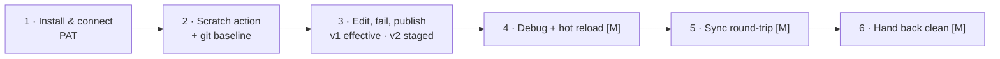

# Capstone Lab — From clean VS Code to a live breakpoint and a sync round-trip (assessed)

**Duration:** 90 min (including grading buffer) · **Passing:** ≥ 80 / 100 points AND
all items marked **[M]** (mandatory) achieved.
**Base document:** [Tutorial: your first DEE debug session](../user-guide/tutorial-first-dee-debug.md)
— the lab follows its arc but is performed **without step-by-step hand-holding** and
extends it with a sync round-trip.
**Reference material allowed:** the entire [user guide](../user-guide/index.md).
Modules may be consulted; the point is doing, not memorizing.

## Scenario

You are joining a customization team. Your lead asks you to prove, on your own
disposable stack, that you can take a DEE action through the full development loop:
connect from a clean VS Code profile, edit and publish safely, debug live with hot
reload, and leave a reviewable git trail — then hand the environment back clean.

## Starting conditions (verified before the clock starts)

- **Clean VS Code state:** extension **not installed**, no `deeDebugger.*` settings,
  no stored secrets (instructor-led: stacks and profiles are reset for you — see the
  [facilitator guide](facilitator-guide.md#3-resetting-for-the-capstone); self-paced:
  uninstall the extension and remove its settings/credentials first).
- Your MES stack **running**, PDB patch **applied** (a plain container restart keeps
  it; if you recreated your stack, re-apply — [why](../user-guide/debugging.md#linux-mes-hosts-the-pdb-prerequisite)).
- A workspace folder containing (or ready to hold) a DEEs folder, under git, clean
  tree.
- Your MES login and Security Portal access for a PAT. The `Training_Scratch` action
  from the modules may still exist; Task 2 creates a separate capstone action.

## Tasks

Work in order. Each task lists the **evidence** the grader checks — capture it as you
go (the artifacts themselves, or a screen capture of the relevant UI state).

### Task 1 — Install and connect (10 min)

Install the VSIX, open your workspace, trust it, discover/connect to your stack, and
authenticate with a **PAT** (not a 1-hour browser-copied access token).

*Evidence:* green **Connected · \<environment\>** row; `MES: …` status bar item;
**Test Connection** success; credential set via *Set Credentials…* → *Set Personal Access Token…*.

### Task 2 — Scratch action and baseline (10 min)

Ensure a scratch action `Capstone_<YourName>` exists (create it in the MES UI: no
group, action code `Input["touched"] = 1;`, test condition `return true;`; the name
must be a C# identifier, so no dots). A new action starts as a draft, so make v1
effective: right-click it in the tree → **Make Version Effective**. Then
establish a git baseline of your DEEs folder via **Sync: Download Changes from MES**
and commit it.

*Evidence:* the action visible at the tree root without a `not effective` badge; a
baseline commit whose tree contains `Capstone_<YourName>.cs`.

### Task 3 — Edit, fail, publish (15 min)

Open the action; inside the **action-code markers** add
`Input["capstone"] = "v1";`. First demonstrate you can read a compile failure:
introduce `var oops = ;`, upload, and show the Problems panel pointing at the line;
then fix and publish cleanly with **Save Action to MES (Compile & Save)**. Finally,
create a staged version: change the value to `"v2"` and use **Save Action to MES as
New Version…** → **Save as new version (keep current version effective)**.

*Evidence:* MES UI shows `"v1"` as the effective code; **Show Version History…**
shows the `"v2"` version present but not effective; Problems panel screenshot from
the failure step.

### Task 4 — Debug with hot reload (25 min) — the core

1. Run **Enable DEE Debug Mode** on the action; verify the DEBUG badge.
2. Attach the debugger: answer **Attach Debugger** in the "Attach the debugger now?"
   prompt (or use the title-bar Attach icon). If the one-time attach notice appears,
   choose **Attach**; install vsdbg if offered.
3. Set a breakpoint on your `Input["capstone"] = …` line.
4. Trigger via **Execute Action…** (read-only, input `{}`) and **hit the
   breakpoint**; inspect `Input` in the Variables pane.
5. Prove the freeze: while paused, show the MES UI unresponsive; then Continue.
6. **Hot-reload proof:** change the string to `"hot-reload"`, save (status bar:
   *DEE: pushed…*), execute again, hit the breakpoint, and show the **new** value in
   Variables — while the MES UI editor still shows the old effective code
   (no Save-to-MES happened).

*Evidence:* breakpoint hit twice; Variables pane showing `"hot-reload"` on the
second hit; MES UI editor simultaneously showing the pre-reload effective code.

### Task 5 — Sync round-trip and capture (15 min)

1. Simulate a colleague: in the **MES UI**, edit a *different* action (add a
   comment) and save.
2. Run **Sync: Compare** — your debugged action and the UI-edited action should both
   classify correctly (explain each classification in one line).
3. Publish your final debugged code with **Save Action to MES (Compile & Save)**. If
   you staged a version in Task 3 and did not reload since, this saves into that draft
   and offers **Make Effective** — decide deliberately and record your choice.
4. **Sync: Download** the colleague's change; **commit** the capture with a
   meaningful message.

*Evidence:* compare summary; final commit whose `git diff` against the baseline
touches only marker-body lines of exactly the two expected files.

### Task 6 — Hand it back clean (5 min)

Run **Disable DEE Debug Mode**; disconnect the debugger; confirm no `DEBUG` and no
`pending upload` badges remain; run **Collect Support Bundle…** and attach the
(self-reviewed) document as your lab report cover.

*Evidence:* tree with no `DEBUG` / `pending upload` badges; the support bundle document (verify
your token value appears nowhere in it).

## Grading rubric

Observable outcomes only — the grader verifies artifacts, not effort. **[M]** items
are mandatory regardless of point total.

| # | Outcome | Points |
|---|---|---|
| 1 | Connected state achieved from clean profile (green row, status bar, Test Connection pass) | 8 |
| 2 | Authentication uses a **PAT** (not a 1-hour access token) | 4 |
| 3 | Scratch action created correctly (ungrouped, valid test condition) and visible at tree root | 4 |
| 4 | Git baseline commit mirrors the MES DEEs | 8 |
| 5 | Compile failure surfaced in Problems on the correct line, then cleared by a clean publish | 8 |
| 6 | Effective code is `"v1"` while a staged `"v2"` version exists non-effective (version semantics understood) | 8 |
| 7 | **[M]** Breakpoint hit with debugger attached; `Input` inspected | 15 |
| 8 | **[M]** Hot-reload proof: second hit shows new value with **no** Save-to-MES; MES UI still shows old effective code | 15 |
| 9 | Paused-host freeze demonstrated and released deliberately | 5 |
| 10 | **[M]** Sync round-trip: compare classifications explained; colleague's change downloaded; capture committed; final diff touches only expected marker bodies | 15 |
| 11 | **[M]** Clean hand-back: debug off, debugger disconnected, no stale badges | 6 |
| 12 | Support bundle produced and verified credential-free | 4 |
| | **Total** | **100** |

**Deductions (applied on top):**

- Edited outside the markers at any point and needed rescue: −5 (−0 if
  self-recovered via the copy-out → Reload → paste-back procedure and documented it).
- Left the host paused > 2 minutes without cause: −3.
- Any credential visible in submitted evidence: automatic fail of item 12 and the
  evidence must be re-captured.

**Grader's fault-injection option (instructor-led):** at any point during Task 4 the
instructor may restart the learner's host container. Recovering unaided — accepting
the re-enable prompt, re-attaching, re-hitting the breakpoint — earns **+5 bonus**
(cap 100); failing to recover within 10 minutes fails item 7/8 as reached.

## Debrief (instructor-led, after grading)

Discuss as a group: which of the five debug-model consequences each learner
personally tripped on; where the marker contract bit; what the team's convention will
be for Compile & Save vs Save-as-New-Version on shared dev instances.
