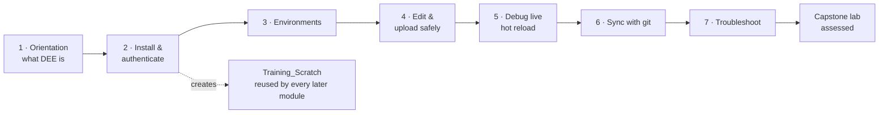

# DEE Debugger for VS Code — Training Course Overview

**Course:** Developing and Debugging DEE Actions with the DEE Debugger for VS Code
**Version:** 1.0 (targets extension 0.2.x; source of truth: the [user guide](../user-guide/index.md))
**Audience format:** self-paced (SCORM/LMS markdown modules) with an optional 1-day instructor-led variant

---

## Course goal

By the end of this course, a learner can take a DEE Action from the MES database into
VS Code and edit it safely under the marker contract. They can debug it live against a
running MES host with hot reload, publish it deliberately (in place or as a new version),
and keep a git-tracked Actions project in sync with the MES. They can also diagnose the
most common failures on their own using the extension's built-in diagnostics.

## Audience and prerequisites

**Audience:** MES customization developers (Critical Manufacturing MES) onboarding to
the DEE Debugger for VS Code extension — including developers migrating from the
"DEE Explorer" Visual Studio add-in and developers new to DEE Actions entirely.

**Assumed knowledge (not taught here):**

- C# fundamentals and comfortable daily use of VS Code.
- Basic MES familiarity: what a customization project is, how to log in to the MES UI,
  and how to reach Administration → DEE Actions.
- Basic Docker literacy: what a container is, `docker ps`, `docker restart`.

**Required environment (per learner):**

- VS Code 1.145+, the extension VSIX, and the Microsoft C# extension.
- A personal, disposable MES development stack (the course assumes the standard
  cmf-cli **docker-in-docker devcontainer** stack started with `cmf dev local stack up`)
  — never a shared or production instance.
- A MES account with DEE Actions permissions and a Personal Access Token.
- A scratch DEE action (`Training_Scratch`) to practice on — created in Module 2.

See the [facilitator guide](facilitator-guide.md) for the full environment prep
checklist, including the one-time Linux host PDB patch (needed on MES 11.x Linux hosts)
that should be applied **before** Module 5.

## Total duration

| Delivery | Duration |
|---|---|
| Self-paced | **≈ 8 hours** (6¼ h modules + 1½ h capstone lab; typically spread over 2–4 days) |
| Instructor-led | **1 day** (8:30–17:30 with the capstone as the afternoon assessment — timing plan in the [facilitator guide](facilitator-guide.md)) |

## Module map

The user-guide pages map to **seven core modules, one elective module, and the capstone
lab**. Deviations from a 1:1 page-to-module mapping, and why:

- **The guide index page is folded into Module 1** together with the DEE Action domain
  model — concepts belong together at the start, and the index alone is not a
  teachable unit.
- **The FAQ page is not its own module.** Its answers are distributed into the modules
  they belong to (per-user debugging → Module 5, versions/collaboration → Modules 4
  and 6) and the remainder into Module 7 — a FAQ is reference material, not a lesson.
- **The tutorial page is the capstone lab**, exactly as the documentation team
  recommended: it is assessed, not taught.
- **Debugging (Module 5) gets double length.** It carries the course's central mental
  model (per-user, in-memory, hot reload, paused-host freeze) plus the Linux PDB
  prerequisite; compressing it is where onboarding fails in practice.

| # | Module | Guide page(s) | Self-paced duration |
|---|---|---|---|
| 1 | [What DEE Actions are and what the extension does](module-01-orientation.md) | [index](../user-guide/index.md) | 30 min |
| 2 | [Install, connect, authenticate](module-02-getting-started.md) | [getting-started](../user-guide/getting-started.md) | 45 min |
| 3 | [Environments and connection topologies](module-03-environments.md) | [environments](../user-guide/environments.md) | 45 min |
| 4 | [Editing and uploading actions safely](module-04-editing-and-uploading.md) | [editing-and-uploading](../user-guide/editing-and-uploading.md) | 60 min |
| 5 | [Debugging DEE actions live](module-05-debugging.md) | [debugging](../user-guide/debugging.md) | 90 min |
| 6 | [Syncing with the git-tracked Actions project](module-06-sync.md) | [sync](../user-guide/sync.md) | 60 min |
| 7 | [Troubleshooting and self-support](module-07-troubleshooting.md) | [troubleshooting](../user-guide/troubleshooting.md), [faq](../user-guide/faq.md) | 45 min |
| 8 *(elective)* | [Debugging custom business DLLs (Attach to MES Host)](module-08-business-attach.md) | [dee-vs-business-debugging](../user-guide/dee-vs-business-debugging.md) | 60 min |
| — | [Capstone lab (assessed)](capstone-lab.md) | [tutorial](../user-guide/tutorial-first-dee-debug.md) | 90 min |

### The learning journey

## Learning objectives per module

Objectives are measurable (Bloom verbs); each module's knowledge check and exercise
test them directly.

**Module 1 — Orientation.** The learner can:
- **Define** a DEE Action, an Action Group, and the effective version, and **explain**
  why DEE code lives in the MES database rather than in a customization DLL.
- **Identify** the four places the extension surfaces in VS Code (DEE Explorer,
  Command Palette commands, status bar item, output channel).
- **State** the production-safety rule (debug/upload are dev-and-test-only) and
  **justify** it with the two underlying reasons.

**Module 2 — Install, connect, authenticate.** The learner can:
- **Install** the VSIX and its C# extension dependency and **verify** activation.
- **Execute** environment discovery and **connect** to a local stack.
- **Differentiate** Personal Access Tokens from browser-copied access tokens
  (lifetime, sourcing procedure) and **select** the appropriate one.
- **Predict** the consequence of the 1-hour access-token expiry on a Security Portal
  stack.

**Module 3 — Environments.** The learner can:
- **Classify** any given MES setup into the correct connection type using the decision
  tree (local docker, docker-in-docker, remote docker, WSL, kubectl/oc, process,
  custom engine).
- **Configure** a docker-in-docker environment manually, including finding the
  devcontainer's name and IP.
- **Explain** why devcontainer names/IPs are volatile and **apply** the
  `devcontainer.json` name-pinning mitigation.
- **Describe** the per-environment credential model and the access-token-over-PAT
  precedence rule.

**Module 4 — Editing and uploading.** The learner can:
- **State** the marker contract and **predict** what happens to edits placed outside
  the markers.
- **Apply** `UseReference(...)` to reference an additional assembly.
- **Distinguish** the three save operations (local save, Compile & Save, Save as New
  Version) by their effect on the MES and on other users.
- **Resolve** a compile error from the Problems panel and **handle** a concurrency
  conflict without losing either side's work.
- **Use** Execute Action (read-only) to test an action without side effects.

**Module 5 — Debugging.** The learner can:
- **Explain** the debug-mode mental model: per-user, in-memory, hot-reload-on-save,
  database untouched, paused host freezes the MES.
- **Perform** the full debug loop: enable debug mode, attach (including first-time
  vsdbg install), set a breakpoint, trigger as the correct user, iterate via hot
  reload, and clean up.
- **Diagnose** the four standard causes of a breakpoint that never hits.
- **Recognize** the Linux PDB compile error and **apply** (or verify) the
  in-product host patch (**Patch Host for DEE Debugging**), including when it must be
  re-applied and why MES 12 hosts do not need it.
- **Predict** the effect of a host restart on debug registrations and **recover**.

**Module 6 — Sync.** The learner can:
- **Execute** the three sync commands (Compare, Download, Upload) against a DEEs
  folder.
- **Interpret** compare results (in sync / differ / local-only / MES-only) and the
  wrapper-normalized diff.
- **Explain** the safety behaviors: dirty-editor skip, batch-continues-on-failure,
  and refusal to overwrite an action changed on the MES after the upload's own
  comparison.
- **Apply** the baseline → develop → capture → apply-elsewhere git workflow.
- **State** what sync does *not* transfer (group membership, order, enabled/effective
  flags).

**Module 7 — Troubleshooting.** The learner can:
- **Apply** the two-step triage (output channel, then Test Connection) to split any
  failure into connectivity vs authentication.
- **Diagnose and fix** the expired-token failure, permanently (switch to a PAT).
- **Match** the top symptoms to their causes: unreachable host, unparseable JSON,
  missing tree actions, frozen MES during debug, "file changed by itself".
- **Produce** a support bundle and **compose** a complete support ticket.

## Completion criteria

A learner completes the course when **all** of the following hold:

1. **Knowledge checks:** ≥ 80% on each module's knowledge check (retakes allowed;
   questions in each module and consolidated in the [quiz bank](quiz-bank.md)).
2. **Module exercises:** all hands-on exercises' success criteria met (self-attested
   in self-paced delivery; spot-checked by the instructor in instructor-led delivery).
3. **Capstone lab:** ≥ 80 / 100 points on the [capstone lab rubric](capstone-lab.md),
   including every item marked **mandatory** (breakpoint hit, hot-reload proof, sync
   round-trip, clean-up).
4. **Final assessment** (optional per organization): ≥ 80% on the scenario section of
   the [quiz bank](quiz-bank.md).

## Delivery notes

### Self-paced

- Modules are sequential; each assumes the prior modules' exercises were completed
  (Module 2 creates the connection and scratch action every later module uses).
- Each module lists its guide page as **required reading** — the module teaches the
  concepts and the *why*; the guide page remains the operational reference. Learners
  should keep the guide open in a browser tab throughout.
- Budget realistic time for Module 5: the first vsdbg install and (if not pre-applied)
  the PDB patch can add 10–15 minutes.
- The "demo script" section in each module is for the instructor variant; self-paced
  learners may skip it or use it as an optional extended walkthrough.

### Instructor-led (1 day)

- Follow the [facilitator guide](facilitator-guide.md) timing plan. Environment prep
  (stacks up, PATs issued, PDB patch applied, scratch actions seeded) must be
  **finished the day before** — it is the single biggest schedule risk.
- Each module = short concept briefing + live demo (scripted in the module file) +
  learners run the exercise on their own stack. Knowledge checks run as live polls or
  are deferred to the LMS.
- Modules 3 and 7 are compressible for time (see the timing plan); Modules 4 and 5
  are not.
- The capstone runs in the afternoon on **reset stacks** (facilitator guide explains
  the reset), and the instructor grades against the rubric during the lab.
- Class size: ≤ 10 learners per instructor — debugging exercises generate individual
  environment issues that need one-on-one attention.

## Course materials

| File | Purpose |
|---|---|
| [module-01-orientation.md](module-01-orientation.md) … [module-07-troubleshooting.md](module-07-troubleshooting.md) | The seven core teaching modules |
| [module-08-business-attach.md](module-08-business-attach.md) | Elective module: debugging custom business DLLs |
| [capstone-lab.md](capstone-lab.md) | Assessed final lab + grading rubric |
| [facilitator-guide.md](facilitator-guide.md) | Environment prep, 1-day timing plan, in-class failure recovery |
| [quiz-bank.md](quiz-bank.md) | All knowledge-check questions + final-assessment scenarios, answers keyed |
