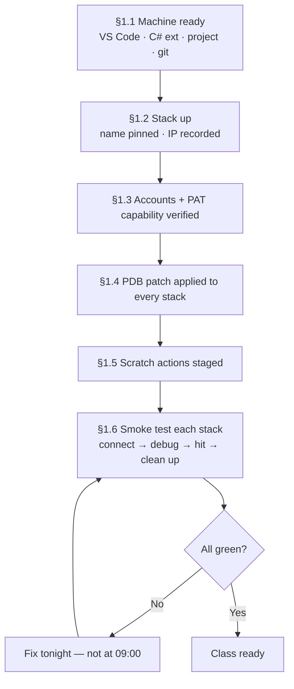

# Facilitator Guide — DEE Debugger for VS Code (1-day instructor-led delivery)

For the instructor/facilitator running the course defined in the
[course overview](course-overview.md). Sources of truth:
[user guide](../user-guide/index.md) and [troubleshooting](../user-guide/troubleshooting.md).
Class size: **≤ 10 learners** per instructor.

---

## 1. Environment prep checklist (finish the day BEFORE)

Environment prep is the single biggest schedule risk. Every item below is
**per learner** unless marked shared. Verify with the smoke test in §1.6.

### 1.1 Per-learner machine

- [ ] VS Code ≥ 1.145 installed; learner can open a terminal and run `docker ps`.
- [ ] The extension VSIX (`dee-debugger-<version>.vsix`) copied locally — do **not**
      rely on classroom internet at 9:00. Do **not** pre-install it: Module 2
      installs it live.
- [ ] Microsoft C# extension: either Marketplace access verified (it auto-installs
      as a dependency) or the C# extension VSIX staged for offline install.
- [ ] The learner's customization project cloned locally (with
      `Cmf.Custom.Data/DEEs` and `DeeDevBase.cs`) — this is the workspace folder and
      gives IntelliSense for free.
- [ ] Git configured (name/email) — Module 6 and the capstone commit.

### 1.2 Per-learner MES stack (docker-in-docker devcontainer)

- [ ] A **disposable** stack per learner, started with `cmf dev local stack up`
      inside the project devcontainer. Never a shared instance: breakpoint pauses
      freeze the whole host, and the course restarts containers on purpose.
- [ ] **Pin the devcontainer name** in the project's `devcontainer.json`:
      `"runArgs": ["--name", "training-<nn>"]`. This removes the
      random-name-after-rebuild failure class from the classroom
      ([why](../user-guide/environments.md#which-connection-type-am-i-decision-tree)).
- [ ] Record each stack's devcontainer name and IP on the class crib sheet
      (`docker inspect <name> --format '{{range .NetworkSettings.Networks}}{{.IPAddress}}{{end}}'`).
- [ ] Host container is `custom_host` (cmf-cli default). If any stack names
      it `host`, note it on the crib sheet — it's a one-field
      environment change.
- [ ] Confirm the API answers:
      `curl -s -o /dev/null -w '%{http_code}' http://<ip>/api/ping` → `200` or `401`.

### 1.3 Accounts and tokens (PATs)

- [ ] One MES user **per learner** (not a shared account — debug mode is per-user;
      shared accounts make Module 5's per-user demonstrations meaningless and let
      learners hit each other's breakpoints).
- [ ] Each user can open **Administration → DEE Actions** in the MES UI.
- [ ] Each user can reach the **Security Portal** PAT page (user security page →
      Personal Access Tokens) and has verified they can **generate a PAT** — learners
      generate their own during Module 2; you verify the capability, not the token.
- [ ] Instructor extras: one PAT for yourself **plus one browser-copied access token
      captured early in the day** — by the afternoon it is expired and becomes the
      live 401 demo for Module 7 (the QA plan uses the same trick).

### 1.4 The one-time Linux PDB patch

Containerized (Linux) MES hosts **up to 11.x** fail DEE debug-mode execution with
`Unexpected error writing debug information -- 'Value cannot be null. (Parameter 'type')'`
until patched — a product bug the extension fixes in place with **Patch Host for DEE
Debugging** ([background](../user-guide/debugging.md#linux-mes-hosts-the-pdb-prerequisite)).
MES 12 stacks already contain the fix; skip this section for them.

- [ ] Patch **every learner stack** the day before: connect the extension to each stack
      and run **DEE Debugger: Patch Host for DEE Debugging (dev/test)…**. It restarts the
      host itself after patching, and it is idempotent: on a patched host it reports
      that the host "is already patched for DEE debugging — no change needed". For scripted prep,
      `tools/host-pdb-patcher/README.md` has the command sequence (needs the .NET SDK on
      the prep machine).
- [ ] **Verify**, don't assume: on at least two stacks, enable debug mode on a scratch
      action — no patch prompt must appear — and Execute it; it must run without the
      "writing debug information" error.
- [ ] Remember the lifecycle: a **restart** keeps the patch (but clears debug
      registrations); a **stack recreate** (`down`/`up`) reverts it — if any stack is
      recreated during the day, **re-apply before Module 5 or the capstone** (learners
      who forget are prompted by the extension, which costs class time).

### 1.5 Scratch actions

- [ ] Learners create their own `Training_Scratch` in Module 2 (that's part of the
      exercise) — but stage the **recipe** on the crib sheet: no group, action code
      `Input["touched"] = 1;`, test condition `return true;`, then make v1 effective.
      Action names must be C# identifiers (letters, digits, underscores — **no dots**);
      the MES rejects anything else.
- [ ] Instructor stack: pre-create `Demo_Scratch` (same recipe) plus one grouped
      action for the tree demo, and — for the Module 1 teaser — have `Demo_Scratch`
      already in debug mode with a breakpoint ready before class.
- [ ] For Module 6/capstone "colleague edits": no second account needed — the MES
      **UI** editor on the learner's own account plays the colleague.
- [ ] Do NOT pre-create the learners' capstone actions (`Capstone_<name>`) —
      creating it is graded (rubric item 3).

### 1.6 Smoke test (per stack, the evening before — 10 min each)

Run the tutorial's spine on each stack, or at minimum on a random sample plus every
stack that was rebuilt: connect → open scratch action → Compile & Save → **Enable DEE
Debug Mode** → answer **Attach Debugger** in the "Attach the debugger now?" prompt
(accept the vsdbg install — doing this now **pre-installs vsdbg in that host
container**, removing 10 learner-minutes and the classroom-bandwidth spike from
Module 5) → breakpoint → Execute → hit → **Disable DEE Debug Mode** → disconnect. Any failure:
diagnose with [troubleshooting](../user-guide/troubleshooting.md) tonight, not at
9:00.

### 1.7 Classroom logistics

- [ ] Crib sheet per learner: stack devcontainer name + IP, MES URL, their username,
      Security Portal URL, scratch-action recipe.
- [ ] Projector-visible font sizes in VS Code AND the browser (MES UI + DevTools —
      the token demo shows tiny header text).
- [ ] LMS quizzes loaded from the [quiz bank](quiz-bank.md), or printed knowledge
      checks.
- [ ] Whiteboard for the Module 5 mental-model drawing.

---

## 2. Timing plan — 1-day instructor-led

Format per module: concept briefing → scripted live demo (in each module file) →
learners run the exercise on their own stack → knowledge check (live poll or
deferred to LMS). Buffers are real: individual environment issues WILL consume them.

| Time | Block | Notes |
|---|---|---|
| 08:30–08:45 | Welcome, crib sheets, stacks-up check | Every learner runs `docker ps` + opens their MES UI before anything else |
| 08:45–09:10 | **Module 1** — Orientation (25) | Includes the 30-second breakpoint teaser — have it pre-staged |
| 09:10–09:50 | **Module 2** — Install, connect, authenticate (40) | The PAT detour is the heart; every learner leaves connected with a PAT and `Training_Scratch` created |
| 09:50–10:00 | Buffer / stragglers | Anyone not connected gets one-on-one help NOW — everything downstream depends on it |
| 10:00–10:15 | Break | |
| 10:15–10:50 | **Module 3** — Environments (35) | Compressible to 25 if late: cut the manual-environment exercise to steps 1–4, skip the rename drill |
| 10:50–11:50 | **Module 4** — Editing & uploading (60) | **Do not compress.** The conflict staging (demo step 5) is the piece people remember |
| 11:50–12:00 | Morning knowledge checks (Modules 1–4) | LMS or paper |
| 12:00–13:00 | Lunch | Instructor: capture the access token that will expire by ~15:00 (Module 7 demo); re-verify any stack that misbehaved |
| 13:00–14:30 | **Module 5** — Debugging (90) | **Do not compress.** vsdbg pre-warmed in prep; the restart drill (exercise step 8) is mandatory — it rehearses the capstone fault injection |
| 14:30–14:40 | Break | |
| 14:40–15:30 | **Module 6** — Sync (50) | Learners must reach the baseline commit before the break at the latest |
| 15:30–16:00 | **Module 7** — Troubleshooting (30, compressed) | Use the now-expired morning token live; compress by demoing drills 2–3 instead of learners running them |
| 16:00–16:10 | Reset for capstone | See §3 — learners reset their own VS Code state while you verify stacks |
| 16:10–17:20 | **Capstone lab** (70 of its 90 — modules already banked the vsdbg install and PDB patch) | Instructor circulates and grades against the [rubric](capstone-lab.md); optionally inject the host-restart fault for +5 |
| 17:20–17:30 | Debrief + completion criteria recap | Per the capstone's debrief section |

**If running behind:** protect Modules 4, 5, and the capstone. Sacrifice, in order:
Module 7 learner drills (demo only), Module 3 exercise steps 5–7, Module 6 exercise
steps 5–6 (demo them instead). Never sacrifice the Module 5 exercise.

---

## 3. Resetting for the capstone

The capstone starts from "clean VS Code", not a clean MES:

Per learner (self-service, ~5 min, put it on screen):

1. Run **Disable DEE Debug Mode** on anything still badged `DEBUG`; disconnect any
   debugger.
2. Stored credentials (do this **before** uninstalling — stored tokens survive an
   uninstall): switch to each environment in turn and run **DEE Debugger: Clear
   Credentials** (it clears only the active environment). Removing an environment in
   **Manage Environments…** also wipes its secrets.
3. Uninstall the extension from the Extensions view.
4. Remove `deeDebugger.*` entries from **both** user and workspace `settings.json`.
5. Keep: the stack (running, patched), the git repo with its module-time history
   (the capstone makes its own baseline commit), the MES user + Security Portal
   access.

Instructor: spot-check two machines for leftover `deeDebugger.environments` keys, and
confirm every stack still answers `/api/ping` and still has the PDB patch (only
stacks that were *recreated* lost it).

---

## 4. Known failure modes during training and recovery steps

Ordered by likelihood in a classroom. Source:
[troubleshooting guide](../user-guide/troubleshooting.md). First move is always the
same and worth repeating to the room: **output channel, then Test Connection**.

| # | Failure (when it typically strikes) | Cause | Recovery |
|---|---|---|---|
| 1 | Everything 401s an hour after a learner "shortcut" (afternoon, mid-Module 5/6) | Learner used a browser access token instead of a PAT in Module 2; it [expired](../user-guide/troubleshooting.md#expired-tokens-the-1-hour-problem) | **Set Personal Access Token…** → Refresh. Setting a PAT automatically clears the stored access token, so no Clear Credentials step is needed. Turn it into a teaching moment — it's Module 7's opening. |
| 2 | Fresh token rejected immediately (Module 2) | Truncated copy — tokens are 1–2 KB | Re-copy with right-click → **Copy value** on the Authorization header; paste without `Bearer `. |
| 3 | "Could not reach the MES host" (any time) | Stack down, or wrong address after someone touched the environment | `docker ps` inside the devcontainer; `cmf dev local stack up` if down; `curl …/api/ping` (200/**401** both prove routing); check the environment's host address against the crib sheet. |
| 4 | "Could not reach…" **while a debug session is active** (Module 5, capstone) | Usually the learner's **own breakpoint**: a paused host answers nothing | Continue (F5), retry. Remind the room this also explains "the MES UI froze". |
| 5 | Patch prompt when enabling debug mode or attaching, or debug execute fails: "Unexpected error writing debug information — 'Value cannot be null. (Parameter 'type')'" (Module 5) | PDB patch missing (MES 11.x Linux host) — stack was **recreated** after prep, reverting the patch | Accept the patch prompt, or run **Patch Host for DEE Debugging (dev/test)…** (the error notification also offers it). It is idempotent and restarts the host itself — no manual `docker restart`. Then the learner re-enables debug mode and re-attaches. |
| 6 | Breakpoint never hits though the action runs (Module 5) | In classroom order: triggered as a different user (learner logged into MES UI with the wrong/shared account); action not executed since enabling (hollow = not yet bound); host restarted and dropped the registration | Trigger via **Execute Action…** (always the token's user) to isolate; if the extension offers **re-enable**, accept; check MES-UI login matches the crib-sheet user. |
| 7 | vsdbg install fails on attach (Module 5) | No internet from the container (fallback: local download + stream — needs WSL on plain Windows), or wrong container/engine config | Check the output channel for which it is; for config, compare against the crib sheet; if bandwidth is the issue, the §1.6 pre-install should have prevented it — run **Install vsdbg in Host Container** against that stack from the instructor machine. |
| 8 | Attach error `0x80131c08` / picker confusion (Module 5) | Wrong process picked — the first entry is a wrapper | Re-attach; pick the `dotnet` process running `Cmf.Foundation.Services.HostService.dll`. |
| 9 | "My file changed on disk by itself" (Modules 4–5) | Host rewrote the wrapper because the learner edited outside the markers (classically a hand-added `using`) | Not a bug. Re-apply the edit **inside** the markers; `UseReference(...)` for assemblies. If markers got damaged: copy bodies out → **Reload Action from MES** → paste back. |
| 10 | Everything broke after a devcontainer rebuild (any time) | Devcontainer name/IP changed — *should* be prevented by the §1.2 name pinning | Re-run the `docker ps`/`docker inspect` pair, update via **Manage Environments…**; verify the pin is actually in `devcontainer.json`. |
| 11 | Learner's tree missing their action (Modules 2, 6) | Action disabled, or a leftover text filter (drafts are shown, with a `not effective` badge) | Filled filter icon → clear; else click the tree's *"N disabled actions hidden"* row. If the action is listed with `not effective`, right-click → **Make Version Effective**. |
| 12 | Two learners "debugging each other" — breakpoints hit from someone else's trigger (Module 5) | Shared MES account (violates §1.3), so per-user registrations collide | Move each learner to their own account and PAT. Only one debugger can attach to a host at a time — separate accounts on **separate stacks** is the design. |
| 13 | Host restarted mid-exercise (someone's `docker restart`, a crash) | In-memory registrations lost; DEBUG badge briefly lies until reconcile | Refresh → accept the *"Debug mode for '…' was lost (the MES host restarted). Re-enable?"* prompt (**Re-enable Debug Mode**) → re-attach. This is deliberately the capstone's fault injection — treat live occurrences as free rehearsal. |
| 14 | Sync download "fails" for some files (Module 6) | Dirty-editor protection: those files are open with unsaved changes | Working as intended — save or revert the editors, re-run for the named entries. |
| 15 | Learner stuck > 10 min, cause unclear | — | **DEE Debugger: Collect Support Bundle…**, read it with them (versions, environment, probes, redacted log) — modeling exactly the escalation behavior Module 7 teaches. |

**Instructor prime directive:** never "fix" a learner's machine silently. Narrate the
triage (output channel → Test Connection → symptom table) every single time — the
recovery *is* the curriculum.
