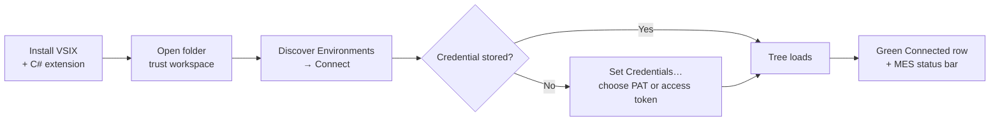
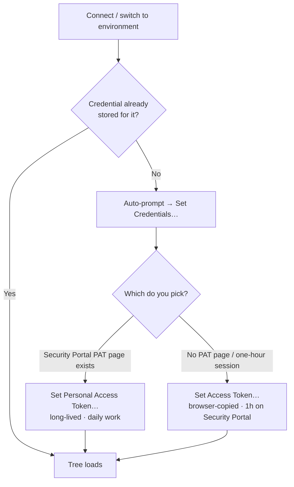

# Module 2 — Install, connect, authenticate

**Duration:** 45 min (self-paced) · 40 min (instructor-led)
**Required reading:** [User guide — Getting started](../user-guide/getting-started.md)
**Prerequisites:** Module 1; your MES stack running; VSIX file available; a MES login
that can open Administration → DEE Actions.

## Learning objectives

After this module you can:

1. **Install** the VSIX and **verify** activation (Activity Bar icon, trusted
   workspace, C# extension present).
2. **Execute** *Discover Environments* and **connect** to your local stack.
3. **Differentiate** a Personal Access Token from a browser-copied access token —
   lifetime, where each comes from, and how to store each — and **select** the right
   one for daily work.
4. **Predict** what happens 1 hour after connecting with a browser-copied access
   token on a Security Portal stack.

## Key concepts

### The path from nothing to a loaded tree



### 1. Installation and activation requirements

Three things must be true before the extension works
([details](../user-guide/getting-started.md#what-you-need)):

- **VS Code ≥ 1.145** with the VSIX installed (`code --install-extension
  dee-debugger-<version>.vsix` or drag onto the Extensions view).
- **The Microsoft C# extension** (`ms-dotnettools.csharp`) — it provides the .NET
  debugger. It's a declared dependency, so it installs automatically when VS Code has
  Marketplace access; on offline machines install it first. C# Dev Kit also works.
- **A trusted workspace with a folder open.** The extension refuses untrusted
  workspaces (it can execute configured container commands — a deliberate safety
  gate, see Module 3) and needs a folder to store downloaded `.cs` files.

**Which folder?** Best: your customization project (the one containing
`Cmf.Custom.Data/DEEs`) — the DEEs folder is auto-detected and the Actions project
gives full IntelliSense. Any folder works; downloads then land in `.dees/`.

If the MES host runs in a container (it almost always does), the `docker` CLI must
work **in the same environment VS Code runs in** — check with `docker ps` in VS Code's
integrated terminal, not an external one.

### 2. Discovery-first connection

*DEE Debugger: Discover Environments…* probes for reachable MES stacks (local Docker,
docker-in-docker devcontainers, local host processes) and **verifies each candidate
with an API ping** — reachable ones are pre-checked. Confirm your selection to add it,
then click **Connect** in the confirmation that follows. If
nothing is found, your topology needs a manual environment (Module 3); discovery
failing is *normal* for remote/cluster setups, not an error.

### 3. The two credential methods — the most important table in this module

The extension authenticates with a credential stored **per environment** in your OS
keychain (VS Code SecretStorage) — never in settings files. When you switch or connect
to an environment that has none, it prompts you; you can also run **DEE Debugger: Set
Credentials…** any time. The method is **your choice**. **Set Credentials…** opens a
quick-pick with exactly these two entries:

```text
┌─ Authenticate to 'local-stack' ────────────────────────────────┐
│ Choose how to provide credentials                              │
├────────────────────────────────────────────────────────────────┤
│ 🔑 Set Personal Access Token…                                  │
│    Long-lived token from the Security Portal user page —       │
│    best for daily work.                                        │
│ 📋 Set Access Token…                                           │
│    Bearer token copied from the browser DevTools —             │
│    expires after ~1 hour.                                      │
└────────────────────────────────────────────────────────────────┘
```



| | Personal Access Token (PAT) | Browser-copied access token |
|---|---|---|
| Source | Security Portal → your user security page → **Personal Access Tokens** | Browser DevTools → Network → any `/api/` POST → `Authorization: Bearer …` header, copied **without** the `Bearer ` prefix |
| Lifetime | Long-lived | **Expires after 1 hour** on Security Portal stacks (which includes the standard local dev stack); only non-Security-Portal stacks issue ~14-day tokens |
| Store with | **DEE Debugger: Set Personal Access Token…** | **DEE Debugger: Set Access Token…** |
| Use for | **Daily work — always prefer this** | Fallback when no PAT page exists; fine for a one-hour session |

The 1-hour expiry is **the single most common problem users hit**: an hour into a
session, every server operation starts failing with authentication errors. Module 7
covers the recovery; this module's job is to make you use a PAT from day one.

Three built-in mercies worth knowing:

- Paste a PAT into the *Set Access Token…* prompt by mistake? The extension
  recognizes it and stores it as a PAT (you'll see a message).
- Setting a PAT automatically clears any access token stored for that environment, so
  switching from a browser token to a PAT takes effect right away.
- Copying browser tokens by hand truncates them easily (they're 1–2 KB) — use
  right-click → **Copy value** on the header.

### 4. What "connected" looks like

After the token is stored: a green **Connected · \<environment\>** row tops the tree,
Action Groups appear as nested folders (each dot in a group name starts a new level),
**actions are the leaves**, ungrouped actions sit at the root, and the status bar shows
**MES: \<environment\>**.

```text
DEE EXPLORER
● Connected · local-stack                  ← green row, confirms where you point
▾ MaterialManagement                    2  ← group rows show their action count
  ▾ MaterialManagementOrchestration     2
    ▾ CreateMaterial                    2
      ▾ Pre                             2
          SetDefaultWarehouse      v3      ← actions are the leaves
          ValidateLotSize          v1
  Training_Scratch   not effective (Active) · v1  ← ungrouped action at the root
──────────────────────────────────────────
 MES: local-stack                          ← status bar item
```

A `not effective (Active)` badge marks a **draft**: a version that isn't effective.
Every action created in the MES UI starts as such a draft (v1). It runs anyway — the MES
runs the effective version or, when none is, the highest — but a version staged later
would take over until one is made effective.

If the tree stays empty or errors: **DEE Debugger: Test
Connection** first, then [Troubleshooting](../user-guide/troubleshooting.md).

## Demo script (instructor variant)

*Setup: instructor machine with the extension NOT yet installed; stack running; MES UI
logged in, in a browser.*

1. **Install live** (5 min). `code --install-extension dee-debugger-<version>.vsix` in a
   terminal. Open the customization project folder, accept Workspace Trust — *pause
   here:* "If you click Don't Trust, the extension refuses to run. That's not a bug —
   Module 3 shows what an environment profile can execute, and you'll agree with the
   gate." Show the new Activity Bar icon and the C# extension in the Extensions view.
2. **Discover and connect** (5 min). Click the icon → welcome view → **Discover
   Environments**. Narrate the probe ("it's pinging each candidate's API — pre-checked
   means verified reachable"). Connect.
3. **Token detour — do this slowly** (8 min). When the token prompt appears, *stop*.
   Switch to the browser: Security Portal → user security page → Personal Access
   Tokens → generate → copy. Back in VS Code: **Set Personal Access Token…** → paste.
   *Then* show the alternative: browser DevTools → Network → click a `/api/` POST →
   Authorization header → right-click → Copy value. *Say:* "This second token dies in
   one hour on this stack. When someone's afternoon 'suddenly breaks' with 401s,
   this token is why. Use the PAT. Always the PAT."
4. **Read the connected state** (3 min). Point out: green Connected row, groups
   nesting by dots, leaves are actions, ungrouped at root, `MES:` in the status bar.
   Open an action briefly — "notice it's a real file; do NOT edit anything yet, the
   editing rules come in Module 4."
5. **Break it on purpose** (3 min). Run **DEE Debugger: Test Connection** (success),
   then `docker stop` the traefik container (or ask learners to imagine the stack
   down), run Test Connection again, show the "Could not reach…" error and the output
   channel line. Restart the container. *Say:* "Test Connection splits every failure
   into 'can't reach' vs 'can't authenticate'. Remember that split — it's the first
   move in Module 7."

## Hands-on exercise

On your own machine and stack:

1. Install the VSIX; confirm the C# extension is installed; open your customization
   project folder; trust the workspace.
2. In VS Code's **integrated** terminal, run `docker ps` — confirm you can see
   containers (on the standard docker-in-docker setup from *outside* the
   devcontainer you may see only one container, whose image is named `vsc-…`; that is
   fine and becomes relevant in Module 3).
3. Run **Discover Environments**, connect to your stack.
4. Generate a **PAT** in the Security Portal and store it via **Set Personal Access
   Token…**.
5. Confirm the connected state (checklist below), then run **DEE Debugger: Test
   Connection**.
6. **Create your scratch action** (used by every later module). In the MES UI:
   Administration → DEE Actions → new action `Training_Scratch` (action names must be
   C# identifiers — letters, digits, underscores, no dots), any classification,
   **no action group**, action code `Input["touched"] = 1;`, test condition
   `return true;`. Save. Refresh the DEE Explorer and find it **at the root of the
   tree** (ungrouped actions sit at the root) with a `not effective (Active)` badge.
   Right-click it → **Make Version Effective** so later modules work with an
   effective action.
7. Open View → Output → **DEE Debugger** and skim what your session logged.

**Success criteria:**

- [ ] DEE Debugger icon on the Activity Bar; workspace trusted.
- [ ] Green **Connected · \<environment\>** row; status bar shows `MES: …`.
- [ ] Token stored is a **PAT** (you used *Set Personal Access Token…*).
- [ ] **Test Connection** reports success.
- [ ] `Training_Scratch` is visible at the root of the DEE Explorer tree, with no
      `not effective` badge.
- [ ] You can name the output-channel dropdown entry without looking.

## Common mistakes to preempt

- **Using a browser access token for the whole course.** It expires mid-Module 4 or 5
  and derails the session with 401s. Insist on the PAT now
  ([the 1-hour problem](../user-guide/troubleshooting.md#expired-tokens-the-1-hour-problem)).
- **Truncated token paste.** Hand-selecting the Authorization header value clips it;
  a "freshly copied token rejected immediately" is almost always truncation. Use
  right-click → Copy value, and paste without `Bearer `.
- **`docker ps` works in an external terminal but not for the extension.** The CLI
  must work in the environment VS Code runs in — WSL vs Windows windows have
  different networks and PATHs. Always verify in the *integrated* terminal.
- **Untrusted workspace / no folder open.** In an untrusted (Restricted Mode)
  workspace VS Code disables the extension, so it looks like "the extension doesn't
  work". With no folder open, opening an action fails because there is nowhere to put
  the `.cs` file. Icon missing → check trust, folder, and the C# extension
  ([troubleshooting row](../user-guide/troubleshooting.md#extension-or-tree-problems)).
- **Expecting discovery to find a remote/cluster stack.** Discovery probes local
  topologies only; anything else is a manual environment — that's Module 3, not a
  failure.

## Knowledge check

**Q1.** Why does the extension require the Microsoft C# extension?
- A. It renders the DEE Explorer tree
- B. It provides the .NET debugger the extension uses ✔
- C. It stores the tokens
- D. It compiles actions before upload

*Rationale: `ms-dotnettools.csharp` supplies the coreclr debugger; it is a declared dependency installed with the VSIX.*

**Q2.** On a standard local development stack (with Security Portal), how long does a browser-copied access token last?
- A. Until VS Code restarts
- B. About 14 days
- C. 1 hour ✔
- D. It never expires

*Rationale: Security Portal stacks expire access tokens after 1 hour — the most common failure users hit; only stacks without the Security Portal issue ~14-day tokens.*

**Q3.** Where does the extension store your tokens?
- A. In `settings.json`, base64-encoded
- B. In the workspace's `.vscode` folder
- C. In the OS keychain via VS Code SecretStorage, per environment ✔
- D. In the MES database

*Rationale: tokens are per-environment secrets in secure storage — never in settings files or the repo.*

**Q4.** You paste a PAT into the *Set Access Token…* prompt by mistake. What happens?
- A. Authentication fails until you clear credentials
- B. The extension recognizes it and stores it as a PAT, telling you so ✔
- C. The token is rejected as malformed
- D. It is stored as an access token and expires in 1 hour

*Rationale: pasted tokens are auto-classified; a PAT is rerouted to PAT storage with a message.*

**Q5.** *Discover Environments* finds nothing, but your MES runs in a Kubernetes cluster. What is the correct conclusion?
- A. The stack is down
- B. Your token is wrong
- C. Discovery only probes local topologies — create a manual environment for the cluster ✔
- D. Reinstall the extension

*Rationale: discovery covers local Docker, docker-in-docker devcontainers, and local processes; remote/cluster setups need Add Environment… (Module 3).*

**Q6.** After connecting, where do ungrouped actions (no action group) appear in the tree?
- A. They are hidden until you enable a setting
- B. Under a special "Ungrouped" folder
- C. At the root of the tree ✔
- D. They cannot exist — every action needs a group

*Rationale: dot-delimited group names nest as folders; actions that belong to no group sit at the root — which is exactly where `Training_Scratch` shows up.*

---

Next: [Module 3 — Environments and connection topologies](module-03-environments.md)
