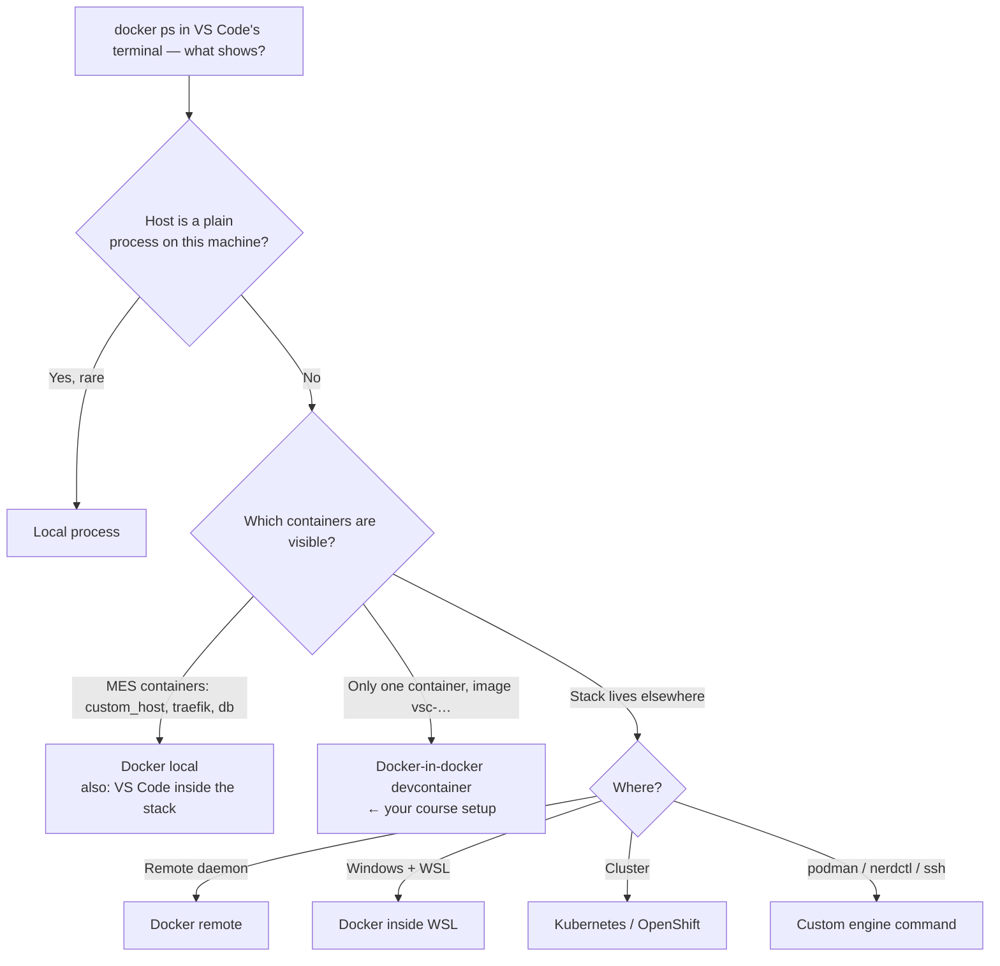

# Module 3 — Environments and connection topologies

**Duration:** 45 min (self-paced) · 35 min (instructor-led, compressible to 25)
**Required reading:** [User guide — Environments](../user-guide/environments.md)
**Prerequisites:** Modules 1–2 (a working discovered connection and a stored PAT).

## Learning objectives

After this module you can:

1. **Classify** any given MES setup into the correct connection type using the
   [decision tree](../user-guide/environments.md#which-connection-type-am-i-decision-tree).
2. **Configure** a docker-in-docker environment manually, **finding** the
   devcontainer's name and IP with `docker ps` / `docker inspect`.
3. **Explain** why devcontainer names and IPs are volatile and **apply** the
   `devcontainer.json` name-pinning mitigation.
4. **Describe** the per-environment credential model, including the
   access-token-over-PAT precedence rule and what rename/remove do to stored secrets.

## Key concepts

### 1. Environments are the only connection configuration

An **environment** is a named profile: MES address + how to reach the host container +
that environment's **own** stored credentials. There are no loose host-address
settings. Exactly **one** environment is active; none active = "not connected"
(welcome view). Typical setup: one environment per MES instance — local stack, shared
dev server, test cluster.

Three ways to create one: **Discover Environments…** (try first), **Add
Environment…** (guided wizard for every connection type), or editing the
`deeDebugger.environments` setting directly — handy for copying a colleague's profile,
but **credentials never travel in settings**; each person sets their own token.

### 2. The decision tree, condensed

After a name and the MES address, the wizard asks where the MES host runs — that is,
how the extension reaches the host container. Learn the reasoning, not just the menu
([full tree](../user-guide/environments.md#which-connection-type-am-i-decision-tree)):




1. **Host is a plain process on this machine** (rare) → **Local process**.
2. **`docker ps` in VS Code's terminal shows the MES containers**
   (`custom_host`/`host`, `traefik`, `db`…) → **Docker (local)**. This is also what you
   use when VS Code itself runs *inside* the stack's devcontainer.
3. **`docker ps` shows only one container, whose image is named `vsc-…`** → the stack
   runs on a Docker daemon *inside* a devcontainer: **Docker-in-docker (devcontainer)**
   — the common cmf-cli setup, and *your* course setup. As the MES address you enter
   the devcontainer's IP (e.g. `http://172.17.0.2`); after you pick the type, the
   wizard asks for the devcontainer's name and then the host container name.
   (Discovery fills in both values for you.)
4. **Stack elsewhere:** remote daemon → **Docker (remote)** (context or `ssh://`/`tcp://`
   URL); Windows + stack in WSL (without VS Code WSL remoting) → **Docker inside
   WSL**; cluster → **Kubernetes (kubectl)** / **OpenShift (oc)**; anything else
   (podman, nerdctl, ssh wrappers) → **Custom engine command…**.

Under the hood these all set the `engineCommand` field — the command prefix used for
container operations, e.g. `["docker","exec","-i","<devcontainer-name>","docker"]` for
docker-in-docker. Two facts about it:

- **It executes on your machine.** Only use environment profiles from sources you
  trust — this is why the extension refuses untrusted workspaces.
- Other fields you may meet: `containerName` (default `custom_host`; some stacks
  use `host`), `sourcePathInHost` (default `/tmp/CriticalManufacturing/dee-debug`),
  `vsdbgPath` (default `/vsdbg/vsdbg`) — see
  [field reference](../user-guide/environments.md#what-each-field-means).

### 3. Docker-in-docker volatility — the recurring gotcha

The devcontainer's **name is randomly generated on every rebuild** and its **IP can
change on every restart**. An environment that worked yesterday and "suddenly can't
connect" after a rebuild is *this*, not a bug. Find the current values:

```bash
docker ps --format '{{.Names}}\t{{.Image}}'   # the row with a vsc-… image is the devcontainer
docker inspect <name> --format '{{range .NetworkSettings.Networks}}{{.IPAddress}}{{end}}'
```

The name is the first column — not the `vsc-…` image name. Permanent fix for the name
churn — pin it in the project's `devcontainer.json`:
`"runArgs": ["--name", "my-mes-dev"]`. Alternative that sidesteps everything: open
VS Code *inside* the devcontainer and use a plain **Docker (local)** environment.

### 4. Managing environments and their credentials

- **Switch:** click the `MES:` status bar item or **Switch Environment…**. The
  switcher marks environments with a stored token (key icon) vs without (warning
  icon); switching to a token-less one prompts you. Switching is clean: the previous
  environment's sessions and debug registrations are dropped/deactivated.

  ```text
  ┌─ Switch MES environment ─────────────────────────────────┐
  │ ✓ local-stack   http://172.17.0.2 · 🔑 token set         │
  │   shared-dev    https://mes-dev…  · 🔑 token set         │
  │   test-cluster  https://mes-test… · ⚠ no token           │
  │ ＋ Add environment…                                       │
  │ 🔍 Discover environments…                                │
  │ ⚙ Manage environments…                                   │
  └──────────────────────────────────────────────────────────┘
  ```

- **Manage:** **Manage Environments…** → pick an environment → **Edit…** (re-runs the
  wizard with the current values; a rename carries the stored credentials to the new
  name automatically) or **Remove** (credentials wiped; removing the active one
  switches to the first remaining environment).
- **Credential precedence:** if an environment has both an access token *and* a PAT,
  **the access token wins**. Setting a PAT clears any stored access token, so moving
  from a browser token to a PAT just works. The trap is the reverse order: an access
  token set *after* a PAT shadows the PAT — and keeps shadowing it after it expires,
  so every call fails with an auth error. Set the PAT again (that removes the access
  token), or run **Clear Credentials** and set it. This rule
  resurfaces in Module 7.
- **Verify:** **Test Connection** after any change; its message distinguishes
  reachability problems from authentication problems. It checks only the MES API
  address and token — not the container settings (`engineCommand`, container name).
  Those are first used when you enable debug mode or attach.

## Demo script (instructor variant)

*Setup: instructor's stack is the standard docker-in-docker devcontainer stack;
current environment was created by discovery in Module 2.*

1. **Anatomy of the discovered environment** (5 min). Open Settings →
   `deeDebugger.environments` in `settings.json`. Walk the fields: `name`,
   `hostAddress` (a container IP — "why is this not localhost? Hold that thought"),
   `containerName` (`custom_host`), `engineCommand`
   (`["docker","exec","-i","<devcontainer-name>","docker"]`). *Say:* "Every
   container operation the extension runs is prefixed by this. That's the whole
   topology story: the profile tells the extension how to *spell* `docker`."
2. **Explain docker-in-docker with the terminal** (5 min). Run `docker ps` — only the
   devcontainer (image `vsc-…`). Then `docker exec <devcontainer-name> docker ps` — the
   MES containers appear. *Say:* "The stack lives one layer deeper. `http://localhost` doesn't answer
   from out here; the devcontainer's IP does." Run the `docker inspect` IP one-liner.
3. **Break it like a rebuild would** (5 min). In Manage Environments… → Edit…, change
   the host container name to a wrong value. Run **Test Connection** — it still
   succeeds, because it only checks the API. Then run **Enable DEE Debug Mode** on
   `Demo_Scratch`: it fails, and the error and the output-channel line name the failing
   command. Fix it back. *Say:*
   "This exact failure is what a devcontainer rebuild does to you — new random name,
   maybe a new IP. Pin the name in `devcontainer.json` and you never see it again."
4. **Walk the wizard without saving** (5 min). Run **Add Environment…** and page
   through the connection types, narrating one sentence per type from the decision
   tree; cancel at the end. Emphasize kubectl/oc for cluster users and Custom engine
   for podman/ssh setups.
5. **Credential precedence trap** (3 min). *Say:* "One rule to write down: access
   token beats PAT. Setting a PAT clears the old access token for you, so upgrading
   is safe. But paste a browser token *after* your PAT — say, for a quick test — and
   it shadows the PAT, and an hour later, when it expires, everything fails with auth
   errors even though your PAT is fine. That is the classic 'my PAT suddenly stopped
   working' ticket: set the PAT again, which removes the access token."

## Hands-on exercise

Uses your docker-in-docker stack; keep your discovered environment untouched as the
safety net.

1. From *outside* your devcontainer, find its **name** and **IP** with the two
   commands from Key concepts §3. Record both.
2. Run **Add Environment…** and manually create a second environment named
   `training-manual` of type **Docker-in-docker (devcontainer)**, using the values
   you found: the IP as the MES address, the devcontainer name, and host container
   `custom_host` unless your stack differs.
3. The new environment is activated as soon as you finish, and because it has no
   token yet, the **Set Credentials…** chooser opens: choose **Set Personal Access
   Token…** and paste your PAT. Then click the `MES:` status bar item and look at the
   switcher: both environments now show *token set* with a key icon — each holds its
   own copy of the token.
4. Run **Test Connection** — success expected. Refresh the tree and confirm
   `Training_Scratch` is there (same MES, different profile).
5. Sabotage drill: in **Manage Environments…** → `training-manual` → **Edit…**, change
   the host container name to `wrong_name`. Run **Test Connection** — it still
   succeeds, because it only checks the API. Then run **Collect Support Bundle…** and
   find the `engineProbe` line: it reports *host container NOT reachable* together with
   the failing command. Repair the container name.
6. Rename `training-manual` to `training-lab` (Manage Environments… → Edit…, first
   step) and confirm the tree still loads **without a token re-prompt** (credentials
   followed the rename).
7. Switch back to your original environment. Optionally remove `training-lab`
   (its credentials are wiped) — or keep it as a spare.

**Success criteria:**

- [ ] You produced the devcontainer name and IP from the CLI, not by guessing.
- [ ] `training-manual` connected successfully with its own stored PAT.
- [ ] You saw that Test Connection does not catch a wrong container name, and where
      the support bundle names the failing command.
- [ ] After the rename, the tree loaded with no token prompt.
- [ ] You can state the access-token-over-PAT precedence rule from memory.

## Common mistakes to preempt

- **Putting `http://localhost` in a docker-in-docker environment.** From outside the
  devcontainer, localhost doesn't reach the stack — the host address is the
  devcontainer's IP. (Inside the devcontainer, the opposite: plain Docker (local) with
  localhost.)
- **Not updating name/IP after a rebuild/restart.** "Everything broke after a
  devcontainer rebuild" = new random name, possibly new IP
  ([troubleshooting row](../user-guide/troubleshooting.md#connection-problems)). Pin
  the name with `runArgs`.
- **Copying a colleague's profile and expecting it to authenticate.** Settings carry
  no credentials; each person sets their own token, per environment.
- **Setting a token while the wrong environment is active.** Token commands always
  apply to the **active** environment — "token works in one environment but not
  another" is this.
- **Pasting a browser access token after a PAT.** The newer access token takes
  precedence and expires an hour later — it looks like "the PAT doesn't work". Set the
  PAT again (that removes the access token).
- **Trusting arbitrary repos.** `engineCommand` runs on your machine; a hostile
  workspace-planted profile is executable code. Only open trusted projects, and take
  the Workspace Trust prompt seriously.

## Knowledge check

**Q1.** From outside the devcontainer, `docker ps` shows only one container, whose
image is `vsc-myproject-a1b2…`. Which connection type is correct?
- A. Docker (local)
- B. Docker-in-docker (devcontainer) ✔
- C. Docker (remote)
- D. Local process

*Rationale: the stack runs on a Docker daemon inside the devcontainer; only the devcontainer itself is visible from outside — the textbook docker-in-docker signature.*

**Q2.** What is the default MES host container name on cmf-cli scaffolded stacks?
- A. `host`
- B. `mes_host`
- C. `custom_host` ✔
- D. `traefik`

*Rationale: `custom_host` is the default; some stacks use `host` — a one-field change in the environment.*

**Q3.** An environment stores both an access token and a PAT. Which is used?
- A. The PAT, because it is long-lived
- B. The access token ✔
- C. Whichever was stored last
- D. The extension asks each time

*Rationale: the access token takes precedence. Setting a PAT clears any stored access token, so both are stored only when an access token was set after the PAT — setting the PAT again removes it.*

**Q4.** After a devcontainer rebuild, a previously working environment cannot connect. Most likely cause?
- A. The PAT expired
- B. The devcontainer's auto-generated name (and possibly IP) changed ✔
- C. The MES database was wiped
- D. VS Code lost the SecretStorage entries

*Rationale: names are regenerated on every rebuild and IPs can change on restart; update the environment or pin the name in `devcontainer.json`.*

**Q5.** Why does the extension refuse to run in untrusted workspaces?
- A. VS Code requires it for all extensions
- B. Downloaded `.cs` files could contain malicious code
- C. A workspace could plant an environment whose `engineCommand` executes arbitrary commands on your machine ✔
- D. Tokens cannot be stored in untrusted workspaces

*Rationale: the engine command is executed locally; trusting the workspace is the gate against hostile planted profiles.*

**Q6.** You rename an environment in Manage Environments…. What happens to its stored token?
- A. It is deleted; you must set it again
- B. It follows the new name automatically ✔
- C. It stays under the old name and must be migrated manually
- D. It is copied to all environments

*Rationale: rename migrates stored credentials with the profile; only removal wipes them.*

---

Next: [Module 4 — Editing and uploading actions safely](module-04-editing-and-uploading.md)
