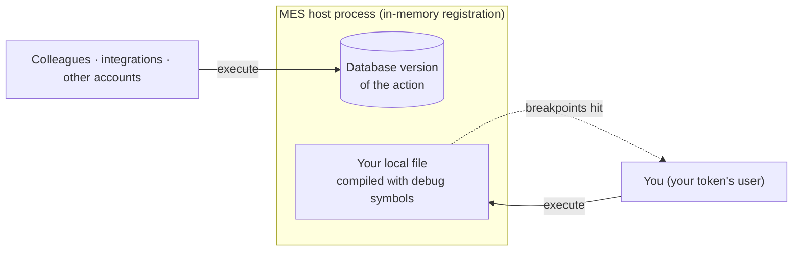
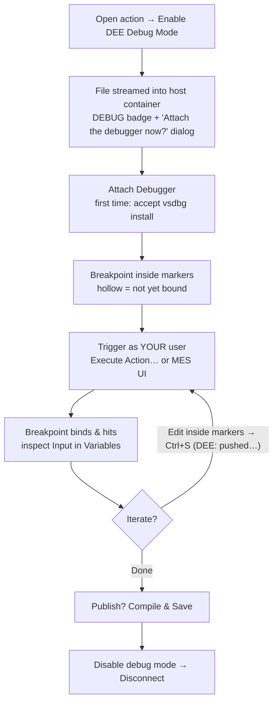
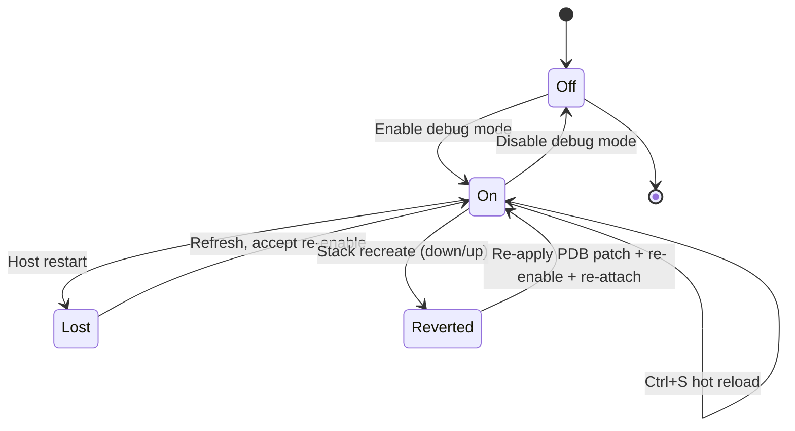

# Module 5 — Debugging DEE actions live

**Duration:** 90 min (self-paced) · 90 min (instructor-led — do not compress)
**Required reading:** [User guide — Debugging DEE actions](../user-guide/debugging.md)
**Prerequisites:** Modules 1–4; `Training_Scratch` uploaded clean; on an MES 11.x
(Linux) stack, **the host PDB patch applied** (see the
[facilitator guide](facilitator-guide.md#14-the-one-time-linux-pdb-patch) — in
instructor-led delivery this was done for you; self-paced learners run **DEE Debugger:
Patch Host for DEE Debugging (dev/test)…** now, before starting). MES 12 stacks need no
patch.

## Learning objectives

After this module you can:

1. **Explain** the five consequences of the debug-mode mental model: per-user,
   in-memory, hot-reload-on-save, database untouched, paused host freezes the MES.
2. **Perform** the full debug loop: enable debug mode, attach (including the
   first-time vsdbg install), set a breakpoint, trigger the action as the correct
   user, iterate via hot reload, and clean up.
3. **Diagnose** the four standard causes of a breakpoint that never hits.
4. **Recognize** the Linux PDB compile error, **explain** how the extension detects an
   unpatched host and offers **Patch Host for DEE Debugging**, and **state** when the
   patch must be re-applied (and why MES 12 hosts need none).
5. **Predict** what a host restart does to debug registrations and **recover** via
   the re-enable prompt.

## Key concepts

### 1. The mental model — everything else follows from it

When you enable **DEE debug mode** for an action, the MES host stops using the
database code *for you* and instead compiles the action **from your local file**
(delivered into the host container by the extension) with debug symbols, every time
*you* trigger it.



Five consequences
([full text](../user-guide/debugging.md#the-mental-model)):

1. **Per-user.** The registration is keyed to your token's user. Only operations
   executed **as that user** run your file and can hit your breakpoints. Colleagues,
   integrations, other accounts — all keep running the stored version, unaffected.
   Corollary: trigger the action from the MES UI logged in as a *different* account
   and your breakpoint never hits.
2. **In-memory.** The registration lives in the host process's memory. A host restart
   silently forgets it. The extension reconciles on refresh and offers to
   **re-enable** when it notices.
3. **Hot reload on save.** With debug mode on, every `Ctrl+S` pushes your file to the
   host; your **next** execution compiles and runs the new code. Edit → save →
   trigger → inspect, with **no** Save-to-MES anywhere in the loop.
4. **Database untouched until you say so.** Disabling debug mode returns you to the
   stored version instantly. Publishing is a separate, explicit act: **Save Action to
   MES (Compile & Save)**.
5. **A paused host is a stopped MES.** .NET debugging suspends the **entire host
   process** at a breakpoint: MES UI unresponsive, API timeouts, colleagues blocked,
   even the extension's own refreshes fail. Normal, not an outage — press Continue.

### 2. The loop, operationally



1. **Enable DEE Debug Mode** (right-click the action or the bug icon on its row; if
   you have not opened the action yet, it is downloaded first). On a containerized
   host the extension first checks the PDB prerequisite; if the host is unpatched
   (MES 11.x on Linux) a modal offers **Patch Host for Debugging** or **Continue
   Anyway**. Then the file is streamed into the host container and debug mode is
   registered: a **DEBUG** badge and a debug icon on the row, `🐞 1` in the status bar,
   and a dialog asking *Attach the debugger now?* (**Attach Debugger** / **Not Now**).
2. **Attach** (the dialog's **Attach Debugger** button, or *Attach Debugger to MES
   Host* any time). The very first attach shows a one-time primer — choose
   **Attach**.
   First time on a fresh container, `vsdbg` isn't there — the extension offers to
   **install it**; accept. (MES 12 host images have `curl`, so the download runs in the
   container. MES 11.x images have neither `curl` nor `wget`, so the extension downloads
   vsdbg on your machine and streams it in; that needs local `bash` and `tar` — Linux,
   macOS, or WSL on Windows.) Before attaching it
   checks ptrace rights: on Docker it runs the debugger with `--privileged -u 0` when
   needed; on Kubernetes it explains the pod-spec change if `SYS_PTRACE` is missing.
   The host process is found automatically; if a picker ever appears, choose the
   `dotnet` process running `Cmf.Foundation.Services.HostService.dll` — **never** the
   first/wrapper process.
3. **Breakpoint** on a line **inside the action-code markers**. A hollow circle is
   normal: the debug-compiled assembly loads on first execution, at which point the
   breakpoint fills solid and hits. If no breakpoint has bound about 8 seconds after
   attaching, the extension shows a *breakpoint(s) have not bound* warning — for a DEE
   breakpoint whose action has not run yet, just trigger the action.
4. **Trigger as your user:** perform the hooked operation in the MES UI **logged in
   as your token's account**, or right-click → **Execute Action…** (always runs as
   your token's user; the execute call waits while you sit at the breakpoint, but
   gives up after the 60-second request timeout).
5. **Iterate:** edit inside the markers, save (status bar flashes
   *DEE: pushed … to host*), trigger again — new code runs.
6. **Finish:** publish with Compile & Save if you want the change kept; disable debug
   mode; disconnect the debugger. Closing the VS Code window with debug on triggers a
   best-effort cleanup of your registrations.

What the tree and editor look like mid-loop:

```text
DEE EXPLORER                      editor: Training_Scratch.cs
  Training_Scratch  [DEBUG] ●       ⭘ 13   Input["greeting"] = "hello…";   ← hollow: not yet bound
                                    ● 13   Input["greeting"] = "hello…";   ← solid: bound after 1st execute
```

### 3. The Linux PDB prerequisite

MES releases up to 11.x have a product bug (#158143) on **Linux-containerized hosts**
(the default for local stacks): the host's DEE compiler asks for debug symbols in a
Windows-only format, so executing an action in debug mode fails with:

```
The Action <name> code is invalid: … Unexpected error writing debug information --
'Value cannot be null. (Parameter 'type')'
```

This is **not your code's fault**, and since 0.2.0 you rarely see it. The extension
checks the host before you enable debug mode and before you attach. If the host is
unpatched, enabling shows a modal (**Patch Host for Debugging** / **Continue
Anyway**), and attaching shows a non-blocking warning with the same patch button.
Patching takes one click; the host restarts. If the error does appear, its notification also
offers **Patch Host for Debugging…**. The patch is available any time as **Patch Host
for DEE Debugging (dev/test)…**, and `tools/host-pdb-patcher` remains for scripted
use. **MES 12 hosts already contain the product fix** and need nothing. Lifecycle rules:

- **Plain restart** (`docker restart`): patch survives, but in-memory debug
  registrations are cleared (consequence 2).
- **Stack recreate** (`cmf dev local stack down`/`up`): the writable layer is wiped —
  the next enable-debug prompt offers the patch again; accept it, then re-enable debug
  mode.

The whole debug-mode lifecycle, including how host events knock it out and how you
recover:



### 4. Situational awareness

- **"Could not reach the MES host" during an active debug session** usually means
  the host is paused at your breakpoint — the extension reminds you; Continue (F5)
  and retry. On shared instances: don't stay paused long.
- **Load balancers:** registration and attach live on **one** host instance; the
  balancer may route executions to another where the stored version runs. Point the
  environment at a single instance while debugging.
- **Multiple developers:** registrations are per (user, action), so several people
  can debug on the same instance with their own files — but only **one debugger can
  be attached** to the host process at a time, and anyone's pause freezes everyone
  ([FAQ](../user-guide/faq.md#can-several-people-debug-on-the-same-dev-instance)).

## Demo script (instructor variant)

*Setup: instructor stack patched (PDB), fresh host container (so the vsdbg install
offer appears live), `Demo_Scratch` uploaded clean; MES UI open as the SAME user as
the instructor's PAT; a second browser profile logged in as a DIFFERENT user for
step 6.*

1. **Draw the model first** (8 min). Whiteboard: DB-stored code vs your local file;
   the host container; your user's executions routed to your file, everyone else's to
   the DB version. Recite the five consequences. *Say:* "Every debugging mystery you
   will ever hit is one of these five, violated."
2. **Enable and inspect the plumbing** (5 min). Right-click `Demo_Scratch` → **Enable
   DEE Debug Mode**. Show the DEBUG badge and the *Attach the debugger now?* dialog;
   choose **Not Now** for the moment. Then prove it's real:
   `docker exec <devcontainer> docker exec custom_host ls -lR /tmp/CriticalManufacturing/dee-debug/`
   — the `.cs` file is inside the container, under the same relative path it has in the
   workspace. Show the output-channel line logging the
   registration and host path.
3. **Attach with the vsdbg install** (7 min). Click the title-bar debug icon
   (**Attach Debugger to MES Host**); accept the one-time primer and the install offer,
   and narrate the wait ("one-time per container"). Debug toolbar appears, status bar turns debug-colored. Mention the
   picker rule: `dotnet …HostService.dll`, never the first process.
4. **Breakpoint lifecycle** (5 min). Set a breakpoint inside the markers — point at
   the hollow circle: "unbound until the assembly loads; that happens on first
   execution. A hollow circle is not a problem, it's a promise."
5. **Hit it** (5 min). Right-click → **Execute Action…** → **Execute read-only** →
   `{}`. The
   breakpoint fills and hits; inspect `Input` in Variables, hover, step with F10.
6. **Show the freeze AND the per-user rule in one pause** (7 min). While paused:
   switch to the MES UI tab — frozen; *say:* "everyone on this instance is waiting
   for me right now." Then, still paused, in the *second* browser profile (different
   user) do nothing yet — first press F5 to release. Now trigger a fresh execution
   from the second profile's UI: no breakpoint hit. *Say:* "Different user → stored
   version → cold breakpoint. This is the number-one 'debugger is broken' ticket, and
   it is working as designed."
7. **Hot reload** (5 min). Change the body text, Ctrl+S — point at the
   *DEE: pushed…* status-bar flash — Execute again: new value at the breakpoint.
   Open the MES UI editor: DB code unchanged. "Iterated twice, published nothing."
8. **Kill the host, live** (7 min). `docker restart custom_host` (via the
   devcontainer). Refresh the tree; when the extension reports **debug mode was
   lost** and offers to re-enable, accept, re-attach, execute — hits again. *Say:*
   "In-memory registration: restarts forget you; the extension notices and offers the
   fix. After a full stack *recreate*, expect the patch prompt again on 11.x hosts."
9. **Clean up + the error you'd have seen** (4 min). Disable debug mode, disconnect.
   Show (slide/screenshot) the `Unexpected error writing debug information` failure:
   "unpatched Linux host — the extension now detects this and offers **Patch Host for
   Debugging**; your stacks were patched before class."

## Hands-on exercise

On `Training_Scratch`, on your own stack (patched).

1. Open `Training_Scratch`; right-click → **Enable DEE Debug Mode**. Confirm the
   DEBUG badge, the `🐞 1` in the status bar, and the *Attach the debugger now?* dialog
   (choose **Not Now** for the moment).
2. Verify the delivery: from your terminal,
   `docker exec <your-devcontainer> docker exec custom_host ls -R /tmp/CriticalManufacturing/dee-debug/`
   — your `.cs` file is listed, under its workspace-relative path.
3. Run **Attach Debugger to MES Host** (title-bar debug icon); at the one-time primer
   choose **Attach** (see Key concepts §2), and accept the vsdbg install if offered. Confirm the debug toolbar appears.
4. Set a breakpoint on your `Input["greeting"] = …` line; note it is hollow.
5. **Execute Action…** → **Execute read-only** → `{}`. The breakpoint binds and hits.
   Inspect `Input` in the Variables pane; step once with F10.
6. While paused, try to use the MES UI in your browser — observe the freeze; then
   Continue (F5) and see the execution report open. (If you stayed paused for more
   than 60 seconds, the execute call times out instead — run it again.)
7. Hot reload: change the greeting string, save (watch for *DEE: pushed*), Execute
   again — the breakpoint hits with the **new** value. Check the MES UI editor: the
   database still holds the old code.
8. Restart drill: `docker exec <devcontainer> docker restart custom_host`. Refresh
   the tree; accept the **re-enable** offer when the extension reports debug mode was
   lost; re-attach; Execute; confirm the breakpoint hits again.
9. Clean up: disable debug mode, disconnect the debugger. Decide deliberately whether
   to publish your last greeting (Compile & Save) or leave the DB as is.

**Success criteria:**

- [ ] File verified inside the container before attaching.
- [ ] Breakpoint hit at least three times: initial, post-hot-reload, post-restart.
- [ ] Hot-reload proof: the value at the breakpoint changed **without** any
      Save-to-MES, and the MES UI still showed the old code.
- [ ] You experienced the paused-host freeze and released it.
- [ ] Re-enable-after-restart flow completed without recreating the environment.
- [ ] Debug mode off and debugger disconnected at the end.

## Common mistakes to preempt

- **Triggering as the wrong user** — the top cause of "breakpoint never hits"
  ([FAQ](../user-guide/faq.md#why-does-my-breakpoint-never-hit-even-though-the-action-runs)).
  MES UI login must match your token's user; **Execute Action…** always runs as your
  token's user and is the safe trigger.
- **Panicking at the hollow circle.** Unbound-until-first-execution is normal; it is
  not a symptom until the action *has* executed and it stayed hollow. The same goes
  for the *breakpoint(s) have not bound* warning a few seconds after attaching —
  unless it says the host is not patched.
- **Forgetting Save-to-MES ≠ needed for iteration** — some learners upload on every
  loop, defeating hot reload and publishing half-finished code to everyone.
  Conversely: forgetting to publish at the end, so the DB never gets the fix.
- **Picking the wrong process in the picker** — the first process is a wrapper;
  attach fails (`Unknown Error: 0x80131c08` is the classic symptom). Choose the
  `dotnet` process running `Cmf.Foundation.Services.HostService.dll`
  ([troubleshooting row](../user-guide/troubleshooting.md#debugging-problems)).
- **Reading the paused-host freeze as an outage** — colleagues' "the MES is down!"
  during your pause is you. Continue promptly; be a good neighbor on shared instances.
- **Losing the PDB patch on stack recreate** — recreate wipes the writable layer; on
  an 11.x host the enable-debug prompt offers the patch again — accept it, then
  re-enable debug mode.
- **Leaving debug mode on and walking away.** Closing the window cleans up
  best-effort, but the deliberate habit is: disable, disconnect, then leave (the status
  bar's `🐞` count is your reminder).

## Knowledge check

**Q1.** Debug mode is ON for an action; a colleague (different MES user) triggers the
hooked operation. What runs for them?
- A. Your local file, with your breakpoints active
- B. The stored database version, completely unaffected by your debug mode ✔
- C. Nothing — the action is locked while you debug
- D. Your file, but without breakpoints

*Rationale: the registration is per-user; only executions as your token's user run your file.*

**Q2.** With debug mode ON, what does Ctrl+S do beyond saving locally?
- A. Nothing extra — you must still Compile & Save
- B. Pushes the file to the host so your NEXT execution compiles and runs it — the database version is untouched ✔
- C. Publishes the change to all users
- D. Creates a new version automatically

*Rationale: hot reload is save-triggered; publishing to the DB stays a separate explicit Compile & Save.*

**Q3.** Your breakpoint shows as a hollow circle right after attaching. What does it
mean?
- A. The symbol format is wrong — apply the PDB patch
- B. Normal: the debug-compiled assembly loads when the action first executes; the breakpoint binds and hits then ✔
- C. The breakpoint is outside the markers
- D. vsdbg is not installed

*Rationale: unbound-until-first-execution is documented, expected behavior — not a fault.*

**Q4.** Executing a debug-mode action on a Linux host fails with "Unexpected error
writing debug information -- 'Value cannot be null. (Parameter 'type')'". What is it,
and what fixes it?
- A. A syntax error in your action — fix the code
- B. A known product bug in the host's debug-symbol format — run **Patch Host for DEE Debugging** (offered automatically when the host is unpatched) ✔
- C. An expired token — set a new PAT
- D. Wrong container name in the environment

*Rationale: Linux hosts emit Windows-only PDBs; the patcher fixes the container in place, once per container (re-apply after a stack recreate).*

**Q5.** Someone recreated the stack overnight. Which pair of recovery steps applies to
your debugging setup?
- A. Nothing — debug registrations persist in the database
- B. Re-apply the PDB patch (writable layer wiped) and accept the extension's offer to re-enable debug mode (in-memory registration lost) ✔
- C. Reinstall the extension and re-create the environment
- D. Only re-attach the debugger; everything else survives

*Rationale: recreate loses both the patch (container layer) and the registration (host memory); vsdbg also needs reinstalling, which the extension offers on attach.*

**Q6.** While you are stopped at a breakpoint, a colleague reports the MES UI is not
responding. What is the correct reading?
- A. The stack crashed — restart the host
- B. Expected: a stopped debugger suspends the entire host process; press Continue and it resumes ✔
- C. The load balancer failed over
- D. Their token expired

*Rationale: whole-host suspension at a breakpoint is normal .NET debugging behavior — the guide's consequence #5.*

---

Next: [Module 6 — Syncing with the git-tracked Actions project](module-06-sync.md)
