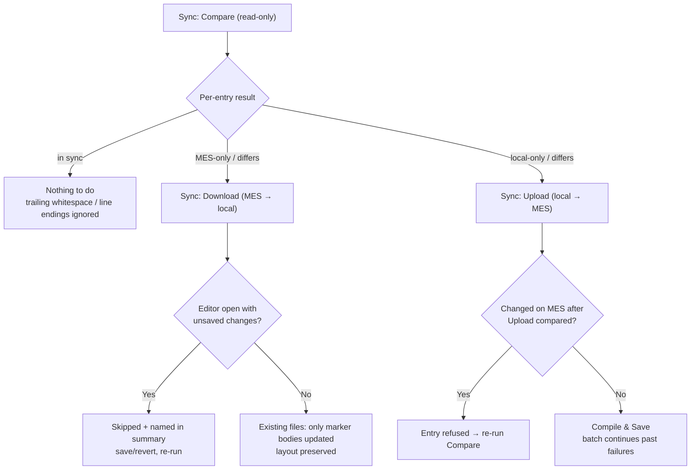

# Module 6 — Syncing with the git-tracked Actions project

**Duration:** 60 min (self-paced) · 50 min (instructor-led)
**Required reading:** [User guide — Sync](../user-guide/sync.md)
**Prerequisites:** Modules 1–5; a workspace containing (or configured to) a DEEs
folder; `Training_Scratch` from the earlier modules.

## Learning objectives

After this module you can:

1. **Execute** the three sync commands — *Compare*, *Download Changes from MES*,
   *Upload Local Changes to MES* — against the DEEs folder.
2. **Interpret** compare results (in sync / differ / local-only / MES-only) and
   **explain** why the diff shows server code inside your local wrapper.
3. **Explain** the three safety behaviors: dirty-editor skip, batch continuing past a
   compile failure, and refusal to upload entries changed on the MES after the upload
   built its comparison — and why that refusal does not replace reviewing the diff.
4. **Apply** the baseline → develop → capture → apply-elsewhere git workflow.
5. **State** what sync does *not* transfer (group membership, evaluation order,
   enabled/effective flags).

## Key concepts

### 1. Why sync exists

DEE actions live in the MES database, but your customization project keeps local
`.cs` copies (conventionally `Cmf.Custom.Data/DEEs`) for IntelliSense, code review,
and source control. The sync commands keep the two sides aligned **in bulk**. All
three work against every DEEs folder, subfolders included (auto-detected, or `deeDebugger.deesFolder`) and
live in the `…` menu of the DEE Explorer's title bar and in the Command Palette.

The three commands and their safety gates at a glance:

### 2. Compare — the read-only starting point

**Sync: Compare Local DEEs with MES** classifies every action/file as **in sync /
differs / local-only / MES-only** and lists everything that is not in sync; pick an
entry to open its **diff editor**. Compare does not know *which side* changed — an
edit on either side shows as *differs*. Two design choices make the diff readable:

- The server side is rendered **inside your local file's wrapper**, so generated
  boilerplate never shows as noise — you compare marker bodies against marker bodies.
  **Differences only in line endings, trailing whitespace, or blank lines at the start
  or end of a body count as in sync.** Indentation and other changes do count.
- **Both marker dialects are recognized**: the generated
  `/** START/END OF USER-DEFINED … **/` markers *and* the older cmf-cli authoring
  dialect (`//---Start DEE Code---` / `//---End DEE Code---` plus the condition
  pair). `DeeDevBase.cs` is skipped automatically.

MES-only entries open **read-only** so you can inspect before downloading.

### 3. Download — MES → local, with protection

**Sync: Download Changes from MES** runs the comparison again and pre-checks every
*differs* and MES-only entry — including files you changed locally. Deselect what you
don't want (or your local body edits are replaced), confirm, and files are written:

- Never-seen actions → complete generated files.
- Existing files → **your local layout is kept; only the marker bodies are updated**
  (this is what keeps git diffs minimal).
- **Dirty-editor protection:** a file open in an editor with **unsaved** changes is
  **skipped**, counted as a failure, and named in the summary — never overwritten
  under your editor. Save or revert, then re-run for those entries.

### 4. Upload — local → MES, batch semantics

**Sync: Upload Local Changes to MES** runs the comparison again and lists the
*differs* entries (pre-checked) and the local-only ones (not pre-checked). Each
selected file is compiled and saved on the MES (same operation as per-file *Save
Action to MES*):

- A compile failure in one file **does not abort the batch**; the summary names
  failures and the errors land in the **Problems** panel against the right files.
- An action changed **on the MES** after the upload built its comparison (for example
  while the picker was open) **fails**; the summary lists it and the output log says to
  run Compare again. Re-compare, review the diff, re-upload.
- That refusal does **not** cover a change made on the MES *before* you started the
  upload: such an action is simply listed as *differs*, pre-checked, and your file
  overwrites it. So run Compare, read the diffs, and deselect anything changed on the
  MES side.
- Files with damaged markers are left out of the comparison (never uploaded); the
  output log names each skipped file and why.
- The batch is cancellable mid-flight from the progress notification.

### 5. The git workflow

The pattern to teach your team
([full version](../user-guide/sync.md#a-typical-git-workflow)):

1. **Baseline:** clean working tree → Download everything → commit. Repo mirrors MES.
2. **Develop:** single-action edit/debug loops (Modules 4–5); save final versions to
   the MES.
3. **Capture:** Compare → download server-side changes (your MES-UI edits, a
   colleague's work) → commit with a meaningful message. `git diff` shows exactly
   what changed per action body.
4. **Apply elsewhere:** on a branch checkout or another environment (status-bar
   switch), Compare then Upload to push the repo's state to that MES.
5. **Review:** PRs over the DEEs folder review actual rule changes; preserved layout
   + whitespace tolerance keep diffs minimal.

**Scope limit to remember:** sync transfers action **code** only. Group membership and
evaluation order are managed in the MES UI (Administration → DEE Actions) or via Data
package installation — not by this extension. Enabled/effective state does not travel
either, but a local-only file uploaded by sync **creates** the action (enabled, as a
version-1 draft) and the batch ends by offering **Make Effective**
([FAQ](../user-guide/faq.md#i-created-a-dee-does-it-run-before-i-make-it-effective)).

## Demo script (instructor variant)

*Setup: instructor workspace = customization project with a populated
`Cmf.Custom.Data/DEEs` under git, clean tree, repo baselined against the MES before
class.*

1. **Frame it** (3 min). *Say:* "Modules 4–5 were one action at a time. Real projects
   have dozens under git review. Sync is the bulk bridge — and it is deliberately
   paranoid: compare is read-only, download refuses dirty editors, upload refuses
   changes that land on the MES while it runs. What it can't do is tell you which
   side changed — that's what the diff is for."
2. **Compare on a clean state** (4 min). Run Compare → everything in sync. Then edit
   one local file's body, add trailing spaces to a few lines of a second, and edit a
   third action in the **MES UI**. Compare again → two *differs* (one changed locally,
   one on the MES — Compare can't tell which), and the trailing-space file **in sync**
   ("trailing whitespace and line endings don't count; indentation would").
3. **Read the diff** (5 min). Open the differing entries' diffs. Point out server
   code rendered inside the local wrapper: "no generated-boilerplate noise — bodies
   against bodies. This is why review diffs stay small."
4. **Download with the dirty-editor trap, live** (6 min). Open the server-changed
   file, type a character, do NOT save. Run Download, deselect the locally edited
   file (it is pre-checked too, and downloading would replace its body), keep the
   server-changed entry → show the summary counting it as **skipped/failed by name**. *Say:* "The extension will
   not overwrite disk under an unsaved editor — ever." Revert the editor, re-run,
   show it now downloads and that `git diff` touches only body lines.
5. **Batch upload with a planted failure** (6 min). Edit three files locally; break
   one (`var oops = ;`). Upload all three → two succeed, one fails, batch completes;
   Problems points into the broken file. Fix and re-upload. *Say:* "One bad file
   never holds the rest hostage."
6. **The 409-style refusal** (4 min). Start an Upload and leave its picker open; bump
   one of the listed actions in the MES UI; then confirm the picker → that entry fails
   (summary) and the output log says "changed on the MES since the comparison — run
   'Sync: Compare' again". *Say:* "Sync's answer to two people on one action:
   re-compare, look, then decide — same philosophy as Module 4's conflict dialog. But
   it only catches changes made *while* the upload runs; a change made before you
   started is just a pre-checked *differs* row, and uploading overwrites it. Read the
   diff first."
7. **Close with the git loop** (4 min). Show the last commits of the DEEs folder:
   baseline commit, capture commits. Recite the 5-step workflow and the scope limit
   (code only, no flags/membership/order).

## Hands-on exercise

Work in your DEEs folder; if your workspace has no git repo, `git init` it first —
the exercise uses git to *see* what sync did.

1. **Baseline:** clean state → **Sync: Download Changes from MES** (accept all) →
   `git add . && git commit -m "MES baseline"`.
2. Make three changes:
   a. locally edit the body of `Training_Scratch.cs` (change the greeting),
   b. in any other downloaded file, add trailing spaces to a few body lines (whitespace
      at line ends only),
   c. in the **MES UI**, edit a *different* action's code (add a comment) and save.
3. Run **Sync: Compare** and predict-then-verify each classification: (a) differ,
   (b) **in sync**, (c) differ. Open (c)'s diff and confirm the server code appears
   inside your local wrapper.
4. **Dirty-editor drill:** open the file from (c) in an editor, type a character,
   don't save. Run **Download**, **deselect (a)** (it is pre-checked too — downloading
   it would replace your greeting edit), keep (c) → confirm (c) is skipped and named
   in the summary. Revert the editor, download (c) again, confirm success and inspect
   `git diff` — only marker-body lines changed.
5. **Batch upload drill:** break `Training_Scratch.cs` inside the markers
   (`var oops = ;`) and also edit one more file validly. Upload both → confirm the
   good one uploads, the broken one fails without aborting, and Problems points at
   the right line. Fix, re-upload clean.
6. **Mid-upload change drill:** change your local `Training_Scratch` body again and
   save. Run **Upload** and leave the picker open; meanwhile bump `Training_Scratch`
   in the MES UI and save there; then confirm the picker → confirm the entry is
   reported as failed and the output log tells you to re-run Compare. Re-compare,
   review the diff, decide, and finish the upload.
7. Commit the final state with a meaningful message.

**Success criteria:**

- [ ] Baseline commit exists; repo mirrored the MES.
- [ ] All three compare classifications predicted correctly, including
      trailing-whitespace-only = in sync.
- [ ] Dirty-editor skip observed by name in the summary; no editor content lost.
- [ ] Batch continued past the planted compile failure.
- [ ] Mid-upload refusal observed and resolved via re-compare.
- [ ] Final `git log` shows baseline + capture commits with body-only diffs.

## Common mistakes to preempt

- **Expecting sync to move configuration.** Group membership, order,
  enabled/effective flags never travel — a downloaded repo applied to a fresh MES
  still needs its Data package / MES-UI configuration.
- **"Sync is missing actions."** Sync reads every action the MES reports — one row
  per name, drafts included (labelled *MES version is a draft (not effective)*) and
  disabled ones included (*disabled on MES*) — whatever the tree's filter or hidden
  disabled actions. Check for a typo in the local file name (the file name *is* the
  action name) and look in the output log for files skipped because of damaged
  markers.
- **Uploading without reading the diffs.** Upload pre-checks every *differs* entry,
  including actions a colleague changed on the MES, and overwrites them. The 409
  refusal only catches changes made while the upload runs. Treat *Compare* + diff
  review as the mandatory first step of every sync session.
- **Reading the skipped-dirty-file count as a bug.** It is the protection working;
  the summary names the files — save/revert and re-run for those.
- **Confusing sync upload with debug hot-reload.** Sync upload = Compile & Save to
  the database for everyone; it has nothing to do with the debug-mode host push.
- **Committing an un-baselined mixture.** Do the baseline download+commit *before*
  developing, or `git diff` can't tell your change from pre-existing drift.

## Knowledge check

**Q1.** A local file differs from the MES only in trailing spaces at line ends and in
line endings (CRLF vs LF). What does Compare report?
- A. Differ — every byte counts
- B. In sync — trailing whitespace and line-ending differences are ignored ✔
- C. Local-only
- D. A merge conflict

*Rationale: the comparison normalizes line endings, trailing whitespace, and blank lines at the start or end of each marker body; indentation or blank lines inside a body would still count as a difference.*

**Q2.** During a sync download, one selected file is open in an editor with unsaved
changes. What happens to it?
- A. The disk file is overwritten; the editor shows a conflict
- B. The editor buffer is updated in place
- C. The entry is skipped, counted as a failure, and named in the summary ✔
- D. The download aborts entirely

*Rationale: dirty-editor protection never overwrites disk under an unsaved editor; you save or revert, then re-run for those entries.*

**Q3.** In a 10-file sync upload, file 4 has a compile error. What is the outcome?
- A. The batch stops at file 4
- B. All 10 are rolled back
- C. The other files upload; file 4 is reported as failed, with its errors in the Problems panel ✔
- D. File 4 is uploaded without compiling

*Rationale: batch upload continues past failures; the summary names them and diagnostics land on the right files.*

**Q4.** You start *Sync: Upload Local Changes to MES*; while its picker is open, a
colleague saves a change to action X on the MES. You then confirm the upload with X
selected. What happens?
- A. Your version silently overwrites theirs
- B. The entry fails; the summary lists it and the output log says to run Compare again — you re-compare, review, then re-upload ✔
- C. An automatic merge is attempted
- D. The whole batch is refused

*Rationale: an entry changed on the MES after the upload built its comparison is refused individually (409) and the rest of the batch proceeds. A change made before you started the upload is not caught this way — it shows as a pre-checked "differs" row, so read the diffs first.*

**Q5.** Which of these does sync transfer between your repo and the MES?
- A. Action code (marker bodies) only ✔
- B. Action group membership
- C. Evaluation order
- D. Enabled/effective flags

*Rationale: sync moves code; membership, order, and flags are managed in the MES UI or via Data package installation.*

**Q6.** Why do downloaded updates to existing files keep your local file's layout and
update only marker bodies?
- A. Performance — writing less is faster
- B. So version-control diffs show only real rule changes, keeping reviews minimal ✔
- C. Because the server does not send the wrapper
- D. To avoid recompiling the wrapper locally

*Rationale: layout preservation plus whitespace tolerance is what makes the git/PR workflow produce clean, reviewable diffs.*

---

Next: [Module 7 — Troubleshooting and self-support](module-07-troubleshooting.md)
