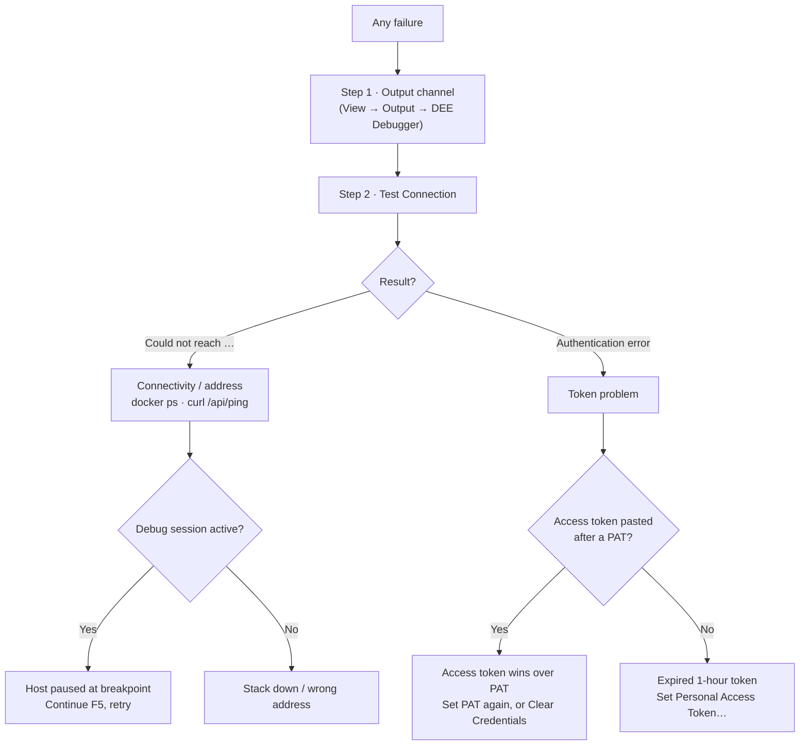

# Module 7 — Troubleshooting and self-support

**Duration:** 45 min (self-paced) · 40 min (instructor-led, compressible to 30)
**Required reading:** [User guide — Troubleshooting](../user-guide/troubleshooting.md)
and [FAQ](../user-guide/faq.md)
**Prerequisites:** Modules 1–6 (you have seen most of these failures happen at least
once, on purpose).

## Learning objectives

After this module you can:

1. **Apply** the two-step triage — output channel first, then *Test Connection* — to
   split any failure into connectivity vs authentication.
2. **Diagnose and fix** the expired-token failure, both immediately (fresh token) and
   permanently (a Personal Access Token).
3. **Match** the top symptoms to their causes: unreachable host, unparseable JSON,
   missing tree actions, frozen MES during a debug pause, and "my file changed by
   itself".
4. **Produce** a support bundle and **compose** a complete support ticket.

## Key concepts

### 1. The triage method (not a symptom list)

The troubleshooting guide is a symptom table; this module teaches the *method* that
makes the table fast to use:

- **Step 1 — Output channel.** View → Output → **DEE Debugger**. Every operation logs
  there — each line timestamped, credentials automatically redacted, starting with a
  version-and-platform line at startup. Many error notifications offer to open it
  directly (**Show Log**).
- **Step 2 — Test Connection.** Its result splits the world in two:
  *"Could not reach …"* → connectivity/address problem;
  an authentication error → token problem. Everything else hangs off that fork.

### 2. The expired-token playbook (the #1 ticket)

**Signature:** everything worked, then *every* server operation fails with 401/403 and
the hint *"The token may be expired — run 'DEE Debugger: Set Credentials…' to set a
new one."* (or with *"returned a login page instead of data — the token was
rejected"*). Local-only edits still work. On a 401/403 the output channel logs the
stored token's type and expiry.

**Cause:** Security Portal stacks (including the standard local dev stack) expire
browser-copied access tokens after **1 hour**. Not a bug in your code or the
extension.

**Fix now:** copy a fresh token, *Set Access Token…*.
**Fix forever:**

1. **Set Personal Access Token…** — paste the PAT. Storing a PAT also removes any
   stored access token, so the PAT takes effect at once — no Clear Credentials needed.
2. Refresh to confirm.

Companion pitfalls: freshly copied token rejected → **truncated** (1–2 KB; use
right-click → Copy value; a pasted `Bearer ` prefix is stripped for you); an access
token pasted *after* a PAT → it takes precedence over the PAT, even once expired (set
the PAT again, or Clear Credentials and set the one you want); token works in one
environment only → credentials are **per environment**.

### 3. Symptom pattern-matching — the shortlist

| Symptom | First hypothesis |
|---|---|
| "Could not reach the MES host at …" | Stack down or wrong address — `docker ps`, then `curl …/api/ping` (200 **or 401** both prove routing) |
| Same, but a debug session is active | Host **paused at your breakpoint** — Continue (F5) and retry |
| "returned a login page instead of data" | The address answered an HTML page — usually the login page served for a revoked or expired token; set a new token. If the token is fine, check the address is the base URL the MES UI uses |
| "returned unparseable JSON" | The address answered something that is not the MES API (wrong port or sub-path) — point at the base URL the MES UI uses; the raw body is in the output channel |
| Everything broke after a devcontainer rebuild | New random devcontainer name / new IP — update the environment or pin the name |
| No DEE Debugger icon | C# extension missing, workspace untrusted, or no folder open |
| Tree empty but Test Connection succeeds | An active **text filter** — filled filter icon in the title bar and a *"N DEEs matched '…'"* row at the top of the tree; click it and clear the filter |
| A specific action missing from the tree | It is **disabled** — click the tree's *"N disabled actions hidden — click to show"* row (or set `deeDebugger.showDisabledActions`) — or excluded by a text filter. Drafts are never hidden: look for the `not effective` badge. (Sync ignores both and always includes disabled actions.) |
| Action is listed but never runs | Not the `not effective` badge alone — with no effective version the highest runs. Check it is enabled and in an action group (MES UI); if a new version was staged, the effective one runs until you **Make Version Effective** |
| "My local file changed on disk by itself" | Not a bug: with debug mode on, the host rewrote the file because its regenerated wrapper differed — you edited outside the markers |
| Breakpoint never hits | The Module 5 four: wrong user / not executed yet (hollow) / load balancer / host restarted. On an unpatched MES 11.x Linux host, the *breakpoint(s) have not bound* warning says so and offers **Patch Host for Debugging** |
| Attach `Unknown Error: 0x80131c08` | Wrong process picked (take `…HostService.dll`). Ptrace rights are checked before attaching: Docker hosts are handled automatically; on Kubernetes the extension warns when the pod lacks `SYS_PTRACE` |

(Full tables with fixes: [connection](../user-guide/troubleshooting.md#connection-problems),
[extension/tree](../user-guide/troubleshooting.md#extension-or-tree-problems),
[uploads](../user-guide/troubleshooting.md#uploads-and-compile-errors),
[debugging](../user-guide/troubleshooting.md#debugging-problems).)

### 4. Escalating well: the support bundle

**DEE Debugger: Collect Support Bundle…** gathers what a support engineer needs
without a screen-share: versions and platform, the active environment and your
environment profiles (engine-command passwords redacted), token **metadata** (type,
expiry, user claim — never the token itself), session and debug state, a live
host-container reachability probe, and the recent redacted log. It opens as a
**document in your editor** — nothing is written to your project or sent anywhere
automatically; review, redact further if you wish, then attach it.

**A good ticket** = support bundle + what you did (command, action) + what you
expected + what happened.

## Demo script (instructor variant)

*Setup: instructor stack running; a deliberately expired or truncated access token
prepared; the environment list containing the `training-manual` profile from
Module 3.*

1. **Sell the method** (3 min). *Say:* "You've now hit a dozen staged failures this
   course. Support triage is two moves: read the output channel, run Test Connection.
   Reach vs auth. Every table row in the guide hangs off that fork."
2. **Auth branch, live** (7 min). With your PAT still stored, set the
   expired/truncated access token (*Set Access Token…*), Refresh → an auth failure
   (401 with the set-token hint, or *returned a login page*) even though a valid PAT
   is stored ("a stored access token wins over a PAT — the classic"). Show the
   output-channel `[auth]` line describing the stored credential. Fix: *Set Personal
   Access Token…* (storing a PAT removes the access token) → Refresh → green. Recite
   the forever-fix: use a PAT.
3. **Reach branch, live** (5 min). Stop the traefik/host container; Test Connection →
   a reach-class failure (typically "Could not reach…"). Prove the split with
   `curl -s -o /dev/null -w '%{http_code}' <address>/api/ping`. Restart. Then point
   the `training-manual` environment at a wrong port or sub-path and Refresh →
   classify what comes back ("could not reach", an HTTP status, "unparseable JSON", or
   "returned a login page"); the raw body is in the output channel. Restore.
4. **The invisible-action question** (4 min). Ask the class: "Administration → DEE
   Actions shows 58 actions; the tree shows 51. Bug?" Elicit: the tree says *"7 disabled
   actions hidden — click to show"* (click it), or a text filter is active. Then show a
   draft row (`not effective` badge): it runs while no version is effective, but a
   version staged later would take over — **Make Version Effective** pins the one that runs.
5. **Support bundle** (5 min). Run **Collect Support Bundle…**; scroll the document:
   versions, environment config, token *metadata* only, the reachability probe,
   redacted log. *Say:*
   "It opens as a document precisely so you can read and redact before sending —
   nothing leaves your machine on its own. Bundle + did/expected/got = a ticket I can
   act on without a screen-share."
6. **Close the course loop** (2 min). "From here on, the guide's symptom tables are
   your first responder, the bundle your escalation. Capstone next."

## Hands-on exercise

Deliberately break and repair your own setup — finish with everything green.

1. **Auth drill:** store a sabotaged token (truncate your browser-copied access token
   to its first 50 characters) via *Set Access Token…*. Refresh → observe the auth
   class (401 and the hint, or *returned a login page*); find the output-channel line
   describing the token. Recover permanently: **Set Personal Access Token…** (it
   removes the stored access token) → Refresh.
2. **Reach drill:** stop your host container
   (`docker exec <devcontainer> docker stop custom_host`), run **Test Connection**,
   read the failure; prove it from the shell with the `curl …/api/ping` probe; start
   the container again and re-test.
3. **Wrong-address drill:** in `training-manual` (or a copy), append a bogus path or
   wrong port to the host address; Refresh → classify the error you get ("could not
   reach", an HTTP status, "unparseable JSON", or "returned a login page"); restore.
4. **Invisible-action drill:** apply a text filter that matches nothing (observe the
   filled filter icon and the *"0 DEEs matched …"* row), then clear it. Compare the tree count with
   Administration → DEE Actions and explain any difference in one sentence.
5. **Bundle drill:** run **Collect Support Bundle…**; verify your token value appears
   **nowhere** in it (search for its first 12 characters); identify the token
   *metadata* lines; write a three-line mock ticket (did / expected / got) as if the
   auth drill had stumped you.

**Success criteria:**

- [ ] Each staged failure classified as reach vs auth **before** fixing it.
- [ ] PAT recovery done and confirmed green.
- [ ] The `curl` ping probe used and interpreted (200/401 = routing OK).
- [ ] One-sentence explanation of the tree-vs-MES-UI count difference.
- [ ] Support bundle generated, checked clean of the token value, mock ticket
      written.
- [ ] End state: connected, tree loading, no filters, PAT stored.

## Common mistakes to preempt

- **Skipping the output channel and guessing.** The channel usually *names* the
  failing command, URL, or token state — guessing is slower than reading.
- **Pasting an access token on top of a working PAT.** A stored access token takes
  precedence over the PAT, so an hour later everything fails again. Set the PAT again
  (that removes the access token), or Clear Credentials and set only the PAT.
- **Restarting the stack to "fix" an auth error.** A 401 never needs a restart — and
  a restart costs you debug registrations (and, after a recreate, the PDB patch).
- **Treating a paused-host freeze as an outage** and restarting the host — you lose
  your own debug registration; Continue (F5) was the whole fix.
- **Reporting "actions are missing" without checking the filter icon and the
  "N disabled actions hidden" row.** Two clicks answer it.
- **Sending screenshots instead of the bundle.** The bundle carries versions,
  config, probes, and redacted logs — a screenshot of a toast carries none of it.

## Knowledge check

**Q1.** *Test Connection* fails with "Could not reach the MES host at …". Which class
of problem is it, and which is ruled out?
- A. Authentication problem; connectivity ruled out
- B. Connectivity/address problem; it is not (yet) a token issue ✔
- C. Compile problem
- D. A damaged marker

*Rationale: Test Connection's two outcome classes split reach vs auth — "could not reach" is the connectivity branch.*

**Q2.** A valid PAT has been stored for weeks. This morning you pasted a browser
access token with *Set Access Token…*; an hour later every call fails with 401. Most
likely cause?
- A. PATs don't work on Security Portal stacks
- B. The stored access token takes precedence over the PAT and has now expired — set the PAT again (that removes the access token), or Clear Credentials and set the PAT ✔
- C. The stack is down
- D. The PAT must be set per action

*Rationale: when both are stored, the access token is used. Storing a PAT removes any stored access token, so the trap only appears when an access token is pasted after a PAT.*

**Q3.** Mid-debug-session, tree refreshes start failing with "could not reach the MES
host". First thing to check?
- A. The token expiry
- B. Whether you are paused at a breakpoint — the suspended host answers nothing; Continue (F5) and retry ✔
- C. The devcontainer IP
- D. Whether vsdbg is installed

*Rationale: a stopped debugger suspends the whole host; the extension even reminds you of this during active sessions.*

**Q4.** Refresh fails with "returned unparseable JSON". What does that indicate?
- A. The MES database is corrupted
- B. The address answered something that is not the MES API (wrong port or sub-path) — fix the environment's base URL ✔
- C. Your action has a syntax error
- D. The output channel is full

*Rationale: a non-JSON answer where the API's JSON was expected means the address is wrong; the raw body is in the output channel. (An HTML page gets its own message — "returned a login page instead of data" — which usually means a rejected token.)*

**Q5.** What does the support bundle contain about your token?
- A. The full token, encrypted
- B. Nothing at all
- C. Metadata only — type and expiry — never the token itself ✔
- D. The last four characters

*Rationale: bundles and logs redact credentials; token metadata is included because expiry is the #1 diagnosis.*

**Q6.** The DEE Explorer shows fewer actions than Administration → DEE Actions. Which
TWO checks resolve it? (pick the answer listing both)
- A. Restart VS Code; reinstall the extension
- B. Clear the text filter (filled filter icon) and/or click the "N disabled actions hidden" row ✔
- C. Clear Credentials; re-add the environment
- D. Re-apply the PDB patch; re-attach

*Rationale: the tree hides disabled actions by default (and says so in a clickable row), and an active text filter hides the rest — both are visibility settings, not faults. Draft versions are shown with a badge.*

---

Next: [Capstone lab](capstone-lab.md)
