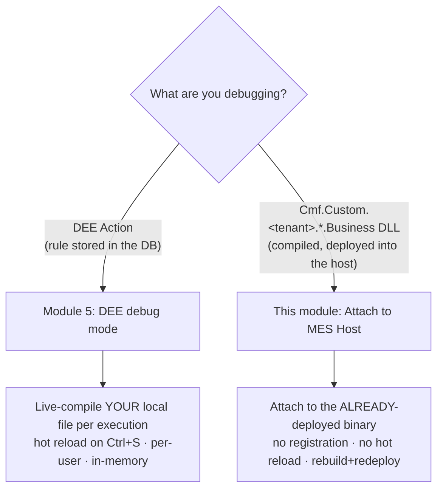
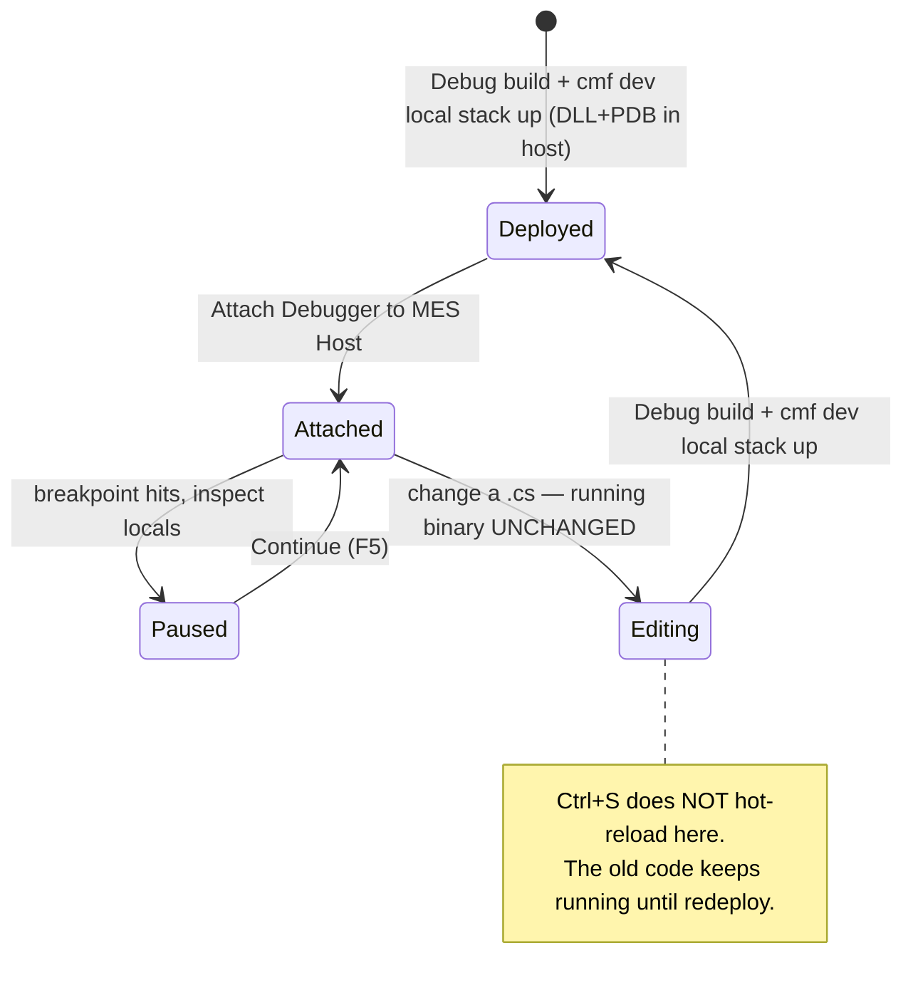

# Module 8 — Debugging custom business DLLs (Attach to MES Host)

**Duration:** 60 min (self-paced) · 50 min (instructor-led)
**Required reading:** [User guide — DEE vs Business debugging](../user-guide/dee-vs-business-debugging.md)
**Prerequisites:** Module 5 (the debug-mode mental model and the attach machinery carry
over); a customization repo whose
`Cmf.Custom.<tenant>.*.Business` project is **built and deployed into your host**
(`cmf dev local stack up`); the Microsoft **C# extension** installed.

> **Elective / sibling module.** This is a *sibling* of Module 5, not a replacement.
> Module 5 debugs **DEE Actions** (database code, live-compiled per-user). This module
> debugs **compiled custom business DLLs** already loaded by the host. Same coreclr
> attach, same container transport — a different edit loop and a different source
> map. Take it once Module 5's mental model is solid.

## Learning objectives

After this module you can:

1. **Decide**, for the code you're debugging, whether it's a **DEE-action** breakpoint
   (needs Debug Mode) or a **custom-business** breakpoint (needs a deployed DLL) — both
   served by the one **Attach Debugger to MES Host** command.
2. **Explain** how the debugger finds your source — the paths recorded in the PDB at
   build time — why a local `cmf build` needs no source map, and when
   `deeDebugger.hostSourceMap` is needed.
3. **Perform** the no-hot-reload rebuild loop: edit → Debug build → `cmf dev local
   stack up` → re-attach, and **state** why `Ctrl+S` does nothing to the running binary here.
4. **State** the portable-PDB prerequisite and **explain** why the Module 5 host patch
   (**Patch Host for DEE Debugging**) does not affect business breakpoints.
5. **Diagnose** an unbound business breakpoint against the three standard causes.
6. **Recall** that business attach needs **no MES sign-in** — neither of the two
   credential methods is used for the attach itself.

## Key concepts

### 1. Two kinds of customization code → two debug loops

Customers write two kinds of C# for the MES, and they debug differently:



**One** command — **Attach Debugger to MES Host** — drives the coreclr debugger into the
host process with a **merged source map**, so a single session holds breakpoints in both
kinds of code. The difference is the **kind of breakpoint**, not the command:

| Breakpoint in… | DEE Action | compiled `Cmf.Custom.<tenant>.*.dll` |
|---|---|---|
| Binds against | the host-compiled local file | the **deployed** assembly |
| Needs a selected action / debug mode | yes (*Enable DEE Debug Mode*) | **no** |
| How the source is found (both merged in one attach) | DEE temp folder (automatic) | paths recorded in the PDB; `deeDebugger.hostSourceMap` only if it was built elsewhere |
| Edit loop | edit → `Ctrl+S` → **hot reload** | edit → **rebuild + redeploy** → re-attach |
| MES sign-in (a credential method) | yes (token identifies your user) | **no** — attach only |
| Registration / marker codec / file-stream | yes | none |

**Choose Attach to MES Host when** the code is compiled into a DLL and shipped in the
host image; **choose DEE debug mode** when the code is a rule you edit in the DEE
Explorer. If you find yourself wanting `Ctrl+S` to change behaviour, you wanted DEE.

### 2. How the debugger finds your source

A portable PDB records the path of every source file **as it was when the DLL was
built**, and the debugger opens that path. A local `cmf build` records your repo's
absolute paths (cmf-cli sets no `PathMap`) — for example
`/path/to/<project>/Cmf.Custom.Business/Cmf.Custom.Orchestration/Foo.cs`.
When VS Code sees the repo at that same path — the usual devcontainer and WSL layout —
the breakpoint binds with **no source map at all**.

```text
  Path recorded in the PDB                          Where your source is now
  ───────────────────────────────────────────      ─────────────────────────────────
  /path/to/proj/Cmf.Custom.Business/…/Foo.cs     =  /path/to/proj/…/Foo.cs      → binds, no map
  /agent/_work/proj/Cmf.Custom.Business/…/Foo.cs →  needs { "/agent/_work/proj": "${workspaceFolder}" }
```

- You need **`deeDebugger.hostSourceMap`** only when the recorded root differs from
  where your source lives now: the DLL was built in another folder or container, on a
  CI agent, or inside a container at `/src` (Critical Manufacturing's own host builds). Map the recorded
  root to your repo root.
- **Default** (setting empty/unset): `{ "/src": "${workspaceFolder}" }`. It covers
  `/src` container builds and is a harmless no-op for everything else.
- The recorded root is simply where the build ran: the repo's path on whatever
  machine or container ran `cmf build`.
- **Never** map to a per-assembly path. The map targets a **source root**.
  (`Cmf.Custom.Business` is only the folder holding `Business.sln`, not an assembly
  name — the assemblies are `Cmf.Custom.<tenant>.*.dll`.)

### 3. No hot reload — the rebuild loop

DEE debug mode recompiles your local file on every execution, so `Ctrl+S` changes the
next run. **Business attach has no such thing.** You are attached to the binary that was
compiled and deployed into the host image. Changing a `.cs` file does **nothing** to the
running process until you rebuild the DLL and redeploy it.



The loop, operationally:

1. Edit your `Cmf.Custom.<tenant>.*.Business` code in the workspace.
2. **Rebuild in Debug** — `cmf build --test` (its test step builds Debug) or
   `dotnet build Cmf.Custom.Business/Business.sln`. Both write the DLLs and PDBs to
   `LocalEnvironment/BusinessTier`. A plain `cmf build` builds Release into
   `Cmf.Custom.Business/Release/` and is **not** what gets deployed.
3. **Redeploy** — `cmf dev local stack up`. It compiles nothing: it rebuilds the host
   image as the base MES image plus a copy of `LocalEnvironment/BusinessTier`, and
   recreates the host container when the image changed — which it does after a new
   build (so `vsdbg` and, on 11.x, the host patch must be
   re-applied — the extension offers both).
4. **Re-attach** — Command Palette → *Attach Debugger to MES Host* (the prior
   session is gone; the process is new).
5. Trigger the operation that runs your business code; the breakpoint hits the **new**
   code.

Mistaking this for DEE (saving and expecting change) is the number-one confusion this
module preempts.

### 4. The portable-PDB prerequisite — not the Module 5 patch

For a business breakpoint to bind, the PDB deployed into the host must be
**portable-format**. That PDB comes from **your build** of the DLL, not from the host.
The Module 5 host patch (#158143, **Patch Host for DEE Debugging**) changes only how the
host compiles **DEE actions** (`Cmf.Foundation.Common.dll`); it does not touch your
DLLs or their PDBs. That is why, on an unpatched host, the attach warning says
DEE-action breakpoints will not bind but *custom-business DLL breakpoints are
unaffected*.

Two prerequisites, then, that are invisible until they bite:

- **Deployed:** the DLL **and** its PDB are in the host image — i.e. you built in
  Debug and then ran `cmf dev local stack up`.
- **Portable PDB:** the PDB built for your DLL is portable-format (the .NET SDK
  default, which `cmf build` keeps), so the Linux debugger can read it.

A one-time **prerequisites primer** (a modal with **Attach** / **Open guide**) reminds
you of these before your very first attach of any kind. It never shows again; choosing
**Open guide** opens the guide instead of attaching.

### 5. No MES sign-in for business attach

Recall the two-credential model from Modules 2–3: a **Personal Access Token** or a
**browser-copied access token** (there is **no** browser sign-in flow). Those identify
*your MES user* for REST calls — activating DEE debug mode, executing actions, saving.

**Business attach uses none of that.** It is a pure coreclr attach to the host process
over the container transport; there is no `ActivateDebugMode` call, no token in the
attach itself — it needs only exec access to the host container, the same access DEE
debugging uses. The success message says so (*"No MES sign-in is needed for the attach
itself"*) and also reminds you there is no hot reload for business code.

## Demo script (instructor variant)

*Setup: instructor stack up with a built `Cmf.Custom.<tenant>.Business` DLL deployed;
the customization repo open at its **root**; C# extension installed; a fresh host
container so the vsdbg install offer appears live.*

1. **Draw the fork first** (6 min). Whiteboard the two-kinds-of-code diagram. *Say:*
   "Same debugger, same host — the difference is the source map and the edit loop."
2. **Show there is no selected action** (3 min). Command Palette →
   *Attach Debugger to MES Host*. Point out: no DEE action selected, no debug
   badge, no token prompt. "Attach only. No MES sign-in."
3. **Where the source comes from** (6 min). Open Settings, show `hostSourceMap`
   empty. *Say:* "The PDB remembers where each file was at build time. We built in this
   devcontainer and debug from it, so the paths match — no map." Then show the case
   that needs one: copy the repo elsewhere (`cp -r <repo> /tmp/repo-copy`), open the
   copy in a second window, set a breakpoint there and attach — it stays hollow. Add
   `{ "<original repo path>": "${workspaceFolder}" }` and re-attach — it binds.
4. **Attach + vsdbg install** (6 min). Accept the one-time vsdbg install (narrate:
   "same install as Module 5, once per container"). One *Attaching to the MES host…*
   progress notification covers probe → install → resolve → attach (the install shows
   its own progress too).
5. **Hit a breakpoint** (6 min). Set a breakpoint in a business method; trigger the
   operation in the MES UI; it binds and hits; inspect locals. "Bound because the path
   recorded at build time is exactly where this file is."
6. **Prove no hot reload** (6 min). Change a string in the method, `Ctrl+S`, trigger
   again — **old** value. *Say:* "Nothing changed. This is attach, not live-compile."
   Then `cmf build --test` (or `dotnet build`) + `cmf dev local stack up`, re-attach,
   trigger — new value.
7. **Unbound-breakpoint feedback** (4 min). Set a breakpoint, then force it to stay
   unbound (the repo copy from step 3, without the map) and attach. If none of your breakpoints has
   bound about 8 seconds after attaching, the extension warns *"Your breakpoint(s)
   have not bound"*, names the most likely cause, and offers **Show Log** (all three
   causes) and **Open guide**.

## Hands-on exercise

On your own stack (with a built + deployed `Cmf.Custom.<tenant>.*.Business` DLL), repo
open at its **root**.

1. Command Palette → *Attach Debugger to MES Host*. If the C# extension is
   missing, install it via the offered button and retry. If the one-time primer
   appears, choose **Attach**; accept the vsdbg install if offered.
2. Confirm the debug toolbar appears **without** any DEE action selected and **without**
   a token prompt.
3. Set a breakpoint inside a `Cmf.Custom.<tenant>.*.Business` method; trigger the
   operation that runs it (from the MES UI or an integration). Confirm it binds and
   hits; inspect a local.
4. **No-hot-reload proof:** change a value in that method, `Ctrl+S`, trigger again —
   confirm the breakpoint hits the **old** value (nothing changed).
5. **Rebuild loop:** `dotnet build Cmf.Custom.Business/Business.sln`, then
   `cmf dev local stack up`; re-attach (accept the vsdbg install again — the container
   was recreated); trigger — confirm the
   breakpoint now hits the **new** value.
6. **Source-map drill:** copy the repo to another path and open the copy in a new
   window. Set a breakpoint in the copy and attach — confirm it stays hollow (the PDB
   points at the original path). Add `{ "<original repo path>": "${workspaceFolder}" }`
   to `hostSourceMap`, re-attach, and confirm it binds.
7. Disconnect the debugger.

**Success criteria:**

- [ ] Attached to the host with **no** DEE action selected and **no** MES sign-in.
- [ ] Breakpoint bound and hit in a compiled business method.
- [ ] No-hot-reload proven: value unchanged after `Ctrl+S`, changed only after
      rebuild + redeploy.
- [ ] Moved-repo case reproduced and fixed via `hostSourceMap`.
- [ ] Debugger disconnected at the end.

## Common mistakes to preempt

- **Expecting `Ctrl+S` to change behaviour.** That is DEE. Business code needs a
  Debug build + `cmf dev local stack up` + re-attach — full stop.
- **Running a plain `cmf build` before `stack up`.** It builds Release into
  `Cmf.Custom.Business/Release/`; `stack up` deploys `LocalEnvironment/BusinessTier`,
  so the host keeps the old DLL. Use `cmf build --test` or `dotnet build`.
- **Debugging a copy of the repo, or a DLL built elsewhere, without a map.** The PDB
  points at the paths used at build time; map that root to where your source is now.
  (Opening a sub-folder of the same repo is fine — the recorded paths are absolute.)
- **Expecting the host patch to fix business breakpoints.** **Patch Host for DEE
  Debugging** fixes DEE-action debug compiles only. A business breakpoint needs a
  portable PDB from your own build, deployed next to the DLL.
- **Forgetting to redeploy before attaching.** Attaching to a host that still has the
  old DLL debugs the old code — the running binary is whatever was last deployed.
- **Looking for a token prompt.** There isn't one; business attach needs no MES sign-in.
- **Expecting a separate "business" command.** There's one attach — *Attach Debugger to
  MES Host* — covering both kinds of code; a *business* breakpoint just needs the
  deployed DLL/PDB whose recorded source paths resolve (no debug mode), while a *DEE*
  breakpoint needs *Enable DEE Debug Mode* on the action.

## Knowledge check

**Q1.** You are debugging code compiled into `Cmf.Custom.<tenant>.Orchestration.dll`
deployed into the host. Which command, and does it need a selected DEE action?
- A. A separate business-only attach command; yes, select the action first
- B. Attach Debugger to MES Host; no action selected, no debug mode ✔
- C. Enable DEE Debug Mode, then attach
- D. There is no way to debug business DLLs

*Rationale: the single Attach Debugger to MES Host binds business breakpoints registration-free through the source paths recorded in the deployed PDB (no DEE action, no debug mode); DEE breakpoints in the same session need Debug Mode.*

**Q2.** After attaching to a business DLL, your breakpoint stays hollow. The PDB is
portable and the DLL was just redeployed. What is the next most likely cause?
- A. You forgot to sign in to the MES
- B. The source paths recorded in the PDB don't match where your source is (the DLL was built elsewhere, or you are debugging a copy) — map them with `hostSourceMap` ✔
- C. vsdbg is not installed
- D. Debug mode was lost on host restart

*Rationale: the debugger opens the build-time paths from the PDB; if they don't exist here, nothing binds until a map points them at your source. With PDB format and deploy ruled out, that is the suspect.*

**Q3.** With a business debug session attached, you edit a `.cs` file and press
`Ctrl+S`, then trigger the operation. What runs?
- A. Your new code — save hot-reloads it
- B. The old code — there is no hot reload; you must rebuild in Debug and `cmf dev local stack up`, then re-attach ✔
- C. Nothing — the file is locked
- D. Your new code, but without breakpoints

*Rationale: business attach targets the deployed binary; only rebuild+redeploy changes it.*

**Q4.** Which credential does business attach use for the attach itself?
- A. A Personal Access Token
- B. A browser-copied access token
- C. A browser sign-in flow
- D. None — it is a coreclr attach with no MES sign-in ✔

*Rationale: the two credential methods identify your MES user for REST; business attach makes no such call.*

**Q5.** You attach to an unpatched MES 11.x Linux host and get the warning that the
host is not patched for DEE debugging (#158143). Which breakpoints does that affect?
- A. All breakpoints — nothing binds until the host is patched
- B. DEE-action breakpoints only; custom-business DLL breakpoints are unaffected ✔
- C. Custom-business DLL breakpoints only
- D. None — the warning is informational

*Rationale: the host patch changes only how the host compiles DEE actions; a business DLL's PDB comes from your build. The attach warning itself says custom-business DLL breakpoints are unaffected.*

---

Back to the [course overview](course-overview.md) · Sibling of
[Module 5 — Debugging DEE actions live](module-05-debugging.md).
