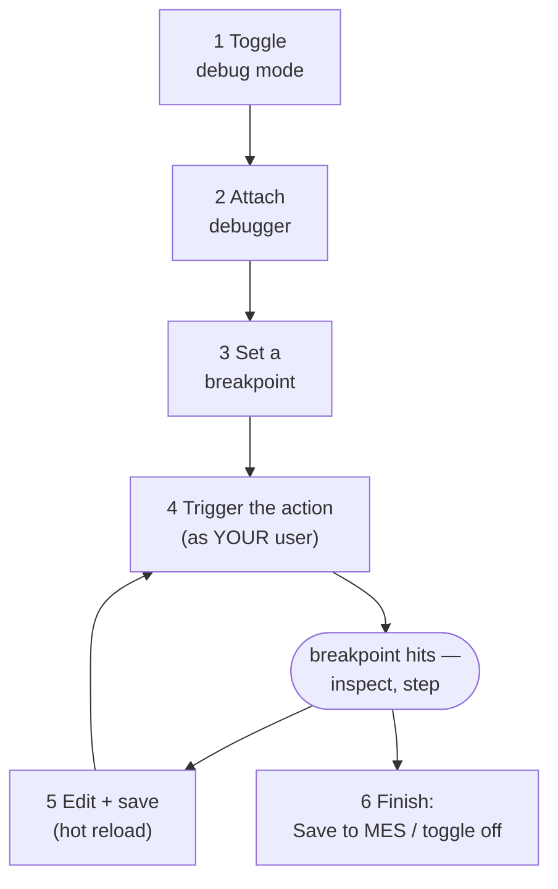
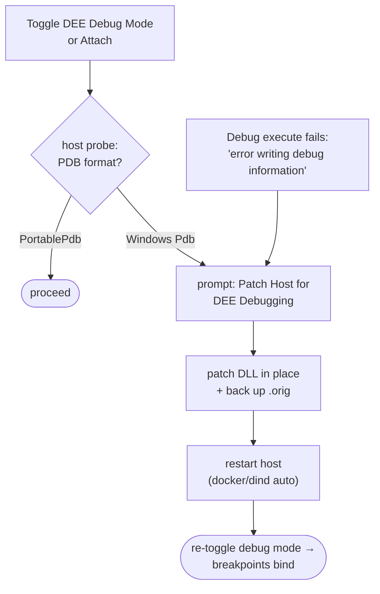
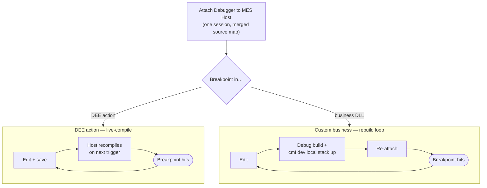
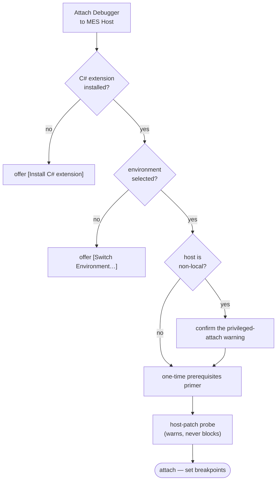

# Debugging DEE actions

> **Warning:** DEE debug mode and debugger attach are for **development and test
> environments only**. Attaching a debugger to a host is highly privileged, and a
> paused host stops the entire MES for everyone using it. The extension warns you
> before attaching to a non-local address; treat that warning seriously.

## The mental model

Understand this first — everything else about debugging follows from it.

When you enable **DEE debug mode** for an action, the MES host stops using the code
stored in its database *for you*. Instead, every time *you* trigger the action, it
compiles your **local file** (the extension delivers it into the host container) with
debug symbols. Five consequences:

1. **It's per-user.** The debug registration is keyed to the user your token belongs
   to. Only operations executed **as that user** run your file's code and can hit your
   breakpoints. Everyone else — colleagues, integrations, other accounts — keeps
   executing the normal database version, completely unaffected. This also means: if
   you trigger the action from the MES UI logged in as a different account, your
   breakpoint will never hit. See the
   [FAQ](faq.md#why-does-my-breakpoint-never-hit-even-though-the-action-runs).
2. **It's in-memory.** The registration lives in the host process's memory. A host
   restart (container restart, stack recreate, redeploy) silently forgets it. The
   extension notices on the next DEE Explorer refresh and asks whether to
   re-enable — see [host restarts](#what-happens-when-the-host-restarts).
3. **Hot reload, no save-to-MES needed.** While debug mode is on, every time you save
   the file (`Ctrl+S`), the extension pushes it to the host, and your **next**
   execution compiles and runs the new code. You iterate — edit, save, trigger,
   inspect — without ever running **Save Action to MES**. The database version doesn't
   change until you explicitly save to MES.
4. **The database is untouched until you say so.** Turning debug mode off returns you
   to the stored version instantly. If you like your changes, publish them with
   **Save Action to MES (Compile & Save)** — that's the moment they become real for
   all users.
5. **A paused host is a stopped MES.** .NET debugging suspends the **entire host
   process** while stopped at a breakpoint. See
   [everything freezes](#while-you-are-paused-everything-freezes).

## Before your first debug session

- The Microsoft **C# extension** must be installed (it comes automatically with this
  extension).
- Your environment must be able to reach the host container — if **Enable DEE Debug
  Mode** or **Attach** fail with container errors, fix the
  [environment](environments.md#which-connection-type-am-i-decision-tree) first.
- **Linux MES hosts up to 11.x need a one-time host-side fix.** You don't have to
  remember it: the extension checks the host when you enable debug mode or attach and
  offers to apply the fix. MES 12 images already contain it. Background in
  [the Linux host prerequisite](#linux-mes-hosts-the-pdb-prerequisite).

## The debug loop, step by step



### 1. Toggle debug mode on

Right-click the action in the **DEE Explorer** → **Enable DEE Debug Mode** (or the bug
icon on the row; the same entry reads **Disable DEE Debug Mode** while it is on — the
Command Palette offers the state-agnostic **Toggle DEE Debug Mode**). The extension copies
your local file into the host container, registers debug mode with the MES, and opens the
file. The action gets a **DEBUG** badge and a bug icon, the status bar shows how many
actions are in debug mode, and a dialog asks **Attach the debugger now?** (**Attach
Debugger** / **Not Now**) — its detail text states the semantics (per-user, in-memory, hot
reload). Set `deeDebugger.attachAfterEnablingDebug` to `always` or `never` to skip the
question; it is never asked while the debugger is already attached.

(If the action has no local file yet, the extension downloads it first. For a `DeeDevBase`
file, the [working copy](editing-and-uploading.md#deedevbase-files-working-copies) is what gets
debugged. On a
containerized host the extension also checks the Linux PDB prerequisite at this point —
see [below](#linux-mes-hosts-the-pdb-prerequisite).)

### 2. Attach the debugger

Choose **Attach Debugger** in that dialog, or run **DEE Debugger: Attach Debugger to MES
Host** (also the debug icon in the DEE Explorer's title bar) any time.

- **First time on a fresh container:** the .NET debugger (`vsdbg`) isn't in the MES
  host image. The extension detects this and offers to install it (**Install vsdbg**) —
  say yes. On MES 12 hosts the image has `curl`, so it downloads inside the container
  (the container needs internet access). MES 11.x images have no download tool, so the
  extension downloads `vsdbg` on your machine and streams it into the container — that
  needs internet access plus `bash` and `tar` locally (on Windows, run VS Code in WSL).
- The extension finds the MES host process automatically. If it ever shows a process
  picker instead, choose the `dotnet` process running
  `Cmf.Foundation.Services.HostService.dll` — **not** the `CmfEntrypoint` wrapper
  (PID 1), which can't be attached to.

You're attached when VS Code's debug toolbar appears and the extension shows
*"Attached to the MES host. …"*.

> **Kubernetes / OpenShift environments** need two things in the host pod spec, because
> there is no privileged-exec workaround on clusters:
>
> - `securityContext.capabilities.add: ["SYS_PTRACE"]` on the host container;
> - since the host image runs as a non-root user (and added capabilities are dropped for
>   non-root users), either `runAsUser: 0` on that container or
>   `kernel.yama.ptrace_scope=0` on the node.
>
> The extension checks this before attaching and tells you exactly what is missing. See
> the [per-type setup notes](environments.md#kubernetes-kubectl-and-openshift-oc).

### 3. Set a breakpoint

Click in the gutter next to a line **inside the action-code markers** of your file.

> **Note:** The breakpoint may show as a hollow circle (unbound) at first. That's
> normal — the debug-compiled assembly only loads when the action first executes.
> It fills in solid at that moment and hits.

### 4. Trigger the action

Make the MES execute the action **as your user**:

- Perform the hooked operation in the MES UI, **logged in as the same account your
  token belongs to** — e.g. create a Material to hit a
  `…CreateMaterial.Pre` action; or
- Right-click the action → **Execute Action…** for a direct run with a JSON input of
  your choosing (this always runs as your token's user). The execute call waits while
  you sit at the breakpoint; after 60 seconds the extension gives up on it and reports
  that it could not reach the MES host — with a hint that the host is probably paused.

The breakpoint hits: you can inspect `Input` and other locals, step, and continue.

### 5. Iterate

Change the code inside the markers, save — the status bar flashes
**DEE: pushed … to host** — and trigger again. The new code runs. No upload, no
recompile step on your side.

### 6. Finish

- Happy with the change? **Save Action to MES (Compile & Save)** to publish it for
  everyone. See [the save semantics](editing-and-uploading.md#the-three-ways-to-save).
- Right-click → **Disable DEE Debug Mode** to turn debug off — the stored version takes
  over again for you. If you close the VS Code window with debug mode still on, the
  extension cleans up your registrations on the way out (best effort).
- Disconnect the debugger with the debug toolbar's disconnect button (see below).

## Debug session controls (Continue, Disconnect, …)

Once attached, VS Code shows the **debug toolbar**. Because this is an **attach** session (you
attached to the already-running MES host — you didn't launch it), the controls behave a little
differently from launching an app. What each does:

| Control | Shortcut | What it does here |
|---|---|---|
| **Continue** | `F5` | Resumes the host and **keeps the debugger attached**. Use this after a breakpoint — it un-freezes the MES so it (and your next trigger) can run. |
| **Pause** | — | Manually suspends the host. Avoid on shared stacks — it freezes the whole MES. |
| **Step Over / Into / Out** | `F10` / `F11` / `Shift+F11` | Normal stepping while paused. **Step Into** can enter product `Cmf.*` code you have no source for ("no source available") — use **Step Over** to stay in your code. |
| **Disconnect** (the red "stop" icon) | `Shift+F5` | **Ends the debug session by DETACHING** — vsdbg lets go and the host keeps running. This is how you finish debugging. It does **not** stop or kill the MES host. |
| **Restart** | `Ctrl+Shift+F5` | Detaches and re-attaches. Rarely needed; if the host was restarted, just re-run **Attach** instead. |

!!! warning "Always Disconnect (Shift+F5) when you're done — and don't leave the host paused"
    A debug session that ends *uncleanly* (you close the VS Code window or the WSL/remote
    connection drops while still attached, especially while **paused**) can leave the debugger
    attached with the host's request threads suspended. The host then answers `/` but **every
    `/api` call hangs** — the extension looks broken with "could not reach the MES host" timeouts.
    Killing the debugger process does **not** recover it; only **restarting the host container**
    does. So: **Continue (`F5`) off any breakpoint** before you step away, and **Disconnect
    (`Shift+F5`)** when finished rather than just closing the window.

    The extension detaches its own attach sessions automatically when it shuts down normally, so a
    routine window close is safe — but a crash or dropped remote connection can still orphan the
    debugger. If you hit the "host answers but `/api` hangs" symptom, restart the MES host.

**Disconnect vs. Disable DEE Debug Mode** — two independent things:

- **Disconnect** ends the *debugger* (vsdbg) session. Your DEE Debug Mode registration is
  untouched — the host still compiles your local file on the next trigger (the status bar
  keeps showing the `🐞` count as a reminder).
- **Disable DEE Debug Mode** ends the *host-side registration* — the stored database version
  runs again. It does not detach the debugger.

Finishing a debug session cleanly usually means both: **Disable DEE Debug Mode**, then
**Disconnect**.

## While you are paused, everything freezes

While the debugger has the host stopped — at a breakpoint, stepped, paused, or on an
exception — the **entire MES host process is suspended**. The MES UI stops responding,
API calls time out, colleagues on the same instance are blocked, and even this
extension's own tree refreshes fail. This is normal .NET debugging behavior, not an
outage.

> **Note:** If you see "could not reach the MES host" errors while a debug session is
> active, the extension reminds you the host is probably paused. Press **Continue**
> (`F5`) and retry. And on a shared dev instance, be a good neighbor: don't stay
> paused for long.

## What happens when the host restarts

Because debug registrations are in-memory, a host restart (someone recreated the
stack, the container crashed, an install ran) drops them — while your local file, your
DEBUG badge, and your attached session know nothing about it. The extension reconciles
with the server on every refresh: when it finds your debug mode gone, it tells you
**debug mode was lost** and offers to **re-enable** it. Accept, re-attach if needed,
and carry on. (After a full stack recreate on a Linux host, you may also need to
re-apply the PDB patch — next section.)

## Linux MES hosts: the PDB prerequisite

MES releases up to **11.x** have a product bug (#158143) that breaks DEE debug mode on
**Linux-containerized hosts** (the default for local stacks): the host generates debug
symbols in a Windows-only format, so executing an action in debug mode fails with an
error like the one below. **MES 12 images already contain the fix**; the probe described
here simply reports them as fine.

```
The Action <name> code is invalid: … Unexpected error writing debug information --
'Value cannot be null. (Parameter 'type')'
```

On an affected host the extension can patch it for you: run
**DEE Debugger: Patch Host for DEE Debugging (dev/test)…**. It flips the one setting in
the host's `Cmf.Foundation.Common.dll` to emit the cross-platform PortablePdb format,
backs up the original (`.orig`), and restarts the host. The patcher runs inside the
container, under the host's own .NET runtime.



- **You are told up front.** Before enabling debug mode on a containerized host, and before
  attaching, the extension probes the host (a read-only run of the bundled patcher) and, if
  the host still emits Windows-only symbols, asks **Patch Host for Debugging** / **Continue
  Anyway**. Without this, the failure happens out of sight: you trigger the action from the
  MES UI, the host fails to compile the debug build, and your breakpoint simply never binds.
  The attach-time warning does not block (custom-business DLL breakpoints need no patch), and
  the "breakpoints have not bound" notice also carries the patch button when the host is known
  to be unpatched. Set `deeDebugger.hostPatchCheck` to `off` to skip the probe.
- When a debug execute fails with the error above, the error notification offers a
  **Patch Host for Debugging…** button directly.
- It's a **dev/test-only** action (it modifies a product assembly). Run directly, the
  command asks you to confirm (**Patch host**); from one of the prompts above, your click
  counts as that confirmation. The same non-local-host warning as attach applies.
- **Docker / docker-in-docker** hosts are restarted automatically; on **Kubernetes /
  OpenShift** the command patches and then tells you the `rollout restart` to run.
- Undo any time with **Restore Host DLL (undo debug patch)…**.
- Set `deeDebugger.hostAppDir` if your host keeps the app somewhere other than `/opt/app`.

> **Note:** The patch lives in the container's writable layer. Recreating the stack
> (`cmf dev local stack down` / `up`) reverts it — just run the patch command again. A
> plain restart keeps the patch but clears debug registrations (previous section).
> The manual `tools/host-pdb-patcher` tool remains for scripted/CI use.

## Load-balanced environments

If the environment runs several host instances behind a load balancer, your debug
registration and your attach both live on **one** instance — but the balancer may send
executions to another, where the stored version runs and no breakpoint exists. Point
your environment's host address directly at a single instance while debugging.

On **Kubernetes/OpenShift** this is the default posture whenever the host deployment
has more than one replica — *four* things must land on the same replica (the
activation call, the pushed file, the trigger, and the attached debugger). Either
scale to one replica while debugging
(`kubectl scale deployment/host --replicas=1 -n <namespace>`) or pin everything to one
pod with `kubectl port-forward` — the recipe and a diagram of the failure mode are in
[How debugging works](how-debugging-works.md#multi-replica-clusters-why-pinning-is-mandatory).

## Attaching for custom business debugging

Everything above debugs **DEE Actions** — C# rules stored in the MES database. But an MES
customization also has **custom business projects**: `Cmf.Custom.<tenant>.*` code compiled
into DLLs and deployed into the host image (`Cmf.Custom.Business` is only the folder holding
`Business.sln` — the assemblies themselves carry the tenant in the name).

**The same command debugs both.** **DEE Debugger: Attach Debugger to MES Host** attaches the
stock `coreclr` debugger to the MES host **once**, with a source map that covers *both* DEE
temp files *and* your deployed business DLLs — so a breakpoint binds wherever the matching code
runs. You no longer choose "which attach"; you attach and set breakpoints where you need them.
For the full contrast see [DEE vs custom-business debugging](dee-vs-business-debugging.md).

| Breakpoint in… | Binds against | Source map (merged automatically) | Edit loop |
|---|---|---|---|
| A **DEE Action** | the host-compiled local file (Debug Mode on) | the DEE temp folder | live-compile — edit, save, re-trigger |
| A **`Cmf.Custom.<tenant>.*` DLL** | the **deployed** assembly | the paths recorded in its PDB (`deeDebugger.hostSourceMap` only if it was built elsewhere) | rebuild + redeploy + re-attach |

!!! note "Two different edit loops, one attach"
    DEE debugging **hot-reloads** — the host recompiles your file on every trigger (see the
    [mental model](#the-mental-model)). Custom-business breakpoints bind against the
    **already-deployed binary**: there is **no hot-reload** — rebuild in Debug, redeploy
    with `cmf dev local stack up`, then re-attach (see [the prerequisites](#the-three-prerequisites)). The single attach carries both source maps, so
    you can hold breakpoints in both at the same time. (*Enable DEE Debug Mode* is still what
    makes the host run your local DEE file; business DLLs need no such registration.)



!!! note "Platform code has no source"
    The host makes **every `Cmf.*` assembly** debuggable — platform (`Cmf.Foundation.*`, `Cmf.*`)
    as well as your `Cmf.Custom.*`. You only have source for **your customization**, so a
    breakpoint binds only in `Cmf.Custom.*`; stepping into product `Cmf.*` shows "no source
    available" (expected). Attach uses `justMyCode: false`, so **Step Over** to stay in your code.
    See [DEE vs custom-business debugging → which assemblies are debuggable](dee-vs-business-debugging.md#which-assemblies-are-debuggable-and-which-you-have-source-for).

### How business breakpoints find your source

A portable PDB records the path of every source file **as it was when the DLL was built**, and
the debugger opens that path. A local `cmf build` records your repo's absolute paths (cmf-cli sets
no `PathMap`), for example `/path/to/<project>/Cmf.Custom.Business/Cmf.Custom.Orchestration/Foo.cs`.
When VS Code sees your repo at that same path — the usual devcontainer and WSL layout — business
breakpoints bind with **no source map at all**.

```
   path recorded in the PDB                         where your source is now
   ─────────────────────────────────────────       ─────────────────────────────────
   /path/to/proj/Cmf.Custom.Business/…/Foo.cs    =  /path/to/proj/…/Foo.cs       → binds, no map
   /agent/_work/proj/Cmf.Custom.Business/…/Foo.cs → map { "/agent/_work/proj": "${workspaceFolder}" }
```

- Set **`deeDebugger.hostSourceMap`** only when the recorded root differs from where your source
  lives now: the DLL was built in another folder or container, on a CI agent, or inside a
  container at `/src` (how Critical Manufacturing builds the platform itself). Map the recorded root to your repo root.
- Leave it empty to use the default `{ "/src": "${workspaceFolder}" }`, which covers `/src`
  container builds and is a harmless no-op for everything else.
- The recorded root is simply the repo's path on the machine or container that ran `cmf build`.
  Opening a sub-folder of the same repo doesn't matter — the recorded paths are absolute.

### Running it, step by step

Run **DEE Debugger: Attach Debugger to MES Host** — from the Command Palette (`Ctrl+Shift+P`),
the debug icon in the DEE Explorer title bar, or the **Attach Debugger** button in the dialog
that follows **Enable DEE Debug Mode**. It's the same command everywhere. Before it attaches,
the extension walks a few checks:



1. **C# extension** must be installed (it ships with this extension); if it's missing you get an
   **[Install C# extension]** button.
2. An **environment must be selected**; if none is, an **[Switch Environment…]** button takes you
   there. (No MES sign-in / token is needed for the attach *itself* — attach is lower-privilege
   than DEE debug mode. You still select an environment because that's how the extension knows
   which host to reach.)
3. Attaching to a **non-local host** asks you to confirm the privileged-attach warning
   (**Continue**).
4. The **first time only**, a prerequisites primer lists what makes a breakpoint bind, for DEE
   actions and for business code (the three business prerequisites are below). Choose
   **Attach** to go on, or **Open guide** to read the guide first (this cancels the attach).
   Once you have answered it with either button, it doesn't show again.
5. On a containerized host, the extension probes for the
   [Linux PDB prerequisite](#linux-mes-hosts-the-pdb-prerequisite). If the host is unpatched
   you get a warning with **Patch Host for Debugging**, but the attach continues.

You're attached when the debug toolbar appears. Set breakpoints in your `Cmf.Custom.*` code —
they bind when the deployed code runs. If none of your enabled breakpoints has bound 8 seconds
after the attach, the extension shows the likely causes with **Show Log** / **Open guide**
buttons (plus **Patch Host for Debugging** when the host is known to be unpatched). DEE
breakpoints whose action hasn't run yet also count as unbound here.

### The three prerequisites

Custom-business attach has no code of its own on the host — it binds against whatever is deployed,
so all three of these must already be true:

1. **The DLLs and PDBs are deployed** into the host image. `cmf dev local stack up` builds the
   host image from the base MES image plus a copy of **`LocalEnvironment/BusinessTier`**, and
   recreates the host container when that image changed (it does after a new build) — it
   compiles nothing. That folder is the output of a **Debug**
   build: `cmf build --test` (its test step builds Debug) or `dotnet build Cmf.Custom.Business/Business.sln`.
   A plain `cmf build` builds **Release** into `Cmf.Custom.Business/Release/` and does not change
   what `stack up` deploys. Recreating the container also removes `vsdbg` (and, on 11.x, the host
   patch) and drops DEE debug registrations — the extension offers each again. Attach itself
   does **not** build or deploy anything.
2. **The PDBs are portable-format.** The debugger on a Linux host reads only portable PDBs.
   `cmf build` already emits portable PDBs for your DLLs. The host patch
   ([Linux PDB prerequisite](#linux-mes-hosts-the-pdb-prerequisite), #158143) is a different
   fix: it changes only how the host compiles DEE actions, not your DLLs' PDBs.
3. **The recorded source paths resolve** — automatic when you build and debug at the same
   path; otherwise set `deeDebugger.hostSourceMap` (see above).

While paused, the [whole host freezes](#while-you-are-paused-everything-freezes) exactly as with
DEE debugging, and [load-balanced / multi-replica](#load-balanced-environments) environments need
the same pinning.

## How it all works under the hood

Curious why debug mode is per-user, why restarts lose it, or what the host actually
compiles? [How debugging works](how-debugging-works.md) walks the client and host
internals with diagrams.

## Related pages

- [Tutorial: your first DEE debug session](tutorial-first-dee-debug.md) — this whole
  loop, guided.
- [Troubleshooting](troubleshooting.md#debugging-problems) — attach failures, unbound
  breakpoints, and the Linux compile error.
- [FAQ](faq.md) — per-user semantics questions.
