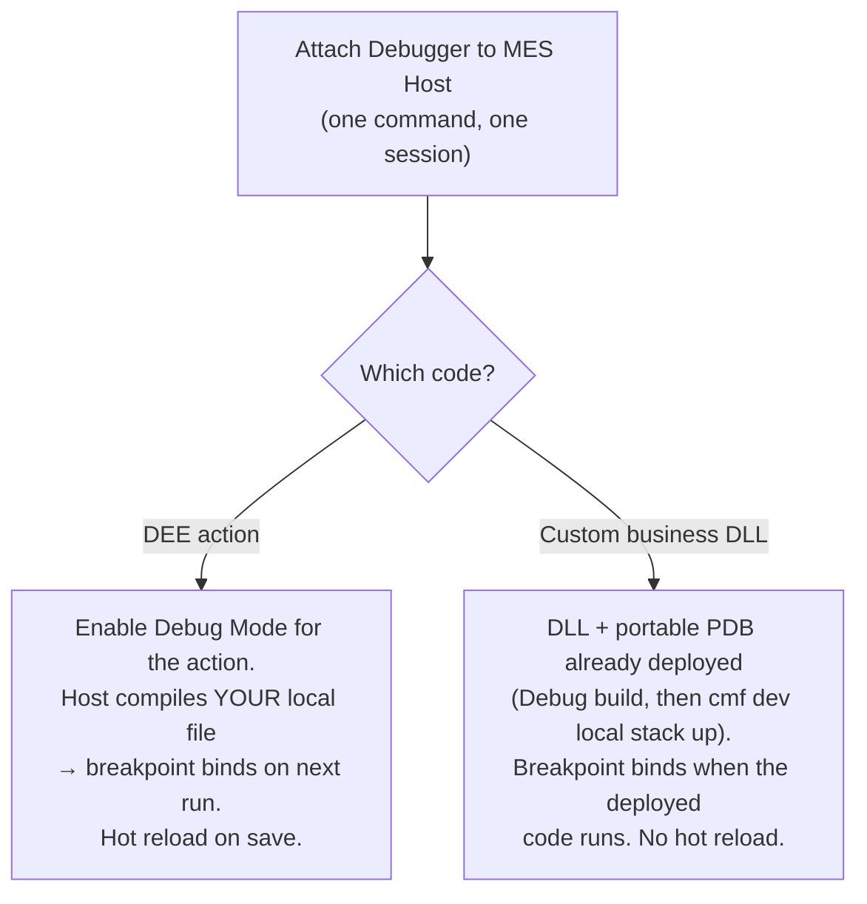

# DEE vs custom-business debugging

One command — **DEE Debugger: Attach Debugger to MES Host** — debugs *both* kinds of MES
customization C#. It attaches the .NET debugger to the running MES host once, with a source
map that covers both, so a breakpoint binds wherever the matching code runs.



## Which assemblies are debuggable — and which you have source for

The MES host makes **every assembly whose name starts with `Cmf.`** debuggable — it deploys
PDBs for them all. That's **two groups**:

- **Platform** — `Cmf.Foundation.*`, `Cmf.*`. Debuggable, but you normally have
  **no source** for it.
- **Your customization** — `Cmf.Custom.<tenant>.*`. Debuggable **and** you have the source.

The attach binds a breakpoint to source only where the source **exists locally**. Your
`Cmf.Custom.*` PDBs record the paths your build used — normally your own repo's paths, so they
resolve directly (or through `hostSourceMap` when the DLL was built elsewhere). Platform PDBs
record Critical Manufacturing's build paths (under `/src/`), which aren't in your repo, so they resolve
to nothing: a breakpoint there won't bind, and **stepping into product `Cmf.*` code shows "no source available."** That's expected,
not a failure — you can only meaningfully set breakpoints in code you have the source for.

!!! tip "Staying in your own code"
    The attach uses `justMyCode: false` (DEE debugging needs it), so **Step Into** can descend
    into product `Cmf.*` frames that have no source. Use **Step Over** (`F10`), or set your
    breakpoints inside your `Cmf.Custom.*` code, to stay in code you can see.

## The two edit loops

| | DEE action | Custom business DLL (`Cmf.Custom.<tenant>.*`) |
|---|---|---|
| What runs | Host **compiles your local `.cs`** while Debug Mode is on | The **deployed, pre-built** assembly |
| Prerequisite | *Enable DEE Debug Mode* on the action (on MES 11.x Linux hosts, also the [host patch](debugging.md#linux-mes-hosts-the-pdb-prerequisite), #158143) | DLL + **portable** PDB deployed via `cmf dev local stack up` (the host patch does not change these PDBs) |
| Source map | DEE temp folder → your file (automatic) | none needed when you build and debug at the same path; `deeDebugger.hostSourceMap` maps a different build root (default `{ "/src": "${workspaceFolder}" }`) |
| Change code | Edit → **save** → re-trigger (**hot reload**) | Edit → **Debug build** (`cmf build --test` or `dotnet build`) **+ `cmf dev local stack up`** → **re-attach** (no hot reload) |
| MES sign-in | Needed to load/run actions | **Not needed for the attach itself** |

## How the one attach covers both

The attach builds a **merged** `sourceFileMap` — the DEE temp folder *and* the business map —
so `coreclr` resolves each breakpoint against whichever PDB matches. Business PDBs whose recorded
paths already exist on this machine need no entry at all:

```text
sourceFileMap:
  /tmp/CriticalManufacturing/dee-debug  →  ${workspaceFolder}      # DEE actions (subfolders mirrored)
  /src                                   →  ${workspaceFolder}      # default business entry (container builds)
```

You don't choose "DEE attach" vs "business attach" — you attach once and set breakpoints
wherever you need them. (*Enable DEE Debug Mode* is still separate: it's what makes the host
run your local DEE file with hot reload; business DLLs need no such registration.)

## If a breakpoint won't bind

A hollow (unbound) breakpoint is the common first hurdle. Most likely, in order:

1. **Custom business:** the deployed DLL/PDB is **stale** — rebuild in Debug (`cmf build --test` or `dotnet build`; a plain Release `cmf build` does not update `LocalEnvironment/BusinessTier`), run `cmf dev local stack up`, then re-attach.
2. **Custom business:** the PDB isn't **portable** — rebuild the DLLs with portable PDBs and redeploy. (**Patch Host for DEE Debugging** does not help here: it only changes how the host compiles DEE actions.)
3. **Custom business:** the source paths recorded in the PDB don't exist here — the DLL was built in another folder, container or on CI, or you are debugging a copy of the repo. Map that build root with `deeDebugger.hostSourceMap`, e.g. `{ "/path/used/at/build": "${workspaceFolder}" }`.
4. **DEE action:** Debug Mode isn't on for that action, you triggered it as a different user than your token's, or (MES 11.x Linux host) the host isn't [patched](debugging.md#linux-mes-hosts-the-pdb-prerequisite).

See [Debugging → Attaching for custom business debugging](debugging.md#attaching-for-custom-business-debugging) for the full flow, and [Troubleshooting](troubleshooting.md) for symptoms.
