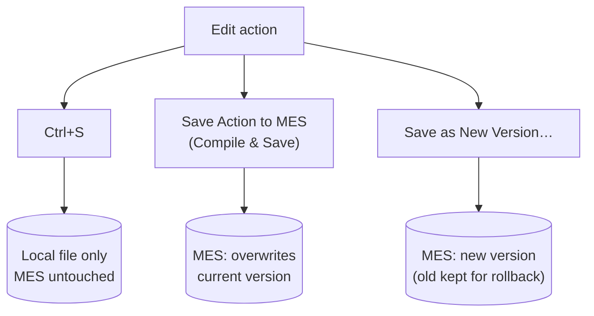

# Editing and uploading actions

This page covers the single-action editing loop: open, edit safely, save back to the
MES, and deal with compile errors, versions, and conflicts. For bulk operations across
your whole project, see [Sync](sync.md).

## Opening an action

Click an action in the **DEE Explorer**. The extension looks for `<ActionName>.cs` in your
DEEs folders, subfolders included, and opens the right file:

- **You already have the file in the MES format** (the generated markers): it opens in place,
  wherever it lives. If its code differs from the MES version, a notice offers **Compare** and
  **Reload from MES**. Opening never replaces your file with the MES version on its own.
- **You have the file in the cmf-cli `DeeDevBase` format**: your file is not touched. A working
  copy opens instead (see [DeeDevBase files: working copies](#deedevbase-files-working-copies)).
- **You have no file yet**: the extension downloads the action as `<ActionName>.cs` into your
  primary DEEs folder.

The DEEs folders are auto-detected: every folder that contains `DeeDevBase.cs`, one per Data
package. You can also list them in the **deeDebugger.deesFolder** setting; the first one is the
primary folder. A downloaded file is a complete, compilable C# file: `using` directives, a
generated wrapper class, and — inside four marker comments — your action code and test
condition.

If two Data packages both contain `<ActionName>.cs`, the extension doesn't guess: it lists both
files and asks you to keep one, or to limit **deeDebugger.deesFolder** to one package. It also
never overwrites a file of that name that has damaged markers; fix or move the file first.

If your workspace contains the standard Actions project (`Cmf.Custom.Data/DEEs` with
its `.csproj` and `DeeDevBase.cs`), the C# extension gives you IntelliSense,
navigation, and local squiggles on these files automatically.

## DeeDevBase files: working copies

Projects created with cmf-cli often keep DEEs in the `DeeDevBase` format
(`//---Start DEE Code---` markers and a `DeeDevBase` base class). The MES host can only debug
the MES format, and it rewrites the file it debugs. So the extension never edits or debugs a
`DeeDevBase` file directly:

1. Opening the action creates a **working copy** in the MES format, with your file's code,
   under `.dee-debug/` at the root of your workspace. The path below `.dee-debug/` mirrors your
   file's path, so files in different packages never collide.
2. You edit, save to the MES and debug the working copy, exactly like any other DEE file.
3. After each successful **Save Action to MES**, the extension offers **Write Back**. It copies
   the code into your `DeeDevBase` file and keeps that file's layout and line endings. You can
   also run **Write Code Back to Source File** from the editor title or the action's
   right-click menu at any time.
4. If you edit and save the `DeeDevBase` file itself, its code is copied into the working copy.
   With debug mode on, that change is pushed to the host as usual.

`.dee-debug/` contains its own `.gitignore`, so working copies are never committed. It sits
outside every `DEEs` folder, so `cmf build` never packages them. Commit only your `DeeDevBase`
file.

## Creating a new action

Click **＋ New DEE Action…** in the DEE Explorer title (or run it from the Command
Palette). You are asked for:

1. **Name** — a C# identifier (letters, digits, underscores; starts with a letter), unique
   on this MES. The host enforces the same rule, so invalid names are rejected before any
   call is made.
2. **Description** (optional) and a **classification** — pick one already in use or type a
   new one.
3. Whether to **create and make effective** (recommended) or **create as draft**.

The action is created exactly like the MES UI wizard does (enabled, the standard starter
template, `return true;` as the test condition), then downloaded and opened as
`<Name>.cs`. One thing the extension does not do: **add the action to an action group** —
do that in Administration → DEE Actions, otherwise the MES has no extension point from
which to invoke it.

## Drafts: versions that are not effective

The MES keeps every version of an action, and at most **one version is *effective***.
Which version **runs** follows one rule: the effective version if there is one, otherwise
the **highest** version. A freshly created action (either side) is stored as **version 1
in state Active, not effective** — and because no other version exists, the MES already
runs it.

A version that isn't effective (a *draft*) is skipped only while another version is
effective — for example a version you staged with **Save as New Version…** (keep current
effective). The flip side: while no version is effective, a version staged later takes over
immediately. That is why it pays to make a version effective.

The tree shows a draft row with a `not effective (Active)` badge and a warning-coloured
icon, and offers **Make Version Effective** (inline ✓ or right-click). Saving into a draft
says whether the MES runs it and offers the same action.

## The marker contract: what you may and may not edit

Every downloaded file contains four marker lines — the action code first, then the
test condition:

```csharp
/** START OF USER-DEFINED CODE (DO NOT CHANGE OR DELETE THIS LINE!) **/
// … your action code …
/** END OF USER-DEFINED CODE (DO NOT CHANGE OR DELETE THIS LINE!) **/

/** START OF USER-DEFINED VALIDATION CODE (DO NOT CHANGE OR DELETE THIS LINE!) **/
// … your test condition (must end in a return statement, e.g. return true;) …
/** END OF USER-DEFINED VALIDATION CODE (DO NOT CHANGE OR DELETE THIS LINE!) **/
```

**Only the code between a START and its END marker belongs to you.** Everything
else — the `using` block, the class declaration, the method signatures — is a wrapper
the server generates and will regenerate.

> **Warning — this is the #1 way to lose work.** Edits **outside** the markers are
> not uploaded (only the marker bodies are sent to the MES). And while debug mode is
> on, the host rewrites its copy of the file with a freshly generated wrapper whenever
> yours differs; the extension pulls that rewrite into **your local file**, discarding your
> out-of-marker edits (it tells you when it does). Never edit the wrapper, never delete,
> duplicate, or add text on a marker line. The extension checks the markers before
> every upload and refuses with a specific message if they are damaged; if that
> happens, don't repair by hand — copy your body code somewhere safe, run
> **Reload Action from MES** to restore a clean wrapper, and paste your code back
> inside the markers.

### Need another assembly? `UseReference`, not `using`

Since you can't touch the `using` block, reference additional assemblies from
**inside** the action-code markers:

```csharp
UseReference("Cmf.Navigo.BusinessObjects.dll", "Cmf.Navigo.BusinessObjects");
```

The first argument is the assembly, the second the namespace to import. This is the
supported mechanism; a hand-added `using` line above the markers is exactly the edit
the host's rewrite will erase.

!!! note "Keep the exact spacing if you package DEEs with `cmf build`"
    The Data package's build step validates every DEE file and rejects a `UseReference`
    call with any whitespace beyond the single space after the comma — write it exactly
    as `UseReference("x.dll", "y");`. The MES host itself is not that strict, so code
    that compiles on the MES can still fail `cmf build`.

### What's in scope inside the markers

- `Input` — a `Dictionary<string, object>` carrying the operation's data.
- `Input["ServiceProvider"]` — the DI service provider for resolving MES services.
- In the validation block, you must end with a `return` of a boolean (whether the
  action code should run).

## The three ways to save



| What you do | What happens |
|---|---|
| **Ctrl+S** (save the file) | Saves **locally only**. The MES is untouched. The tree shows a **pending upload** badge on the action. (Exception: with debug mode ON, saving also pushes your file to the host for *your* executions only — see [Debugging](debugging.md#the-mental-model).) |
| **Save Action to MES (Compile & Save)** — the cloud-upload icon on the action's row (hover), or the Command Palette | Compiles your marker bodies on the MES and **overwrites the current version** of the action for **all users**. This is the normal "publish my change" step. Success is confirmed briefly in the status bar and the *pending upload* badge clears; if the saved version is a draft you are offered **Make Effective**. |
| **Save Action to MES as New Version…** — right-click the action | Compiles and saves as a **new version** of the action, leaving the previous version intact in the history. You choose whether the new version becomes **effective** (the one the MES actually runs) immediately, or is stored without activating it. |

Versioning semantics in short: the MES keeps every version of an action; exactly one
version is *effective* at a time. **Save Action to MES** updates, in place, the version
you are working on: the one you opened (the effective one, or the draft when no version is
effective yet) — or, after **Save as New Version…**, that new version. If it is a draft,
you are offered **Make Effective**. **Reload Action from MES** puts you back on the version
shown in the tree.
**Save as New Version…** is the safer choice for significant changes on shared
environments — it preserves a rollback point, and "save but don't make effective" lets
you stage a change without changing behavior. Browse and diff old versions any time with
**Show Version History…** (right-click the action); a staged Active version can be
promoted from there with **Make vN Effective**.

## Compile errors

When the MES rejects your upload, the compile errors appear:

- as entries in VS Code's **Problems** panel, mapped onto the correct lines of your
  local file (inside the right marker region), and
- as squiggles in the editor.

Fix the code and upload again; a clean save clears the diagnostics. The raw server
response is also written to the **DEE Debugger** output channel if you need the
unmapped original.

## Concurrency conflicts (someone else changed it)

If the action changed on the MES after you loaded it — a colleague uploaded, or you
edited it in the MES UI — your upload is refused and a dialog explains that the action
**was changed on the MES since it was loaded**:

- **Overwrite** — pushes *your* marker bodies over the newer server version (their
  wrapper is refetched, so only the bodies are at stake).
- **Cancel** — leaves the server untouched, so you can open a diff first (see
  [Sync: compare](sync.md#comparing-local-vs-mes)) or reload and re-apply your change.

> **Note:** Before overwriting, consider **Show Version History…** to see what you'd
> be replacing — or use **Save Action to MES as New Version…** so nothing is lost.

## Reloading from the MES

Right-click → **Reload Action from MES** (or the discard icon on the row) replaces
your local file with the server's current content. A confirmation dialog always comes
first, because **Reload** discards any pending local changes. This is also the standard fix for a
broken wrapper or damaged markers.

If the file is open with **unsaved** changes in the editor, reload (and sync
download) will not silently clobber it — see
[dirty-editor protection](sync.md#dirty-editor-protection).

For a `DeeDevBase` file, **Reload** replaces only the working copy. Use **Write Code Back to
Source File** afterwards if your repository file should take the MES version too.

## Trying an action without side effects

**Execute Action…** (right-click the action) runs it ad hoc with a JSON input
dictionary you provide:

- **Read-only execution** runs the code without persisting side effects — good for a
  quick check.
- **Full execution** behaves like the real thing and asks for confirmation first.

The result opens as a JSON report with the input, the decoded output, and the
duration.

## Related pages

- [Debugging](debugging.md) — breakpoints, hot reload, and how debug mode changes
  what "save" means.
- [Sync](sync.md) — bulk compare/upload/download and the git workflow.
- [Troubleshooting](troubleshooting.md#uploads-and-compile-errors) — upload failures
  that aren't compile errors (hint: expired token).
