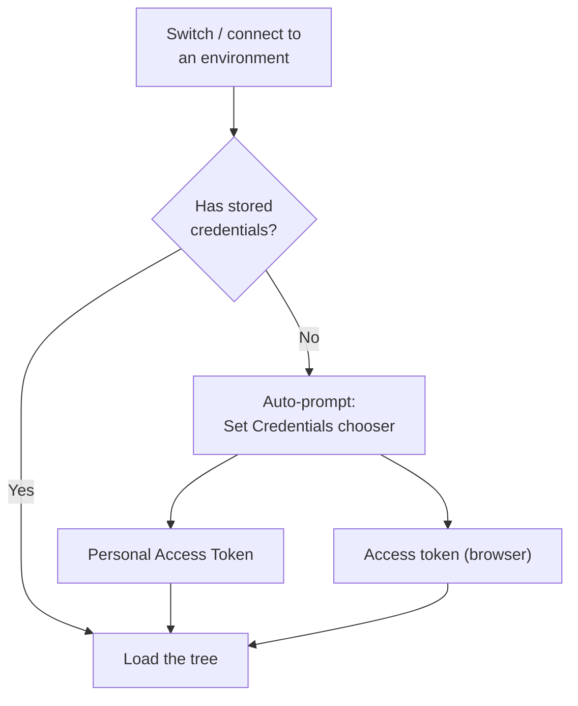
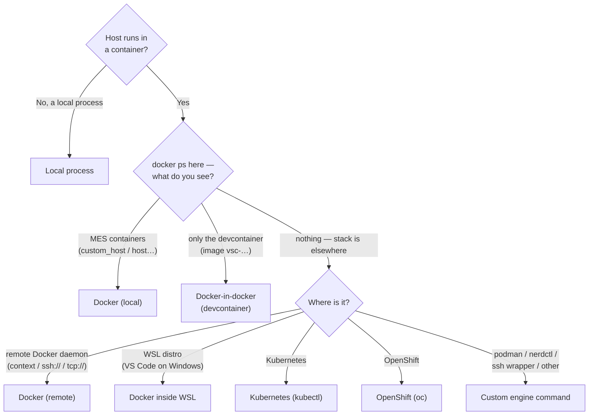

# Environments

An **environment** is a named connection profile: the MES address, how the extension
reaches the MES host container, and that environment's own stored credentials. All
connection configuration goes through environments — there are no loose "host address"
settings. Exactly one environment is **active** at a time; no active environment means
"not connected", and the DEE Explorer shows its welcome view.

You will typically have one environment per MES instance you work with: your local
stack, a shared dev server, a test cluster.

## Creating environments

Three ways:

- **DEE Debugger: Discover Environments…** — probes your machine for reachable MES
  stacks (local Docker, docker-in-docker devcontainers, local host processes), verifies
  each with an API ping, and lets you connect in one click. Try this first.
- **DEE Debugger: Add Environment…** — a guided wizard for every supported connection
  type (listed below). Use this when discovery can't see your MES — remote machines,
  Kubernetes, unusual setups.
- Editing the **deeDebugger.environments** setting directly (Settings → search
  "DEE Debugger" → edit in `settings.json`). Handy for copying a colleague's working
  profile — but remember that **credentials are not in settings**; each person sets
  their own token.

> **Note:** If you used an earlier version of the extension with the old flat
> connection settings, those were migrated automatically into an environment named
> `default`, credentials included. Nothing to do.

## Switching, managing, testing

- **Switch:** click the **MES: \<name\>** Status Bar item, or run **DEE Debugger:
  Switch Environment…**. The switcher shows which environments already have a stored
  token (a key icon) and which don't (a warning icon). Switching to an environment
  without a token prompts you for one.

```text
┌─ Switch MES environment ───────────────────────────────┐
│ ✓ local        http://localhost · 🔑 token set         │
│   test-cluster https://mes-test… · ⚠ no token          │
│ ＋ Add environment…                                     │
│ 🔍 Discover environments…                              │
│ ⚙ Manage environments…                                 │
└────────────────────────────────────────────────────────┘
```

- **Manage:** **DEE Debugger: Manage Environments…** lets you edit any field, rename
  (stored credentials follow the new name automatically), or remove an environment
  (its stored credentials are wiped). Removing the active environment switches you to
  the first remaining one in the list (or disconnects you if none is left).
- **Test:** **DEE Debugger: Test Connection** proves the address and the token with
  one API call and reports success or a specific failure. It does not exercise the
  container settings; **Collect Support Bundle…** probes those (its `engineProbe` line).

Switching environments is clean: open sessions and debug registrations belonging to
the previous environment are dropped or deactivated, and the tree reloads with the new
environment's data.

## Per-environment credentials

Each environment stores its **own** credentials in the operating system's secure
storage — never in settings files, never in your repository.



Run **DEE Debugger: Set Credentials…** (or the **Set Credentials** button on the
Explorer welcome view) any time to (re)choose how to authenticate — the method is always
your choice:

- **Set Personal Access Token…** — a long-lived token; best for daily work.
- **Set Access Token…** — a bearer token copied from the browser DevTools; expires ~1 h.

**Set Credentials…**, both individual prompts, and **Clear Credentials** always apply to
the **active** environment. Full copy-a-token steps:
[Getting started → provide a token](getting-started.md#step-4-provide-a-token).

!!! note "Which token wins if both are stored"
    If both an access token and a PAT are stored, the **access token is used**. Setting a
    **Personal Access Token** auto-clears any stored access token, so a new PAT takes
    effect immediately — no need to Clear Credentials first. The one case that still
    bites: pasting a browser **access token** *after* a PAT — the access token wins, and
    it keeps winning after it expires (every call then fails with an auth error). Set the
    PAT again (that removes the access token), or run **Clear Credentials** and set the one
    you want.

## Which connection type am I? (decision tree)

After the name and the MES address, the wizard asks how the extension reaches your MES
host container. Follow
the tree — the terminal check that decides most cases is `docker ps` **run in the same
VS Code window you'll use the extension from**.



Details for each branch:

**1. Does your MES host run in a container at all?**
- **No — it's a process on this machine** (rare; e.g. running the host service
  directly): choose **Local process**. No container plumbing is involved; when you
  attach, you pick the host process in VS Code's process picker.
- **Yes:** continue.

**2. Run `docker ps` in the same VS Code window. Do you see the MES containers
(`custom_host` or `host`, `traefik`, `db`, …)?**
- **Yes:** choose **Docker (local)**. This is the simple case — host address is usually
  `http://localhost`, container name `custom_host` (cmf-cli stacks) or `host`
  (some other stacks). This is also what you get when you run VS Code **inside** the
  devcontainer that runs the stack — from in there, everything is local.
- **You see only one container, whose image is named `vsc-…`:** your stack runs on a Docker
  daemon **inside a devcontainer** — continue to 3.
- **You see nothing, but the stack exists somewhere else:** continue to 4.

**3. Docker-in-docker (devcontainer) — the common cmf-cli setup.** The stack was
started with `cmf dev local stack up` *inside* a project devcontainer, so from outside
that devcontainer, `docker ps` shows only the devcontainer itself and
`http://localhost` doesn't answer. Nothing is broken — the stack just lives one layer
deeper. Choose **Docker-in-docker (devcontainer)**. The wizard asks for the
devcontainer's name and runs every container command through it. As the MES address,
enter the devcontainer's IP (e.g. `http://172.17.0.2`). **Discover Environments…**
fills in both for you. To find name and IP yourself:

```bash
docker ps --format '{{.Names}}\t{{.Image}}'        # the vsc-… image row is the devcontainer
docker inspect <name> --format '{{range .NetworkSettings.Networks}}{{.IPAddress}}{{end}}'
```

> **Warning — devcontainer names and IPs are volatile.** The devcontainer's **name is
> randomly generated on every rebuild**, and its **IP can change on every restart**.
> If an environment that worked yesterday suddenly can't connect or can't reach the
> container, re-check both and update the environment (**Manage Environments…**). To
> stop the name churn permanently, pin a name in the project's `devcontainer.json`:
> `"runArgs": ["--name", "my-mes-dev"]`.

An alternative that avoids all of this: open VS Code **inside** the devcontainer and
use a plain **Docker (local)** environment from there.

**4. The stack is on another machine or in a cluster:**
- **A remote machine's Docker daemon** you can reach via a Docker context or an
  `ssh://…` / `tcp://…` daemon address: choose **Docker (remote)** and provide the
  context name or daemon URL.
- **You're on Windows and the stack runs inside a WSL distribution** (and you are not
  using VS Code's own WSL remoting): choose **Docker inside WSL** and name the
  distribution (or leave it empty for the default one).
- **Kubernetes:** choose **Kubernetes (kubectl)** and give the target pod or
  deployment (and namespace). `kubectl` must be configured for the cluster in your
  shell.
- **OpenShift:** choose **OpenShift (oc)** — same as Kubernetes but using the `oc`
  CLI and your `oc login` session.
- **Anything else** — podman, nerdctl, an ssh wrapper script, a jump host: choose
  **Custom engine command…** and provide the command prefix the extension should run
  container operations through.

## Per-type setup notes

Pick your type above, then read its notes here — they cover the prerequisites and the
one-line check that proves the *engine path* works before you blame the extension.

### Local Docker
- Prerequisite: `docker ps` in the same environment VS Code runs in shows the MES containers.
- Verify the engine path: `docker exec custom_host echo ok`
- Fully verified topology — this and docker-in-docker are the setups the extension is
  routinely tested against.

### Docker-in-docker (devcontainer)
- See the volatility warning above (name/IP change on rebuild/restart).
- Verify the engine path: `docker exec <devcontainer> docker exec custom_host echo ok`
- Fully verified topology.

### Remote Docker
- > **Warning:** `hostAddress` must be the **remote machine's** MES address (e.g.
  > `http://mes-dev.example:80`) — not `http://localhost`, which points at *your*
  > machine. The wizard pre-fills your current address; change it.
- Prerequisite: the context or daemon URL works without interactive prompts — use ssh
  keys/agents, never passwords in the command. Check with:
  `docker --context <name> ps` or `docker -H ssh://user@host ps`
- Expect noticeably slower debug-file pushes and host-rewrite checks over ssh links;
  operations time out after 30 s.

### Docker inside WSL (VS Code on Windows)
- Only needed when VS Code runs **on Windows itself**. If you use VS Code's WSL
  remoting (green corner badge says *WSL*), you are already *inside* WSL — use plain
  **Docker (local)** instead.
- Verify: `wsl -d <distro> docker ps` from a Windows terminal shows the MES containers.

### Kubernetes (kubectl) and OpenShift (oc)
- `k8sTarget` takes anything `kubectl exec`/`oc exec` accepts, e.g.
  `deployment/host -n mes-dev` or a pod name plus `-n <namespace>`.
- Verify the engine path: `kubectl exec deployment/host -n mes-dev -- echo ok`
  (or the `oc` equivalent; OpenShift also needs a live `oc login` session).
- > **Warning — debugging needs `SYS_PTRACE` in the pod spec.** Unlike Docker, there
  > is no privileged-exec escape hatch on Kubernetes: if the host pod's
  > `securityContext` doesn't grant the `SYS_PTRACE` capability, **attaching the
  > debugger will fail** even though browsing, editing and uploading work fine. Ask
  > whoever owns the deployment to add
  > `securityContext: { capabilities: { add: ["SYS_PTRACE"] } }` to the host
  > container (dev/test clusters only). If the container runs as a non-root user (the
  > product host image does), the added capability is dropped on exec, so the pod also
  > needs `runAsUser: 0`, or the node needs `kernel.yama.ptrace_scope=0`. The extension
  > checks this before attaching and names the missing piece.
- vsdbg is installed into the pod's writable layer — a pod restart or redeploy removes
  it; the extension simply offers to install it again.
- > **Warning — multiple host replicas break debugging.** The debug registration lives
  > in **one replica's memory** and your pushed file in **one pod's filesystem**, while
  > a Service load-balances every request — so activation, file, trigger and debugger
  > scatter across replicas and debugging "randomly works" (or fails with
  > file-not-found compiles). While debugging, either scale down:
  > `kubectl scale deployment/host --replicas=1 -n <namespace>`, or pin everything to
  > one pod: `kubectl port-forward pod/<host-pod> 8080:8080`, set `hostAddress` to
  > `http://localhost:8080`, point `k8sTarget` at that same pod, and trigger via
  > **Execute Action…** (the MES UI still routes through the ingress). Details and
  > diagrams: [How debugging works](how-debugging-works.md#multi-replica-clusters-why-pinning-is-mandatory).

### Local process
- For a MES host running directly on your machine (no container). Debug source files
  are used in place — no copying, no `sourcePathInHost`; attaching opens VS Code's
  process picker.

### Using a bind mount instead of copying (`useMount`)
Any Docker-based type can skip the file copying during debugging if the host container
already **bind-mounts your local DEEs folder**: add a volume mapping your DEEs folder
to a container path (e.g. in a compose override:
`volumes: ["<abs path to DEEs>:/mnt/dees"]`), set `sourcePathInHost` to that container
path and `useMount` to `true` in the environment. Debug-mode files are then shared
directly — instant pushes, no streaming. Requires editing the stack definition and
recreating the container, so most people stay with the default copying, which needs
no stack changes. With `useMount`, only files inside the mounted (primary) DEEs folder can be
debugged: `DeeDevBase` working copies under `.dee-debug/` and files in other Data packages are
outside the mount, and the extension stops with a message naming the file.

### Custom engine command
- Any docker-CLI-compatible prefix works (`podman`, `nerdctl`, `ssh devbox docker`, a
  wrapper script). The extension appends `exec …` to it for every container operation
  (files are streamed through `exec` too, never copied with `cp`).
- Verify: `<your command> exec custom_host echo ok` from a terminal.
- Same trust rule as everything on this page: the command runs on your machine.

> **Note on maturity:** local Docker and docker-in-docker are exercised against live
> MES stacks continuously. Remote Docker, WSL, Kubernetes, OpenShift and custom
> engines use the exact same mechanics and are covered by automated tests, but have
> seen less real-world mileage — if you hit a rough edge on one of them, capture a
> support bundle (**DEE Debugger: Collect Support Bundle…**) and report it.

## What each field means

You normally never touch these — the wizard fills them — but **Manage Environments…**
and `settings.json` expose them:

| Field | Meaning | Default when omitted |
|---|---|---|
| `name` | The environment's display name. Also the key under which its tokens are stored. | (required) |
| `hostAddress` | Base URL of the MES API — what you'd put in a browser, e.g. `http://localhost` or `https://mes-test.example.com`. | `http://localhost` |
| `kind` | How the host runs: `docker`, `kubernetes`, or `process`. | `docker` |
| `containerName` | Name of the MES host container. cmf-cli stacks use `custom_host`; some other stacks use `host`. | `custom_host` |
| `k8sTarget` | For Kubernetes/OpenShift: the pod or deployment (with namespace) to exec into. | — |
| `engineCommand` | The command prefix used for all container operations, replacing plain `docker`. Examples: `["docker","exec","-i","<devcontainer>","docker"]` for docker-in-docker; `["docker","--context","remote1"]`; `["wsl","-d","Ubuntu","docker"]`; `["oc"]`. | plain `docker` / `kubectl` |
| `sourcePathInHost` | Directory **inside the host container** where debug-mode source files are placed. | `/tmp/CriticalManufacturing/dee-debug` |
| `useMount` | If the container already bind-mounts your local DEEs folder, set `true` so files don't need to be copied in. | `false` |
| `vsdbgPath` | Where the .NET debugger lives inside the container. | `/vsdbg/vsdbg` |

> **Warning:** The `engineCommand` is executed on your machine. Only use environment
> profiles from sources you trust — this is also why the extension refuses to run in
> untrusted workspaces. Avoid embedding passwords in a custom engine command; use ssh
> keys or contexts instead.

## Verifying a new environment

After creating an environment, run **DEE Debugger: Test Connection**. If it fails, the
message tells you whether the problem is reaching the address (stack down, wrong
address, WSL networking) or authentication (token missing/expired). The
[troubleshooting page](troubleshooting.md#connection-problems) maps each failure to a
fix.

## Related pages

- [Getting started](getting-started.md) — first connection walkthrough.
- [Debugging](debugging.md) — what the container plumbing is used for.
- [Troubleshooting](troubleshooting.md) — connection symptoms and fixes.
