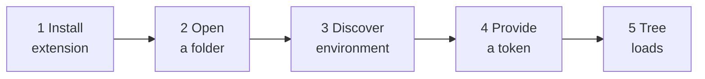

# Getting started

This page takes you from nothing to a loaded DEE Explorer tree — typically in under
10 minutes. For a full guided session that ends with a breakpoint hit, continue with
the [tutorial](tutorial-first-dee-debug.md) afterwards.



> **Tip:** the same steps are available inside VS Code as an interactive walkthrough with a
> button per step — run **DEE Debugger: Open Getting Started** (also linked from the DEE
> Explorer's welcome view and Help → Welcome). This page is the long form with screenshots
> and troubleshooting.

## What you need

- **VS Code 1.90 or newer.**
- **The extension VSIX** (`dee-debugger-<version>.vsix`), from your team's usual
  distribution channel or CI builds.
- **The Microsoft C# extension** (`ms-dotnettools.csharp`). It provides the .NET
  debugger the extension uses. It is declared as a dependency, so VS Code installs it
  automatically with the VSIX when it has Marketplace access; on an offline machine,
  install it first. C# Dev Kit also works — it includes the C# extension.
- **A running MES development or test instance** you are allowed to change — for
  example a local stack started with `cmf dev local stack up` in your customization
  project.
- **A MES user account** with permission to use DEE Actions (the same account you use
  in Administration → DEE Actions in the MES UI).
- **The `docker` CLI** available in the same environment VS Code runs in, if your MES
  host runs in a container (it almost always does). Quick check: open VS Code's
  integrated terminal and run `docker ps`.

> **Note:** The extension only works in **trusted** workspaces. If VS Code shows the
> Workspace Trust prompt when you open your folder, choose **Trust**.

## Step 1 — Install the extension

Get the `.vsix` from the project's GitHub Releases page (or a CI build artifact). Then either
drag it onto the Extensions view, or from a terminal:

```bash
code --install-extension dee-debugger-<version>.vsix
```

Then run **Developer: Reload Window** (the extension host only picks up a new build after a
reload). A new **DEE Debugger** icon appears on the Activity Bar.

!!! note "Upgrading or replacing a pilot build"
    `--install-extension` replaces an older version in place. If an **internal pilot build with
    a higher version number** is installed (early testers had a `0.3.0` pilot), VS Code may
    treat the release as a downgrade — add `--force`, or uninstall first:

    ```bash
    code --uninstall-extension criticalmanufacturing.dee-debugger
    code --install-extension dee-debugger-<version>.vsix
    ```

    Environments and stored tokens survive both paths (they are keyed by the extension id).
    Working inside **WSL or a Remote-SSH / devcontainer window**: run the command in that
    remote's terminal so the extension lands on the remote side, where `docker` is.

## Step 2 — Open a folder

The extension needs a workspace folder to store the `.cs` files it downloads.

- **Best:** open your customization project — the folder containing
  `Cmf.Custom.Data/DEEs`. The extension auto-detects the DEEs folders (it looks for
  `DeeDevBase.cs`, or a folder named `DEEs` that contains a `.csproj`), including their
  subfolders and every Data package, and the Actions project gives you full C# IntelliSense
  for free.
- **Also fine:** any folder. Downloaded files then go into a `.dees/` subfolder. You
  can point the extension somewhere specific later with the **deeDebugger.deesFolder**
  setting.

## Step 3 — Discover your environment

1. Click the **DEE Debugger** icon on the Activity Bar. Since you are not connected
   yet, the **DEE Explorer** shows a welcome view with the next step as a button. (The
   welcome view adapts: *not connected* → Discover / Add; *environment without a token* →
   Set Credentials; *connected but nothing loaded* → Refresh / Show Output Log.)
2. Click **Discover Environments** (also available from the Command Palette as
   **DEE Debugger: Discover Environments…**).
3. The extension probes for MES stacks it can reach — a local Docker stack, a stack
   inside a devcontainer, or a local host process — and verifies each candidate by
   pinging its API. Reachable ones are pre-checked.
4. Select your stack and choose **Connect**.

If nothing is discovered, your setup probably needs a manually configured
environment — see [Environments](environments.md), in particular the
[connection decision tree](environments.md#which-connection-type-am-i-decision-tree).

## Step 4 — Provide a token

The extension authenticates to the MES with a token, stored securely per environment
(in your OS keychain via VS Code — never in settings files). When you connect to an
environment without a stored token, the **Set Credentials…** chooser opens
automatically — pick how you want to authenticate:

```text
┌─ Authenticate to 'local' ──────────────────────────────┐
│ Choose how to provide credentials                      │
├────────────────────────────────────────────────────────┤
│ 🔑 Set Personal Access Token…                          │
│    Long-lived token from the Security Portal — best     │
│    for daily work.                                      │
│ 📋 Set Access Token…                                    │
│    Bearer token copied from the browser DevTools —      │
│    expires after ~1 hour.                               │
└────────────────────────────────────────────────────────┘
```

| | Personal Access Token | Access token (browser) |
|---|---|---|
| **Command** | Set Personal Access Token… | Set Access Token… |
| **Where from** | Security Portal → your user page | Browser DevTools → Network tab |
| **Lifetime** | Long-lived | ~1 hour (Security Portal stacks) |
| **Best for** | Daily work | Quick start / no PAT page |

!!! tip "Recommended: Personal Access Token"
    PATs are long-lived, so you set them once. Generate one in the MES **Security
    Portal** → your user security page → **Personal Access Tokens**, copy it, then run
    **DEE Debugger: Set Personal Access Token…** and paste it.

### Copying an access token from the browser

If your setup has no Security Portal PAT page, reuse the token your browser session
already has:

1. Log in to the MES UI in your browser, then open DevTools (`F12`) → **Network** tab.
2. Perform any data operation (for example, open a Material).
3. Click a `POST` request to `/api/...` and find the `Authorization: Bearer …` header.
4. Right-click → **Copy value** and paste **without** the `Bearer ` prefix into
   **DEE Debugger: Set Access Token…**.

!!! warning "Access tokens expire after 1 hour"
    On Security Portal stacks — including the standard local development stack — a
    browser access token dies after an hour, and every operation then fails with an
    authentication error until you paste a fresh one. This is the single most common
    problem people hit; a PAT avoids it entirely. See
    [Expired tokens](troubleshooting.md#expired-tokens-the-1-hour-problem).

!!! note "Pasted the wrong kind?"
    Paste a PAT into the **Set Access Token…** prompt by mistake and the extension
    recognizes it, stores it as a PAT, and tells you so. Manual copy-selection truncates
    these 1–2 KB tokens — always use right-click → **Copy value**.

## Step 5 — Watch the tree load

After the token is stored, the **DEE Explorer** loads:

```text
DEE EXPLORER                      ↻  ＋  ⌕  🐞   …      ← title bar: Refresh · New DEE Action ·
● Connected · local                                         Filter · Attach; the rest under …
  3 disabled actions hidden — click to show
▾ MaterialManagement                                   2   ← group rows show their action count
  ▾ MaterialManagementOrchestration                    2
    ▾ CreateMaterial                                   2   ← each dot-separated part is a level
      ▾ Pre                                            2
          SetDefaultWarehouse    DEBUG · pending upload · v2
          ValidateLotSize                            v3
  OrphanAction                                        v1   ← ungrouped actions sit at the root
  Tutorial_MyFirstDee     not effective (Active) · v1   ← a draft (runs: no version is effective)
───────────────────────────────────────────────────────
MES: local · 🐞 1                                          ← Status Bar: environment + debug count
```

- A **Connected · \<environment name\>** row with a green plug icon at the top confirms
  where you point; click it to switch. Below it, an *"N disabled actions hidden"* row
  appears when the default filter hides anything — click it to show them.
- **Action Groups** appear as a folder hierarchy (dot-delimited names become nested
  levels) with the number of actions they hold; **actions are the leaves**. Ungrouped
  actions sit at the root.
- Badges on an action row, in order of urgency: **DEBUG** (debug mode on; the row icon
  also turns into a coloured bug), **pending upload** (saved locally, not yet on the
  MES), **not effective (Active)** (a draft: it runs while no version is effective, but a
  version staged later would take over — right-click → **Make Version Effective**),
  **disabled**, and the version number.
- Hover a row for the inline actions: **Enable/Disable DEE Debug Mode**, **Save to MES**,
  **Reload from MES**, and **Make Version Effective** on drafts. Right-click for the rest
  (new version, history, execute, **Open in MES UI**).
- The title bar keeps four extension icons — **Refresh**, **New DEE Action…**, **Filter**,
  **Attach Debugger** — next to VS Code's own **Collapse All**, and puts Switch
  Environment, Sync, Expand All, Show Disabled, Show Output Log, Collect Support Bundle
  and Open Getting Started under the `…` menu.
- The Status Bar shows **MES: \<environment name\>** and, while any action is in debug
  mode, a bug icon with the count.

Click any action to open its code — and read
[Editing and uploading](editing-and-uploading.md#the-marker-contract-what-you-may-and-may-not-edit)
**before you edit anything**: only the code between the marker comments is yours.

If the tree stays empty or an error appears, run **DEE Debugger: Test Connection**
from the Command Palette and see [Troubleshooting](troubleshooting.md).

## Next steps

- [Tutorial: your first DEE debug session](tutorial-first-dee-debug.md) — the full
  loop, breakpoint included, in about 30 minutes.
- [Environments](environments.md) — if you work with more than one MES instance, or
  discovery did not find yours.
- [Editing and uploading](editing-and-uploading.md) — the editing rules that keep you
  from losing work.
