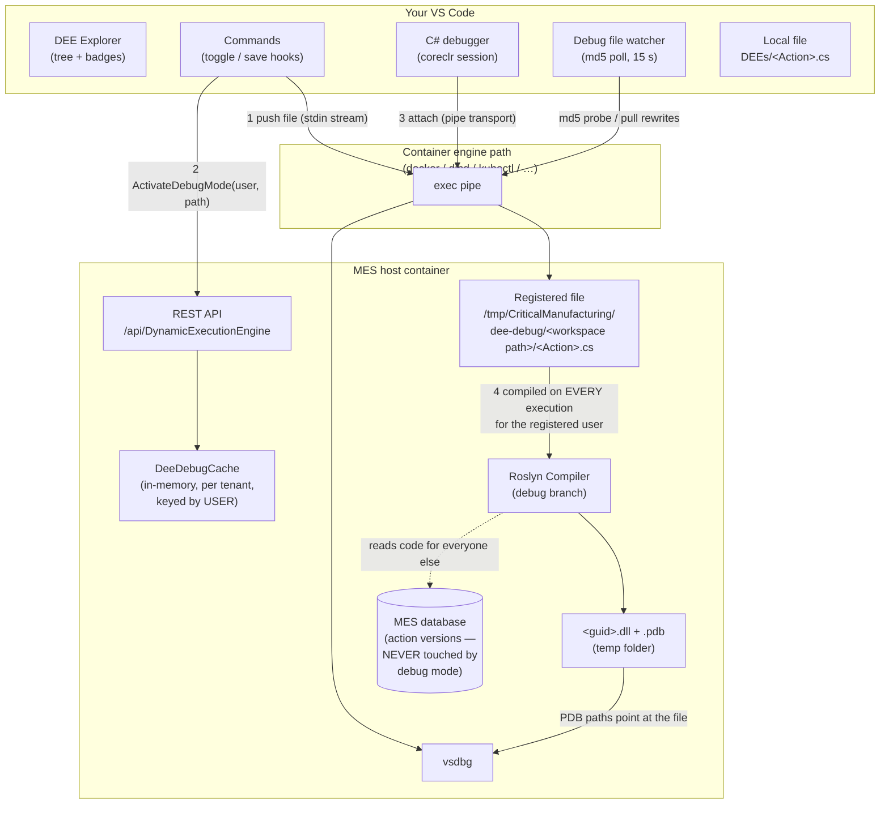
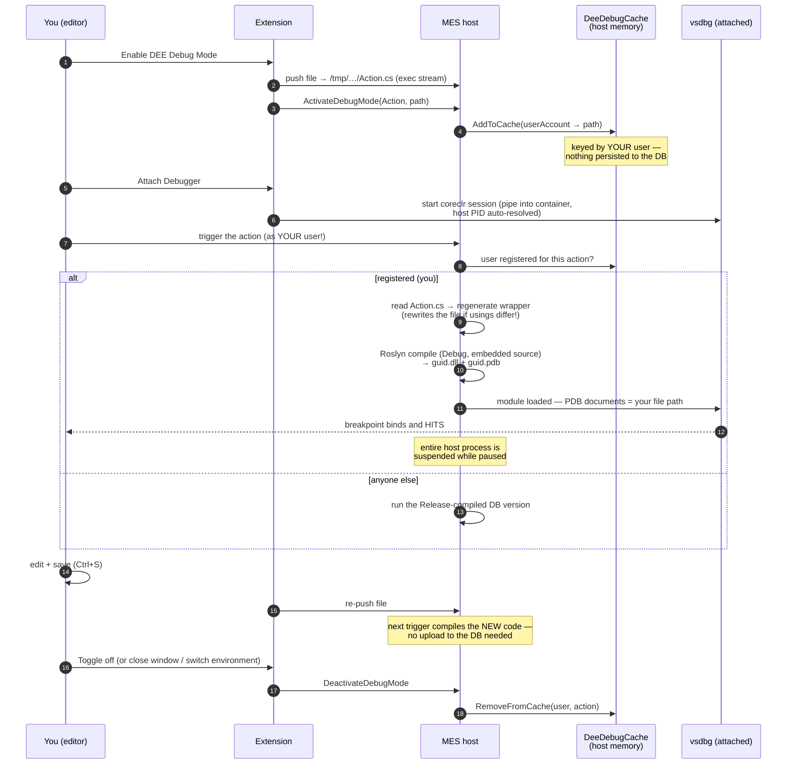
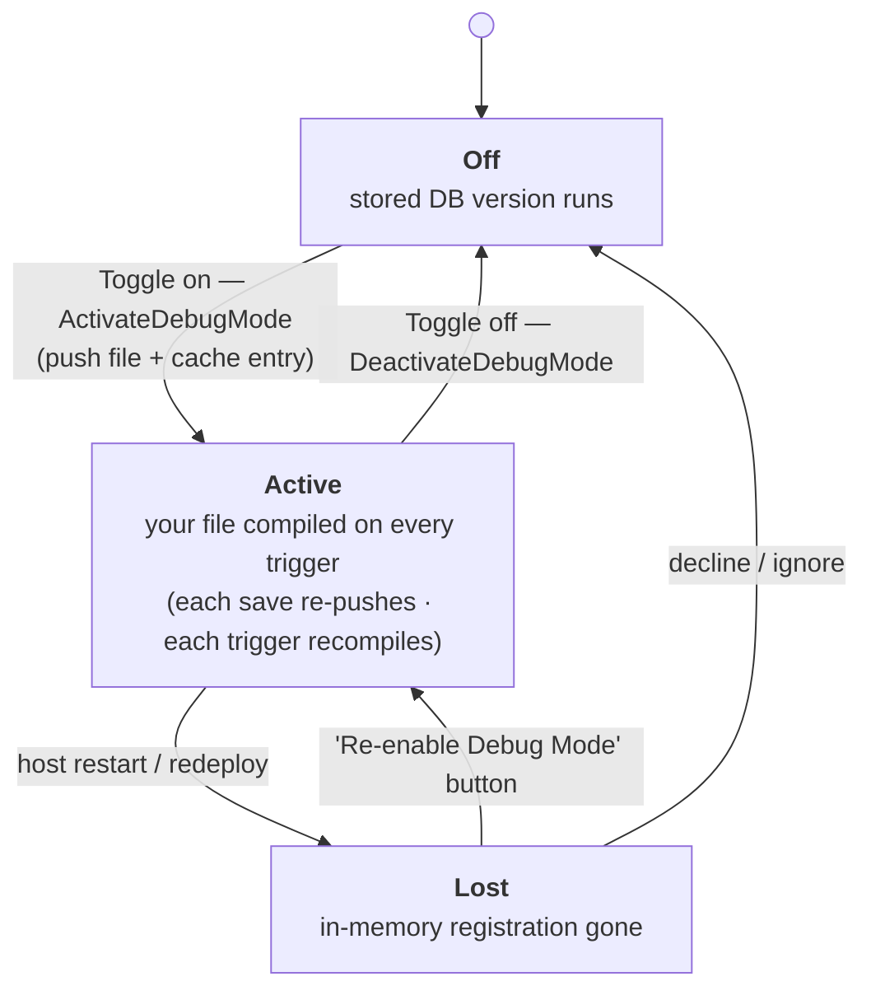
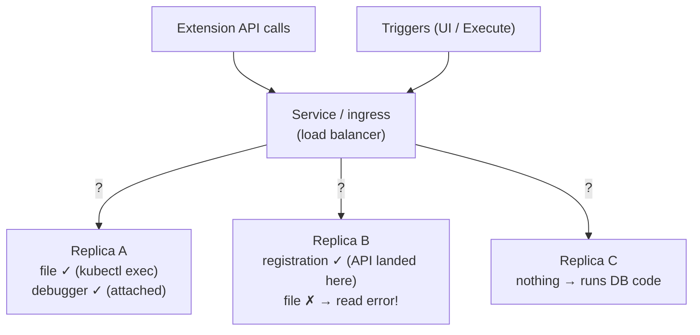

# How DEE debugging works (client + host internals)

You don't need this page to *use* the debugger — [debugging.md](debugging.md) covers
that. Read this when you want to understand *why* it behaves the way it does: why
breakpoints are per-user, why a host restart loses debug mode, why the host sometimes
rewrites your file, and why multi-replica clusters need pinning.

## The moving parts

Key asymmetry: **the database is never involved in debug mode.** The registration lives
only in the host process's memory, and the code the host runs *for you* comes only from
the registered file.

## The full loop, step by step

## The registration's lifecycle (and why restarts matter)

The extension detects the **Lost** state by comparing its local badge with the server's
per-user `IsInDebugMode` after every refresh — the host itself never announces it.

## What the host actually does (for the curious)

1. **Registration** is four lines in the host: build an `ActionDebugInfo{Id, Name, path}`
   and put it in a per-tenant in-memory dictionary keyed by your user account. The
   `IsInDebugMode`/`SourceFilePath` you see in API responses are *computed from that
   dictionary*, not database columns.
2. **Every execution** checks that dictionary for the calling user. Hit → unconditional
   recompile from your file. Miss → the cached Release build of the database version.
3. **The debug compile** re-extracts your two marker bodies from the file and
   regenerates the full wrapper (usings come from your `UseReference(...)` calls, never
   from the file's `using` lines). If the regenerated wrapper differs from your file,
   **the host rewrites your file**; the extension's watcher pulls that back into your
   editor.
   Then Roslyn compiles the file with a *file-backed* syntax tree, embedded source, and
   emits `<guid>.dll` + `<guid>.pdb` whose document paths are your file — which is
   exactly what lets the attached debugger bind your breakpoints.
4. **Pausing at a breakpoint suspends every thread of the host** — all users, the UI,
   everything — until you continue. This is normal .NET debugging, and the core reason
   debug mode is a development/test-only feature.

## Multi-replica clusters: why pinning is mandatory

Because the registration is one replica's memory and the file is one pod's filesystem,
**four things must land on the same replica**: the ActivateDebugMode call, the pushed
file, the triggering execution, and the attached debugger. A load balancer scatters
them:

With N replicas you get roughly a 1-in-N chance per trigger that everything aligns —
experienced as "debugging randomly works", plus file-not-found compile errors when the
registration and the file land on different replicas.

**Fix, in order of preference:**

1. **Scale the host to one replica in the dev/test namespace** while debugging:
   `kubectl scale deployment/host --replicas=1 -n <namespace>`. (A hit breakpoint
   freezes the whole host anyway — multi-replica debugging has no upside.)
2. **Pin everything to one pod**: `kubectl port-forward pod/<host-pod> 8080:8080`, set
   the environment's `hostAddress` to `http://localhost:8080`, and set `k8sTarget` to
   that same pod. Then trigger via **Execute Action…** (which uses your pinned address)
   rather than the MES UI, whose requests still go through the ingress.

The same applies to any classic load-balanced deployment — the original Visual Studio
add-in documentation carried the equivalent warning.

## Related pages

- [Debugging guide](debugging.md) — the practical how-to
- [Environments — per-type setup notes](environments.md#per-type-setup-notes)
- [Troubleshooting](troubleshooting.md) — symptom-first fixes
