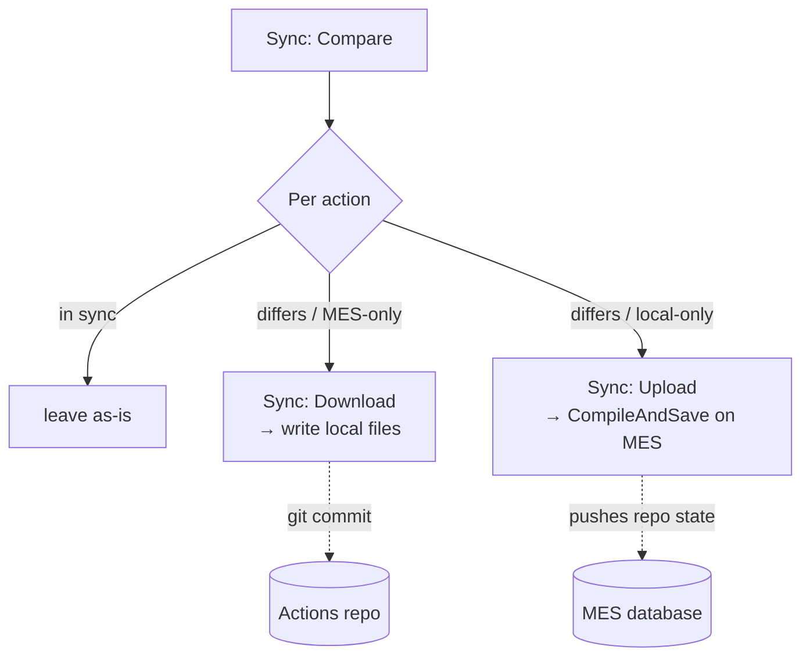

# Syncing with your local Actions project

DEE actions live in the MES database — but your customization project keeps local
`.cs` copies of them (conventionally under `Cmf.Custom.Data/DEEs`) for IntelliSense,
code review, and source control. The **Sync** commands keep the two sides aligned in
bulk: compare, download what changed on the MES, upload what changed locally.

All three commands work against every DEEs folder, subfolders included. The folders are
auto-detected in your workspace (one per Data package), or listed in the
**deeDebugger.deesFolder** setting. The commands are available from the `…` menu in
the DEE Explorer's title bar or the Command Palette:

- **Sync: Compare Local DEEs with MES**
- **Sync: Download Changes from MES**
- **Sync: Upload Local Changes to MES**

Start with **Compare** — it classifies every action. Download and Upload each run the
same comparison first and act on its results. Both directions preserve the marker contract: only marker bodies move, wrapper
boilerplate never shows as diff noise.

## Comparing local vs MES

**Sync: Compare Local DEEs with MES** scans your local DEE files and the server's
actions and reports: **in sync / differ / local-only / MES-only**. From the results
you can open a per-file **diff editor** for anything that differs.

Two things make the diff readable:

- **Only real code differences are highlighted.** The server side of the diff is
  rendered **inside your local file's wrapper** — so the generated boilerplate never
  shows as noise; you compare marker bodies against marker bodies. Differences only in
  line endings, trailing whitespace, or blank lines at the start or end of a body count
  as in sync.
- **Both marker dialects are understood.** Files with the generated
  `/** START/END OF USER-DEFINED … **/` markers and files in the older cmf-cli
  authoring dialect (`//---Start DEE Code---` / `//---End DEE Code---` and the
  condition pair) are both recognized. `DeeDevBase.cs` is skipped automatically.
- **Subfolders and several packages are scanned.** `bin`, `obj` and the extension's own
  `.dee-debug/` working copies are not.

MES-only entries open read-only so you can inspect before downloading.

## Downloading

**Sync: Download Changes from MES** shows the changed/new entries pre-checked; deselect
what you don't want, confirm, and the extension writes the files:

- Actions you've never had locally are written as complete generated files in the primary
  DEEs folder (the first one).
- Actions you already have keep your local file's layout — only the marker bodies are
  updated.

A summary reports how many files were written and lists any failures.

### Dirty-editor protection

> **Warning avoided:** if a file selected for download (or an action you reload) is
> **open in an editor with unsaved changes**, the extension **skips it** rather than
> overwrite the disk under your editor. Skipped files are counted as failures and
> named in the summary. Save or revert the editor, then run the download again for
> those entries.

## Uploading

**Sync: Upload Local Changes to MES** shows the locally changed files; pick the ones
to push. Each is compiled and saved on the MES (the same operation as
**Save Action to MES** per file):

- A compile failure in one file **does not abort the batch** — the rest upload, and
  the summary names the failures, with the errors in the **Problems** panel against
  the right files.
- If an action changed **on the MES** after the comparison, that entry fails, and the
  output log tells you to run **Sync: Compare** again — so you never blind-overwrite a colleague's
  change. Re-compare, review the diff, then re-upload.
- Files with damaged markers are left out of the comparison, so they are never
  uploaded; the **DEE Debugger** output log names each skipped file and why (see
  [the marker contract](editing-and-uploading.md#the-marker-contract-what-you-may-and-may-not-edit)).
  If that action exists on the MES, it is listed as *MES only*. Downloading it does not
  overwrite the damaged file: the entry fails, and the output log says why. Fix the markers
  (or move the file), then compare again.
- **Local-only files create new actions** on the MES — enabled, with your file's bodies, as
  **version 1 in state Active (not effective)**. They run already — with no effective
  version the MES uses the highest — but a version staged later would take over. At the end
  of the batch the extension lists the created actions and offers **Make Effective**; choose
  **Keep as Drafts** to promote them later from the tree. Either way they now appear in the
  tree (with a `not effective` badge while drafts) and compare as *in sync*.

The upload is cancellable mid-batch from the progress notification.

## A typical git workflow

With the Actions project in git, sync gives you reviewable DEE changes:

1. **Baseline:** on a clean working tree, run **Sync: Download Changes from MES** for
   everything. Commit. Your repo now mirrors the MES.
2. **Develop:** edit actions in VS Code — single-action loop
   ([edit](editing-and-uploading.md) / [debug](debugging.md)) — and save your final
   versions to the MES.
3. **Capture:** run **Sync: Compare** to confirm repo vs MES state, download anything
   changed server-side (your own MES-UI edits, a colleague's change), and commit with
   a meaningful message. `git diff` shows exactly what changed in each action body.
4. **Apply elsewhere:** on a branch checkout or another environment (switch with the
   Status Bar item), run **Sync: Compare** then **Sync: Upload Local Changes to MES**
   to push the repo's state to that MES.
5. **Review:** pull requests over the DEEs folder review actual rule changes; because
   downloads preserve layout and skip whitespace churn, diffs stay minimal.

> **Note:** Sync transfers action **code**. Action *group membership and evaluation
> order* are managed in the MES UI (Administration → DEE Actions) or via Data package
> installation — not by this extension. Enabled/effective state is not synced either,
> but the tree shows it (`disabled`, `not effective` badges) and **Make Version
> Effective** is one click away.

## Related pages

- [Editing and uploading](editing-and-uploading.md) — single-action semantics,
  versions, conflicts.
- [Environments](environments.md) — switching between the MES instances you sync
  against.
- [FAQ](faq.md#why-dont-i-see-all-actions-in-the-tree-or-in-sync) — what sync and the
  tree cover, and why a newly created action shows as `not effective`.
