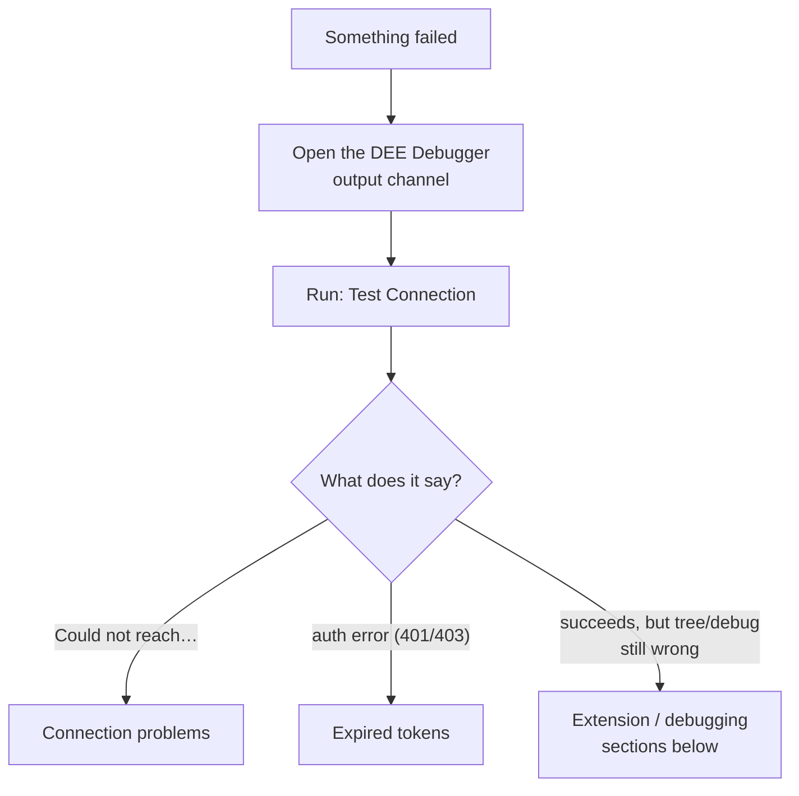

# Troubleshooting

Find your **symptom** below. Two habits solve most problems fast:

## Step 1: open the DEE Debugger output channel

**View → Output**, then select **DEE Debugger** in the dropdown on the right. Every
operation logs there — timestamped, with the environment and version information
support needs, and with credentials automatically redacted. Many error notifications
also offer to open it. When a fix below says "check the output channel", this is the
place.

## Step 2: prove the basics with Test Connection

Run **DEE Debugger: Test Connection** from the Command Palette. Its result splits the
world in two: *"Could not reach …"* means a connectivity/address problem
([Connection problems](#connection-problems)); an authentication error means a token
problem ([Expired tokens](#expired-tokens-the-1-hour-problem)).

---

## Expired tokens (the 1-hour problem)

**Symptoms:** everything worked, and now every operation fails with an authentication
error (HTTP 401/403) and the hint *"The token may be expired — run 'DEE Debugger: Set
Credentials…' to set a new one."*. Refresh fails, uploads fail, debug toggle fails.

**Why it happens:** on MES stacks that use the **Security Portal** — which includes
the standard local development stack — browser-copied **access tokens expire after
1 hour**. (Only stacks *without* the Security Portal issue ~14-day tokens.) One hour
into your session, the token dies mid-work. This is the most common problem users
report, and it is not a bug in your code or the extension.

**Confirming it's the cause:**

- The error mentions 401/403 or "token may be expired".
- The output channel shows your token's type and expiry time on the failure — look
  for the `[auth] stored credential: …` line. A negative "min from now" value means the
  token has expired, and by how long.
- Operations that don't touch the MES (editing locally) still work; everything that
  talks to the server fails.

**Fix now:** get a fresh token and run **DEE Debugger: Set Access Token…** (see
[how to copy one from the browser](getting-started.md#copying-an-access-token-from-the-browser)).

**Fix forever:** use a **Personal Access Token**. Generate it in the Security Portal →
your user security page → **Personal Access Tokens**, then in VS Code:

1. **DEE Debugger: Set Personal Access Token…** — paste the PAT. (Setting a PAT
   automatically clears any stored access token for that environment, so it takes effect
   immediately — you don't need to Clear Credentials first.)
2. **Refresh** the tree to confirm.

**Other token pitfalls:**

| Symptom | Cause / fix |
|---|---|
| A freshly copied token is rejected immediately | It was truncated when copied — these tokens are 1–2 KB. In the browser DevTools, use right-click → **Copy value** on the Authorization header, and paste without the `Bearer ` prefix. |
| Set a browser **access token** after a PAT, still hitting auth errors | A stored access token always takes precedence over the PAT — even after it has expired. Run **Clear Credentials**, then set the credential you actually want. |
| Token works in one environment but not another | Credentials are stored **per environment** — set the token while the right environment is active. |

---

## Connection problems

| Symptom | Likely cause / fix |
|---|---|
| **"Could not reach the MES host at …"** | The stack is down (`docker ps` should show the MES containers — start it with `cmf dev local stack up`), or the host address is wrong. Verify from the same shell VS Code uses: `curl -s -o /dev/null -w '%{http_code}' <address>/api/ping` should print `200` (or `401` — that still proves routing). |
| Same, but a debug session is active | The host is probably **paused at your breakpoint** — a stopped debugger suspends the whole MES. Press Continue (`F5`) and retry. See [everything freezes](debugging.md#while-you-are-paused-everything-freezes). |
| Works in a terminal, not in VS Code (or vice versa) — WSL setups | Windows and WSL have different networks. Use the address that works for `curl` **in the same environment VS Code runs in** (check the bottom-left remote indicator: WSL window vs local window). |
| **"returned a login page instead of data"** | The address answered with an HTML page instead of the API. Usually the token was rejected (revoked or expired) and the forward-auth served the login page — set new credentials. If the token is fine, the address is wrong (wrong port, or a sub-path instead of the base URL the MES UI uses, e.g. `http://localhost`). |
| **"returned unparseable JSON"** | The address answered with something that is neither JSON nor an HTML page. Point the environment at the base URL the MES UI uses (e.g. `http://localhost`, not a sub-path). |
| Devcontainer stack unreachable from outside; `docker ps` shows only the devcontainer (image `vsc-…`) | Your stack runs docker-in-docker. Use the **Docker-in-docker (devcontainer)** environment type — and re-check the devcontainer's **IP and name**, which change on restart/rebuild. See [the decision tree](environments.md#which-connection-type-am-i-decision-tree). |
| Everything broke after a devcontainer rebuild | Same as above: new random container name, possibly new IP. Update the environment via **Manage Environments…**, or pin the name in `devcontainer.json`. |

## Extension or tree problems

| Symptom | Likely cause / fix |
|---|---|
| The extension doesn't activate / no DEE Debugger icon | The Microsoft **C# extension** (`ms-dotnettools.csharp`) is missing — it's a required dependency. Check the Extensions view for an install error; on offline machines install it manually. Also: the workspace must be **trusted**, and a folder must be open. |
| Tree is empty but Test Connection succeeds | Check the tree isn't filtered (a filled filter icon in the DEE Explorer title = a text filter is active — click it and clear). Also check the rows at the top of the tree: *"N DEEs matched '…'"* (filter) and *"N disabled actions hidden"*. |
| **A specific action doesn't appear in the tree** | Draft (not-yet-effective) actions **are** shown, with a `not effective` badge. If it is missing it is either **disabled** (the tree shows a *"N disabled actions hidden — click to show"* row; click it or enable **deeDebugger.showDisabledActions**) or excluded by a **text filter**. See the [FAQ](faq.md#why-dont-i-see-all-actions-in-the-tree-or-in-sync). |
| **An action never runs** | A `not effective` badge is not the cause on its own: with no effective version the MES runs the highest version. Check that the action is **enabled** and belongs to an **action group** (MES UI). If you staged a new version, the effective one keeps running until you make the new one effective (right-click → **Make Version Effective**). |
| Tree shows a different environment's data than expected | Check the green **Connected · …** row at the top of the tree and the **MES:** status-bar item — you may be on another environment. Click to switch. |

## Uploads and compile errors

| Symptom | Likely cause / fix |
|---|---|
| Upload fails with errors in the **Problems** panel | A real compile error in your code — click the entry to jump to the line, fix, re-upload. The raw server message is in the output channel. |
| Upload refused: "marker problems" | A marker line was deleted, duplicated, or edited. Don't fix by hand — copy your body code out, run **Reload Action from MES**, paste back inside the markers. See [the marker contract](editing-and-uploading.md#the-marker-contract-what-you-may-and-may-not-edit). |
| Upload refused: changed on the MES since it was loaded | Someone else saved the action meanwhile. See [concurrency conflicts](editing-and-uploading.md#concurrency-conflicts-someone-else-changed-it). |
| Upload fails with an authentication error | Token expired — [see above](#expired-tokens-the-1-hour-problem). |
| **My local file changed on disk by itself** | Not a bug: with debug mode on, the MES host **rewrites the file** when its regenerated wrapper differs from yours — typically because something was edited outside the markers (e.g. a hand-added `using`). Keep all edits inside the markers and use `UseReference(...)` for extra assemblies. |

## Debugging problems

| Symptom | Likely cause / fix |
|---|---|
| "spawn docker ENOENT" (or "docker: not found") on toggle/attach | The `docker` CLI isn't on the PATH of the environment VS Code runs in. Verify `docker ps` in VS Code's integrated terminal. On WSL setups, docker must work **inside** the same remote. |
| Toggle/attach fails with a container error naming the engine or container | The environment's container plumbing is wrong — wrong container name (`custom_host` vs `host`), stale devcontainer name/IP, dead remote context. The error and output channel name the failing command; fix the [environment](environments.md#what-each-field-means). |
| "vsdbg was not found … Install it now?" | Normal on a fresh container — choose **Install vsdbg** and the extension installs the debugger. On MES 12 hosts the download runs inside the container (the image has `curl`), so the container needs internet access. MES 11.x images have no `curl`/`wget`, so the extension downloads vsdbg on your machine and streams it in — that needs internet plus `bash` + `tar` locally (on Windows, run VS Code in WSL). Either way, a wrong engine/container config also fails here (see previous row). |
| Attach fails with `Unknown Error: 0x80131c08` | Wrong process picked — choose the `dotnet` process running `Cmf.Foundation.Services.HostService.dll`, never the first/wrapper process. If it persists, the container may lack debugging privileges; on Kubernetes the pod spec must allow `SYS_PTRACE`. |
| Process picker is empty | The debugger isn't installed in the container yet, or the engine/container settings point at the wrong place — check the output channel for the probe result. |
| **Attach "works" but DEE breakpoints never bind, and no error appears anywhere** | On a Linux-containerized host that is **not patched** for DEE debugging (#158143), every debug-mode execution fails to compile *inside the host* — nothing reaches the extension. Since 0.2.0 the host is probed when you enable debug mode or attach, and you are prompted to patch; if you chose **Continue Anyway** or turned the probe off (`deeDebugger.hostPatchCheck`), run **Patch Host for DEE Debugging (dev/test)…** now, then re-toggle debug mode. |
| **Breakpoint never hits** (action clearly runs) | Almost always one of: (1) the action ran as a **different user** than your token — debug mode is per-user ([FAQ](faq.md#why-does-my-breakpoint-never-hit-even-though-the-action-runs)); (2) the action hasn't executed since you enabled debug mode (breakpoints bind on first execution — hollow until then); (3) a **load balancer** sent the execution to another host instance — point the environment at one instance directly; (4) the host restarted and dropped the registration — accept the re-enable prompt, or toggle debug off/on. |
| Executing a debug-mode action fails: "code is invalid … Unexpected error writing debug information -- 'Value cannot be null. (Parameter 'type')'" | The **Linux host debug-symbols bug** (MES up to 11.x) — a product issue, not your code. The error notification offers **Patch Host for Debugging…**; accept it (the host restarts), then re-enable debug mode. See [the Linux prerequisite](debugging.md#linux-mes-hosts-the-pdb-prerequisite). After a stack recreate the extension offers the patch again. |
| Debug worked, then silently stopped after a host/stack restart | In-memory registration lost. The extension prompts to re-enable when it notices; if in doubt, toggle debug off and on, re-attach, and (Linux) re-apply the PDB patch after a recreate. |
| MES UI / API / colleagues frozen while you debug | You're paused at a breakpoint — the whole host process is suspended. Press Continue (`F5`). Expected behavior. |
| Breakpoint binds but opens a **read-only** copy of the file | The path mapping between container and your local folder drifted (e.g. the DEEs folder moved, or debug mode was enabled by version 0.2.0 or older). Toggle debug mode off and on to re-register, then re-attach. |
| "Several local files belong to '…'" when opening an action | Two DEEs folders (usually two Data packages) both contain `<ActionName>.cs`. Keep one, or list only one package in **deeDebugger.deesFolder**. |
| "… exists but has no valid DEE markers — the extension will not overwrite it" | A file with the action's name exists but its markers are damaged, or it is not a DEE file. Fix the markers or move the file, then open the action again. |
| "… is outside …, which the debugger maps to …" when enabling debug mode | The file is outside the folder the host path maps to. Keep DEE files inside the workspace folder. With `useMount`, only files inside the mounted DEEs folder can be debugged. |

---

## When you're stuck: Collect Support Bundle

Before contacting support (or your internal tools team), run:

**DEE Debugger: Collect Support Bundle…**

The extension gathers everything a support engineer needs to diagnose without a
screen-share — versions and platform, the active environment's configuration, token
*metadata* (type, expiry — **never the token itself**), session and debug state, live
connectivity probes, and the recent output-channel log (secrets redacted).

It opens as a **document in your editor** — nothing is written to your project or sent
anywhere automatically. Review it, remove anything you consider sensitive, then save
it or paste it into your ticket.

A good ticket = the support bundle + what you did (which command, which action) + what
you expected + what happened.
